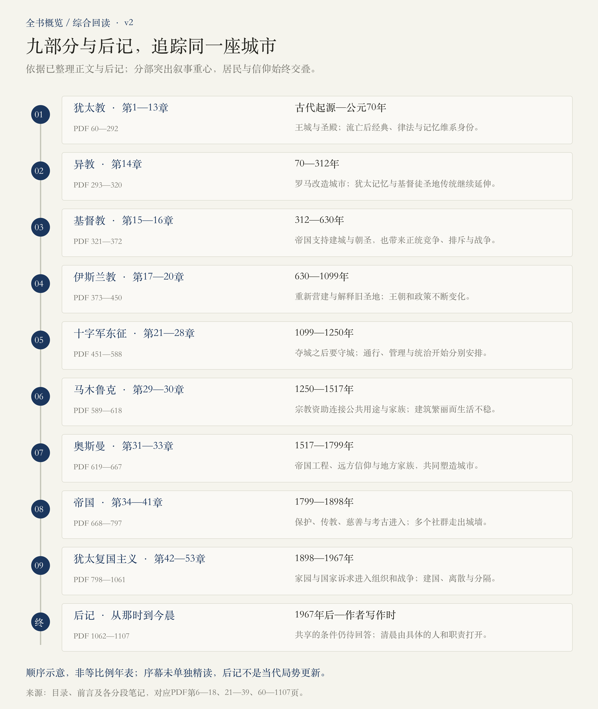
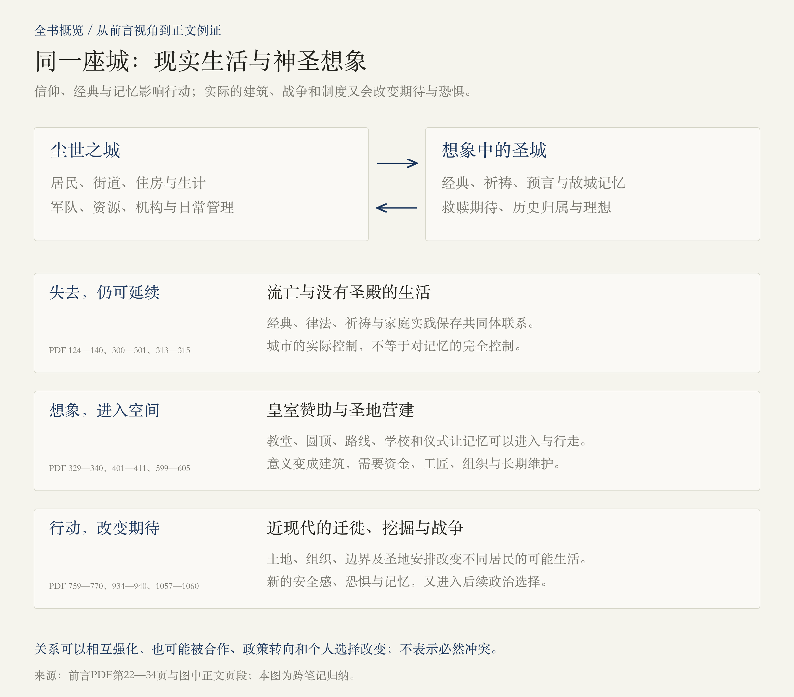
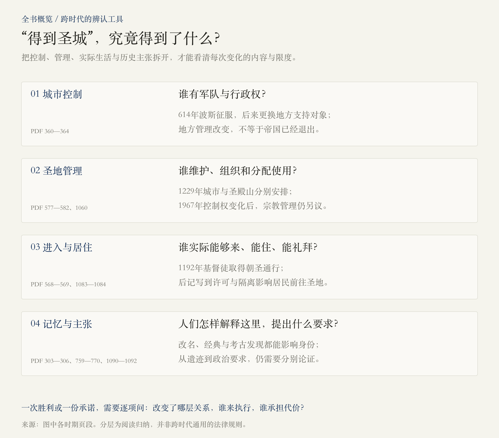

# 全书概览：一座小城，如何承载整个世界

> 阅读边界：v2依据此前整理的目录与前言、九部分第1—53章及后记笔记综合更新，本次未新增PDF阅读。对应来源为PDF第6—18、21—39、60—1107页；序幕第40—59页仍未单独精读，附录等不在范围。正文主线止于1967年，后记延伸至作者约2010—2011年的写作语境，不代表当代局势。所有页码均为PDF物理页码。

<!-- block: core-question -->
## 01 · 读到后记，再回答：这本书究竟在讲什么？

  **这是一部城市传记：神圣记忆不断吸引统治者、朝圣者与远方力量，他们把信仰和政治目标变成建筑、制度与战争；居民则在这些变化中谋生、迁徙、保存记忆，并重新定义自己的归属。**  作者以人物和家族串联三千年的变化，呈现同一座城如何被建造、毁坏、修复和解释。[前言，PDF第21—34页；各部分综合]

开卷时的问题是“为什么偏偏是耶路撒冷”。读到结尾后，可以把答案分成两层：经典、圣地传统、流亡记忆和救赎期待，使它的重要性远超地理规模；军队、财富、组织、外交、土地和日常管理，则决定这些意义怎样进入现实。一座城可以失去政治中心地位，却继续吸引远方的资源与情感。[第一部分PDF第117—140页；第三部分第323—340页；第六部分第596—616页；第八部分第708—764页]

全书也不断让我们看见意义与后果之间的距离：建造壮丽圣所的君主未必解决继承和治理问题；宣称保护信仰的政权可能限制其他居民；取得城市的军队仍要面对通行、管理与生活安排。  **判断一次“胜利”，既要看谁获得了什么，也要看谁失去了什么。**  [第一部分第192—227页；第五部分第548—551、574—583页；第九部分第1008—1035页；后记第1067—1091页]

<!-- block: book-map -->
## 02 · 九部分与后记：每一段给了我们什么理解？

图按分部顺序排列，时间不按比例。分部标题标示叙事重心，信仰、人口和制度始终交叠；章题年代也不能替代正文实际范围。

### 01 · 犹太教｜第1—13章｜古代起源—公元70年

王权与圣殿把城市变成共同体中心，亡国流亡又使经典、律法和故城记忆承担延续身份的作用。重建以后，希腊化、王朝竞争和罗马统治继续改变它；耶稣、雅各与保罗的讨论，则涉及救赎与共同体边界。  **建筑和国家可以失去，宗教与城市的联系仍能延续。**  第13章止于提图斯进军，70年围城详述在尚未精读的序幕，不能由章题补成已读经过。[回读第一部分](#/read/jerusalem-part-01)｜PDF第60—292页。

### 02 · 异教｜第14章｜70—312年

罗马以凯旋、税收、改名、道路和神庙重新定义城市。犹太人的律法与祈祷、基督徒的圣地传统，却在不同处境中继续发展。  **帝国控制公共空间，无法保证控制人们怎样记忆它。**  70年毁城与科赫巴起义后的惩罚属于不同断裂。[回读第二部分](#/read/jerusalem-part-02)｜PDF第293—320页。

### 03 · 基督教｜第15—16章｜312—630年

皇帝与贵族的支持，把地点记忆变成圣墓大教堂、朝圣路线、修道院和接待设施。新繁荣伴随教义竞争、排斥和街头暴力，波斯与拜占庭战争又改变社群处境。  **宗教取得帝国支持后，仍需面对内部协调和如何对待他者的问题。**  [回读第三部分](#/read/jerusalem-part-03)｜PDF第321—372页。

### 04 · 伊斯兰教｜第17—20章｜630—1099年

阿拉伯征服与倭玛亚营建，使圣殿山获得新的建筑、礼拜和王朝意义。其后权力中心转移，保护、限制、迫害与修复随政治环境变化。  **同一片圣地可以被重新解释，同一宗教统治也没有永恒不变的待遇规则。**  岩石圆顶、阿克萨与整个平台需要分别辨认。[回读第四部分](#/read/jerusalem-part-04)｜PDF第373—450页。

### 05 · 十字军东征｜第21—28章｜1099—1250年

夺城与屠杀之后，拉丁王国还要解决港口、兵力、人口和继承。萨拉丁征服、理查作战及后续谈判，把城市控制、圣地管理和朝圣通行拆成不同安排。  **攻得下、守得住、管得好与允许他人进入，需要不同条件。**  协议也可能遗漏居民利益，或在权力变化后失去保障。[回读第五部分](#/read/jerusalem-part-05)｜PDF第451—588页。

### 06 · 马木鲁克｜第29—30章｜1250—1517年

苏丹、军官与宗教资助者建设学校、修道院、陵墓和市场；瓦克夫连接信仰、公共用途与家族延续。城市同时经历苛征、治安不稳和准入限制。  **神圣声望和宏伟建筑，并不能独自保障居民的安全与生计。**  [回读第六部分](#/read/jerusalem-part-06)｜PDF第589—618页。

### 07 · 奥斯曼｜第31—33章｜1517—1799年

苏莱曼的城墙、供水和慈善工程改变实际城市；远方移民、宗教期待与外交保护拓展其联系，地方家族则通过职位、财富、学识和圣地职责积累影响。  **帝国、远方与家族，共同构成城市运作的网络。**  后来的统治沿用前代石材与建筑，保存也伴随改写。[回读第七部分](#/read/jerusalem-part-07)｜PDF第619—667页。

### 08 · 帝国｜第34—41章｜1799—1898年

远征之外，领事保护、传教、慈善、买地、考古和旅游，都成为介入圣城的方式。多个社群共同推动城外扩张，本地语言、商业和节日生活继续发展。  **即使没有取得城市主权，远方力量也能持续改变居民的选择。**  朝圣、避难迁徙和政治组织需要分别理解。[回读第八部分](#/read/jerusalem-part-08)｜PDF第668—797页。

### 09 · 犹太复国主义｜第42—53章｜1898—1967年

政治运动把安全与自决诉求变成组织、外交、移民和国家计划；奥斯曼终结、英国托管、反抗与镇压、纳粹大屠杀及战争，使竞争不断改变。1948年建国的经验与巴勒斯坦人失去家园的灾难，同时进入城市历史；1949年的分隔与1967年的老城易手，又改变实际通路和圣地安排。  **宗教归返、民族家园、国家建立与军事控制，须逐层辨认。**  [回读第九部分](#/read/jerusalem-part-09)｜PDF第798—1061页。

### 后记 · 从那时到现在／明天／今晨

作者回顾1967年后的建设、冲突与和平谈判，讨论共享城市的条件，最后让镜头停在拉比、钥匙保管人、守门人与宣礼吏的日常工作。  **占有城市，与让不同的人实际居住、进入和礼拜，仍有距离；城市也依靠每天履行职责的人延续。**  “明天”中的方案属于作者写作时的愿景。[回读后记](#/read/jerusalem-epilogue)｜PDF第1062—1107页。

<!-- block: interpretive-model -->
## 03 · 两个耶路撒冷，怎样在正文中相互塑造？

“尘世之城”包含街道、居民、住房、资源和权力；“天国之城”包含经典、信仰、预言、记忆与理想。前言给出的这组视角，在正文中有三种尤其清楚的表现：

-  **失去城市，仍能延续联系。**  巴比伦毁城后的流亡经验，以及后来没有圣殿时的律法、善行与祈祷，使共同体在远方保持身份和故城记忆。[第一部分PDF第124—140页；第二部分第300—301、313—315页]
-  **想象可以转成可行走的空间。**  圣墓教堂、岩石圆顶、朝圣路线、学校与宗教设施，把信仰记忆变成建筑、仪式和资源组织；它们也表达统治者的声望与主张。[第三部分第329—340页；第四部分第401—411页；第六部分第599—605页]
-  **实际行动也会反过来改变记忆与政治。**  挖掘、修缮、迁徙、战争与边界，让不同群体对同一地点产生新的期待和恐惧。政治领袖会借助古老记忆，实际的组织与制度又决定行动后果。[第八部分第759—770页；第九部分第934—940、1057—1060页；后记第1067—1091页]

这些关系并非不断升级的单一循环：圣城也曾衰落、被忽视，不同群体内部始终有分歧；政治需要、地方利益、跨信仰联盟和个人帮助，会改变原本看似固定的对立。[前言PDF第29页；第五部分第496—501、509—513页；后记第1104—1105页]

<!-- block: cross-book-lessons -->
## 04 · 贯穿全书的四条线，最后汇到居民身上

 **第一条：记忆的延续。**  神圣联系依靠经典、祈祷、节日、教育和家庭传递。毁坏有时强化记忆，但这不是灾难值得发生的理由，也不意味着每个人都作相同选择。[第一部分PDF第124—140页；第二部分第313—315页]

 **第二条：意义需要资源才能落地。**  建筑要有人筹款与施工，圣所要有维护和收入，国家计划要有组织与执行。希律建殿、马木鲁克瓦克夫、苏莱曼供水、近代慈善住房，都可沿这一条线比较；各自制度与强制程度仍有区别。[PDF第205—209、600—605、623—625、748—759页]

 **第三条：远方与本地互相利用，也互相改变。**  皇室、教会、流散社群、领事和政治组织带来资源；地方家族、商人、学者和居民会争取、抵抗或改造这些机会。本地社会一直在行动。[第七部分PDF第627—642、655—666页；第八部分第708—718、772—789页]

 **第四条：繁荣、虔敬与公平并不自动同步。**  一座学校可能兼有公共用途和家族利益，一次胜利可能改善部分人的进入条件却迫使另一些人离家。判断城市改变，应落到人能否安全生活、保有住房、自由行动并获得具体保障。[第六部分PDF第596—616页；第九部分第1008—1035页；后记第1067—1069、1082—1084页]

<!-- block: rights-and-control -->
## 05 · “得到耶路撒冷”，至少包含四种不同问题

这种区分贯穿多份笔记：

| 层面 | 应该问什么 | 已读内容中的例子 |
| --- | --- | --- |
| 城市控制 | 谁掌握军队、行政和实际统治？ | 波斯征服后更换地方支持对象，并不等于波斯已经退出。[PDF第360—364页] |
| 圣地管理 | 谁维护场所、组织仪式、分配使用？ | 1229年城市与圣殿山被分别安排；1967年军事控制改变后，宗教管理另议。[PDF第577—582、1060页] |
| 进入与居住 | 谁实际能来、能住、能礼拜？ | 1192年基督徒取得朝圣通行；后记讨论许可与隔离如何影响到达圣地。[PDF第568—569、1083—1084页] |
| 记忆与主张 | 谁怎样解释这里，凭什么提出要求？ | 改名、文物发现、经典记忆与政治诉求相联，但各自需要证据与论证。[PDF第303—306、759—770、1090—1092页] |

这是跨章节的阅读工具，不是把古代帝国、宗教管理与现代国家套进同一套法律。把问题拆开，才能看清承诺与执行、象征与实际控制之间的距离。

<!-- block: author-method -->
## 06 · 作者的写法，读完之后应该怎样评价？

城市传记的优势，是让抽象力量通过人的选择显现：希律同时是建设者和残酷的王朝统治者；奥萨玛的友谊与偏见并存；瓦希夫从音乐与咖啡馆的记录者成为失去故居的人；后记的守门人又让漫长历史落在一把钥匙上。[PDF第192—227、496—501、824—826、1008—1009、1095—1099页]

流畅和鲜明也带来阅读上的风险。早期经典、晚出记载、游记、人物回忆、宫廷传闻、作者推测和现代研究，证据层次并不一致。正文中的对话与确定语气，需要连同注释的限定阅读；个别译名、日期或文件措辞，也在分部笔记中另作了核对或保留。[前言PDF第32—37页；第五部分第469—470页；第九部分笔记“战时安排”；后记笔记“谈判状态核对”]

作者自述希望跨越立场，不代表每项人物评价都中立。尤其后记对谈判责任和未来方案有明确判断。本概览沿用已整理笔记中的区分：信仰传统、书中叙述、证据未知与助手归纳分别标明；读者可以理解某个行动的背景，同时继续判断其具体责任与代价。

<!-- block: reading-prompts -->
## 07 · 已读内容怎么串起来回看？

可以按问题回读，不必从头再背一遍人名：

1.  **失去建筑，为什么仍能保留圣城？**  从[流亡与经典](#/read/jerusalem-part-01/part-01-ch05)走到[没有圣殿的生活](#/read/jerusalem-part-02/part-02-parallel)，再看近现代的归返与家园诉求。
2.  **同一处建筑，为什么不断获得新意义？**  连接[倭玛亚圣地营建](#/read/jerusalem-part-04/part-04-ch18)、[十字军与萨拉丁的用途调整](#/read/jerusalem-part-05/part-05-space)和[苏莱曼的城市工程](#/read/jerusalem-part-07/part-07-city)。
3.  **谁在为神圣性提供长期资源？**  从[瓦克夫](#/read/jerusalem-part-06/part-06-waqf)回看皇室赞助，再到[近代保护与救济](#/read/jerusalem-part-08/part-08-ch37-protection)。
4.  **为什么控制圣城以后，仍需要谈判？**  并读[中世纪的通行与管理](#/read/jerusalem-part-05/part-05-control)、[1947—1967年的不同安排](#/read/jerusalem-part-09/part-09-arrangements)与[后记的共享问题](#/read/jerusalem-epilogue/epilogue-layers)。
5.  **普通人怎样让城市继续？**  把[语言与节日](#/read/jerusalem-part-08/part-08-ch40-life)、[瓦希夫离家](#/read/jerusalem-part-09/part-09-1948-civilians)与[圣地的清晨](#/read/jerusalem-epilogue/epilogue-morning)放在一起读，比较交往怎样建立、断裂与延续。

如果还想补齐叙事开场，可另读序幕PDF第40—59页。若讨论今天的局势，则需要另开专题、查证新资料，保留本书的历史时间边界。

<!-- block: provenance -->
## 来源与更新记录

- 本次以已有10篇分段笔记为直接整理依据：九部分正文及注释PDF第60—1061页，后记及注释第1062—1107页，并保留首版目录第6—18页、前言第21—39页的阅读框架。原导读另记录曾核对第3—5页书目信息，本次未重读。
- 本次未新增PDF阅读。序幕第40—59页仍未单独精读；附录、致谢和译后记不在概览的已读依据中。概览覆盖全书主体线索，不表示整份1141页PDF逐页精读完成。
- 原书主体止于1967年，后记回顾与前瞻止于作者写作语境；没有用后来的事件反推作者已知结局。分部中的外部历史文件核对，仍以各分部的标注为准。
- 三张图均为基于既有笔记的原创理解示意，不是原书插图、精确地图或统一的历史因果模型；SVG源与PNG展示图分别保存。
- 2026-10-26：v1，基于目录与前言的开卷导读。
- 2026-11-01：v2，综合九部分正文与后记，重写阅读地图、贯穿线索、跨时代区分与回读路线；保留原笔记ID及原有六个模块ID。首版PDF仍作为历史导读保留，本版概览不再链接旧版PDF。
