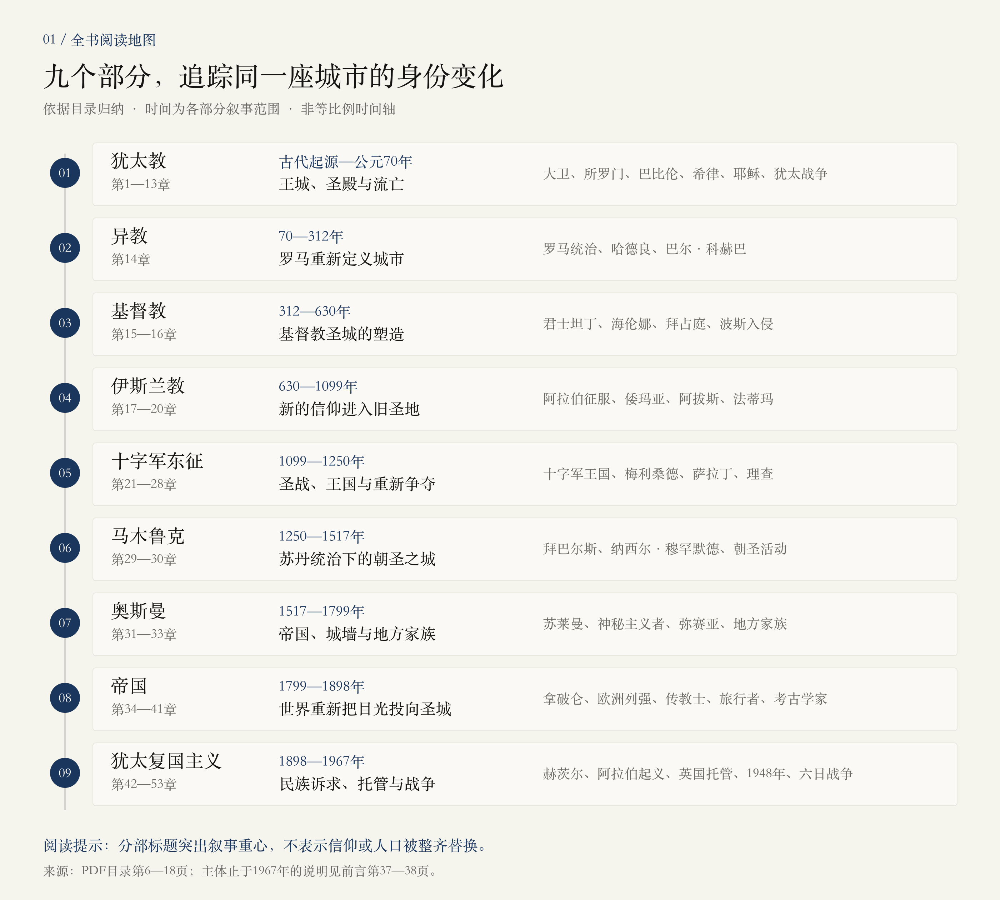
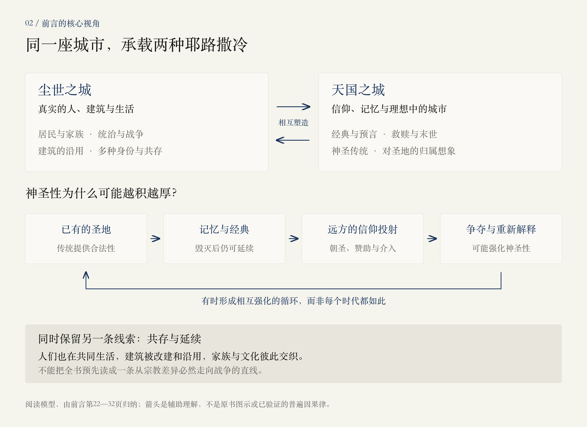

# 全书概览：一座小城，如何承载整个世界

> 阅读边界：本篇只依据目录与前言，不包含序幕、正文或后记的内容总结。页码均指这份PDF从第一页开始计算的文件页码。“今天”“当今”等表述若涉及原书观点，属于作者写作时的语境，不代表2026年的局势。

<!-- block: core-question -->
## 01 · 这本书究竟在讲什么

**一句话：作者以人物与家族为线索，按时间顺序讲述耶路撒冷如何被建造、毁坏、记忆和重新解释，逐渐成为多种信仰、帝国与民族诉求交汇的城市。**

它的中心问题是：为什么偏偏是耶路撒冷？前言指出，这座城市自然条件并不优越，远离海岸贸易路线、缺水，却吸引了远超其规模的情感与权力投入。理解它，需要同时看见现实中的居民与统治者，以及人们不断投射到它身上的神圣意义。[前言，PDF第21—27页]

全书的基本写法是“城市传记”：时间是骨架，人物与家族是叙事载体。作者希望把古代王城、三大宗教、帝国竞争和现代民族运动放在同一条历史线上，但不把后来的结局写成早已注定的结果。[前言，PDF第28—34页]

<!-- block: book-map -->
## 02 · 先看全书地图

图中时间表示目录的叙事范围，轴线不按年数比例绘制。分部以宗教、王朝或运动命名，只是在强调叙事重心；不能理解为某一信仰出现后，之前的人群就消失了。

### 01 · 犹太教｜第1—13章｜古代起源—公元70年

**王城、圣殿与流亡。** 目录中的主要节点包括：大卫、所罗门、巴比伦、希律、耶稣、犹太战争。

带着这个问题读：王城与圣殿如何成为共同体的中心？毁灭之后，记忆如何延续？

### 02 · 异教｜第14章｜70—312年

**罗马重新定义城市。** 目录中的主要节点包括：罗马统治、哈德良、巴尔·科赫巴。

带着这个问题读：征服者如何通过改造城市与圣地，重写它的身份？

### 03 · 基督教｜第15—16章｜312—630年

**基督教圣城的塑造。** 目录中的主要节点包括：君士坦丁、海伦娜、拜占庭、波斯入侵。

带着这个问题读：帝国的支持与对圣迹的追寻，如何改变城市的宗教重心？

### 04 · 伊斯兰教｜第17—20章｜630—1099年

**新的信仰进入旧圣地。** 目录中的主要节点包括：阿拉伯征服、倭玛亚、阿拔斯、法蒂玛。

带着这个问题读：新信仰如何解释和利用已有的神圣空间？

### 05 · 十字军东征｜第21—28章｜1099—1250年

**圣战、王国与重新争夺。** 目录中的主要节点包括：十字军王国、梅利桑德、萨拉丁、理查。

带着这个问题读：宗教目标如何与王朝、战争、外交和个人命运交织？

### 06 · 马木鲁克｜第29—30章｜1250—1517年

**苏丹统治下的朝圣之城。** 目录中的主要节点包括：拜巴尔斯、纳西尔·穆罕默德、朝圣活动。

带着这个问题读：聚光灯之外，这座城市如何继续生活？

### 07 · 奥斯曼｜第31—33章｜1517—1799年

**帝国、城墙与地方家族。** 目录中的主要节点包括：苏莱曼、神秘主义者、弥赛亚、地方家族。

带着这个问题读：中央权力、地方家族与宗教生活怎样共同塑造城市？

### 08 · 帝国｜第34—41章｜1799—1898年

**世界重新把目光投向圣城。** 目录中的主要节点包括：拿破仑、欧洲列强、传教士、旅行者、考古学家。

带着这个问题读：遥远的强国、宗教想象与知识生产，如何介入本地生活？

### 09 · 犹太复国主义｜第42—53章｜1898—1967年

**民族诉求、托管与战争。** 目录中的主要节点包括：赫茨尔、阿拉伯起义、英国托管、1948年、六日战争。

带着这个问题读：古老的神圣空间如何成为现代民族与国家诉求的焦点？

以上各部分的问题是根据目录提出的阅读线索，尚不是对各章论证结果的总结。[目录，PDF第6—18页]

<!-- block: interpretive-model -->
## 03 · 前言给了我们怎样的理解框架

### 一座现实城市，也是一座想象中的城市

前言反复区分“尘世的”和“天国的”耶路撒冷。前者是具体的街道、居民、建筑与权力；后者存在于信仰、经典、预言和理想中。当人们认为现实城市不符合心中的圣城时，就可能试图改变它。宗教想象因此会进入实际历史，而不只停留在信徒心中。[PDF第22—24、30、39页]

### 神圣性会通过记忆、传统与竞争而累积

作者提出：一处地方因长久被尊崇而拥有传统的合法性，后来的信仰会解释、继承或争夺已有的圣地。毁灭也未必抹掉意义：作者以巴比伦毁城后的犹太记忆与经典书写为例，说明失去现实城市，有时反而促使它在共同体想象中变得更重要。[PDF第24—28、30—31页]

这不意味着城市的重要性始终上升。前言明确说，它也有衰落、被忽视的时期；来自远方的信仰与政治需要，常会重新激活人们对它的投入。[PDF第29页]

### 冲突之外，还有共存、混合与日常生活

前言特别提醒：这里有许多相互重叠的文化和身份，人不能总被分成两个对立阵营。家族延续、建筑改建、居民生活，是这部城市传记不可省去的内容。只记住征服者名单，会漏掉作者想展示的连续性。[PDF第28—31、33页]

<!-- block: author-method -->
## 04 · 怎样理解作者的写法

| 阅读时要区分什么 | 前言给出的提示 |
| --- | --- |
| 历史事实与人们相信的历史 | 作者不裁定宗教神迹是否真实，但信仰对人的行动产生的影响，是历史的一部分。 |
| 作者的目标与实际实现程度 | 作者自述希望面向各信仰和无信仰读者、不服务于特定政治意图；是否做到，仍需读正文判断。 |
| 流畅叙事与证据确定性 | 作者承认早期史料与考古存在争议，并说明正文不会反复写出所有“也许”“可能”；叙述肯定不等于证据没有争论。 |
| 历史解释与今日立场 | 作者主张按时间顺序理解变化，避免以当下的关注重塑过去，也避免把结局写成必然。 |

[前言，PDF第32—37页]

全书主体止于1967年。前言说明，后记会延伸讨论此后的发展，并以圣地清晨的描写收尾；本轮没有读取后记，因此不总结它的具体内容。[PDF第37—38页]

<!-- block: reading-prompts -->
## 05 · 接下来怎么读，才不容易迷失

不用一开始就记住所有人名。每读一段，先回答三个问题：

1. **谁在行动？** 是统治者、家族、信仰共同体，还是本地居民？他们要改变什么？
2. **什么使这里重要？** 是现实权力、经典记忆、朝圣传统，还是来自远方的期待？
3. **什么改变了，什么留下了？** 城市易主后，建筑、居民、故事与日常生活怎样继续存在？

适合下一轮的追问：

- “天国的耶路撒冷”如何影响“尘世的耶路撒冷”？先用前言中的例子解释。
- 为什么毁灭可能强化一座城市的神圣性？这个说法适用到什么程度？
- 作者为什么强调家族与共存，而不只讲宗教战争？

下一步可从序幕开始，或直接指定第一章的一小段；在确定范围后再读取。

<!-- block: provenance -->
## 来源与更新记录

- 源文件：用户提供的《耶路撒冷三千年》PDF，共1141页。
- 本篇依据：目录第6—18页；前言第21—39页。另核对了第3—5页的书目信息。
- 未读取：序幕、九部分正文、后记、附录与致谢。
- 两张图均为依据目录与前言绘制的辅助图，不是原书插图，也不是地理地图。
- 本篇ID：`jerusalem-overview`。内容块ID用于后续局部替换；追问可另存为独立笔记，避免重新生成概览时覆盖。
- 2026-10-26：首版，基于目录与前言。
