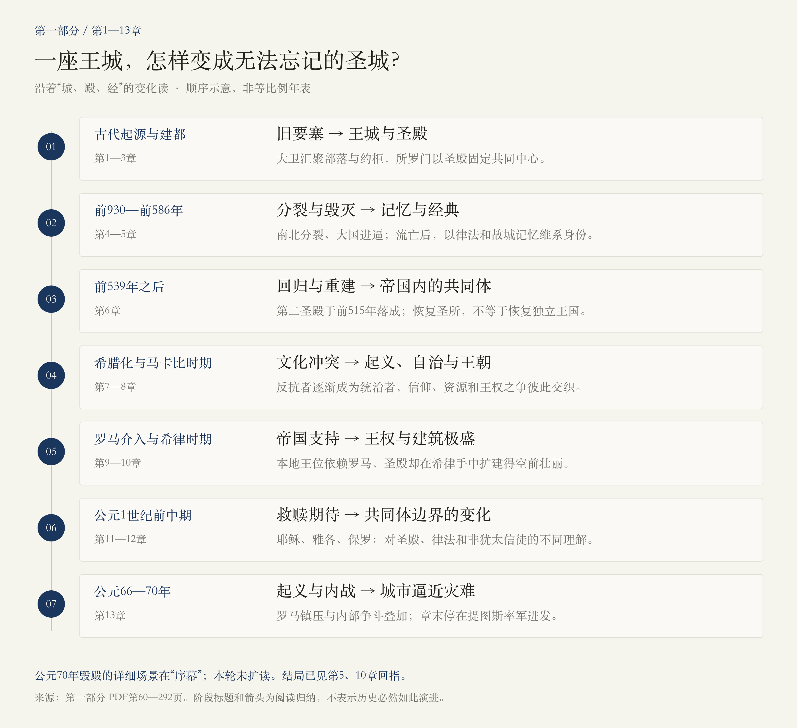
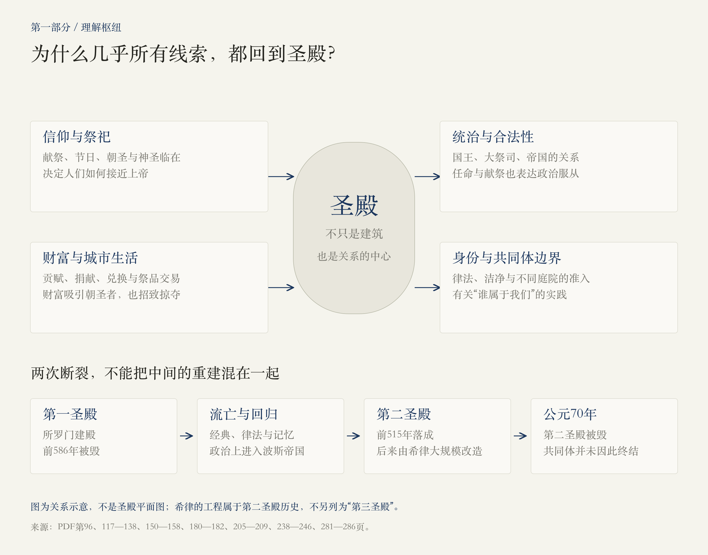
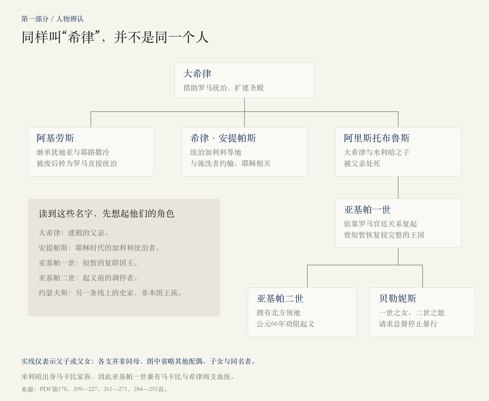

# 第一部分 · 犹太教：王城、圣殿与流亡

> 本篇依据第一部分第1—13章正文及章末注释整理，范围为PDF第60—292页。页码均为文件页码。本轮不扩读序幕或第二部分；涉及公元70年毁殿结局时，依据本部分第5、10章的回指，具体围城经过留待序幕。以下“作者认为”属于这本书的历史解释，未另行用外部资料核证。

<!-- block: part-01-core -->
## 01 · 先抓住这一部分的问题

**一座王城，怎样成为一个共同体即使失去国家、远离故土，也无法忘记的圣城？**

这13章把两条变化交织在一起：耶路撒冷不断改换统治者；人们理解它、依附它的方式也在变化。大卫把政治与约柜汇聚到城中，所罗门以圣殿使这种结合固定下来；国家的分裂与毁灭没有让这套联系消失，流亡者反而通过经典、律法和故城记忆维系身份。重建圣殿之后，这座城市又卷入希腊化、犹太王朝内斗和罗马统治。

到了耶稣与保罗的时代，关于圣殿、救赎和“谁能进入共同体”的讨论，还打开了另一种理解耶路撒冷的方式。这些变化后来影响深远，但在当时并没有一个所有人都知道的终点。

可以用这条线记忆：**王城的建立 → 圣殿成为中心 → 亡国流亡 → 经典与律法维系身份 → 重建后的竞争 → 罗马统治下的分化与战争。** 这是阅读提纲，不是每一步必然导致下一步的历史定律。

<!-- block: part-01-map -->
## 02 · 七个阶段，看清千年主线

图中节点按叙事顺序排列，不按年代比例绘制。日期沿用本书叙述；古代起源、圣经传统与精确年代之间存在证据差异。

| 阶段 | 对应章节 | 这一段真正改变了什么 |
| --- | --- | --- |
| 从旧要塞到王城 | 第1—3章 | 耶路撒冷成为统合不同部落、王权与祭祀的中心。 |
| 分裂、威胁与毁灭 | 第4—5章 | 国家的失败迫使人们重新解释自身与上帝、城市的关系。 |
| 归来与重建 | 第6章 | 恢复了圣殿与共同体，政治上仍处在大帝国之内。 |
| 希腊化与马卡比 | 第7—8章 | 信仰边界与生活方式之争，和祭司职位、税收、王朝权力缠绕。 |
| 罗马与希律 | 第9—10章 | 政治权力更多取决于帝国支持，圣殿却被扩建得空前壮丽。 |
| 耶稣与保罗 | 第11—12章 | 关于救赎、律法和非犹太信徒的讨论，逐渐突破地方共同体边界。 |
| 起义与内战 | 第13章 | 帝国镇压与城内派系战争相互加剧，城市逼近灾难。 |

<!-- block: part-01-temple -->
## 03 · 为什么几乎所有线索都回到圣殿

对当时的人而言，圣殿既是敬拜中心，也涉及祭司权威、王朝合法性、贡赋和捐献、朝圣贸易、共同体的准入规则。因此，“谁任命大祭司”“谁能进入内院”“为谁献祭”，都可能同时具有宗教和政治意义。[第4、6—13章，PDF第96—292页]

这可以解释三个看似奇怪的现象：

- **国王为什么关心朝圣？** 王国分裂后，北方的耶罗波安担心，人民继续到耶路撒冷献祭，会重新归心于南方国王，所以另建圣所。[PDF第96页]
- **征服者为什么反复觊觎圣殿？** 圣殿积累的财富令它成为掠夺目标；控制它，也意味着触及本地权威。[PDF第97、101、153—157、180—182页]
- **停止一项献祭为什么像宣战？** 公元66年，停止为罗马皇帝献祭，意味着撤回一种可见的忠诚表达。[PDF第285页]

第一圣殿被毁后，人们依靠文字、律法与记忆维系身份，并不意味着圣殿从此不重要。流亡与散居中的实践，和重返圣地、恢复祭祀的期待，可以同时存在。

<!-- block: part-01-ch01 -->
## 第1章 · 大卫的世界

**核心变化：在大卫之前，这里已经是一座有历史、有圣所的城市。**

作者从地形、水源和迦南人的防御工事讲起：耶路撒冷远离沿海商道，却有可防守的山地与基训泉。城市的形成首先与生存、防卫有关。大卫后来占领的不是空地，而是此前居民经营已久的要塞。

随后，作者转向亚伯拉罕、摩西、出埃及和以色列人的起源。这些传统为共同体提供关于祖先、土地和与神立约的叙述。但作者也明确区分：经典中有历史材料、传说、诗歌与后来编写的内容；许多事件无法确定年代，不能把每段故事都当作同等可靠的现场记录。

**读完记住：城市的古老性、以色列人的起源叙事、大卫的建都，是互相关联但不能混成一件事的三层历史。**

来源：PDF第62—71页。

<!-- block: part-01-ch02 -->
## 第2章 · 大卫的崛起

**核心变化：战争压力推动部落联盟寻找更集中的领导。**

面对非利士人的军事优势，以色列人的部落联盟需要能组织作战的国王，扫罗由此被推上台前。大卫则凭军事声望进入王廷，经历被赏识、与王室联姻、遭追杀、带领自己的追随者，以及暂投非利士人的曲折道路。扫罗战死，为权力重组留下空间。

这一章的大卫有勇气、有魅力，也善于在复杂关系中求生。歌利亚的故事表现了英雄声望如何形成，但书中注释也提示了文本版本的差异。

**因果线索：外部威胁增强了集中权力的需求；个人声望可以聚拢追随者，却还不等于稳定的王国制度。**

来源：PDF第72—77页。

<!-- block: part-01-ch03 -->
## 第3章 · 王国和圣殿

**核心变化：大卫建都与所罗门建殿，把王权和神圣空间连接起来。**

大卫先在希伯伦统治南方，经过争夺后获得北方部落支持。他选择耶路撒冷的一个政治理由是：它原先不属于南北任何一方，更适合作为新的共同中心。占领后，他吸纳原住民，把约柜迎入城中。城市于是同时承载王朝与上帝同在的象征。

所罗门建造圣殿，使这套连接固定在一处宏伟建筑中。这条建国建殿的线索之外，大卫时代的押沙龙叛乱和继承权争斗，以及所罗门末期的高额税收和劳役负担，都揭示王朝的脆弱。圣城的理想与统治者的现实行为，从一开始就有距离。

**读完记住：大卫主要完成政治汇聚，所罗门通过圣殿强化这一中心；建筑的辉煌没有解决统治与继承的问题。** 本章对大卫王国规模、建筑年代和圣经描述的可证实程度仍保留争论，不能把传说中的帝国全貌当成已确认事实。

来源：PDF第78—95页；有关证据争议见第90—95页。

<!-- block: part-01-ch04 -->
## 第4章 · 犹大的国王们

**核心变化：统一王国分裂后，耶路撒冷的圣殿仍是一种跨越国界的吸引力。**

所罗门死后，罗波安拒绝减轻负担，北方部落转而拥立耶罗波安，形成以色列与犹大两个王国。耶路撒冷属于南方犹大；此后的“以色列”有时特指北方王国，阅读时要与整个以色列共同体区分。

接下来，宗教改革、宫廷政变与大国压力交错。北方王国被亚述吞并，难民南下，也把传统与文本带到耶路撒冷。希西家筑墙、修水道应对西拿基立；以赛亚则把城市与公义、和平、未来的救赎联系起来。地上城市可能受威胁，理想中的锡安却可以超出眼前疆域。

**特别值得留意：同一场围城有不同的胜利叙事。** 圣经传统强调神的拯救，亚述年鉴强调贡赋与屈服。作者并列它们，让我们看到幸存者和征服者怎样给事件赋义。[PDF第107—111页]

来源：PDF第96—116页。

<!-- block: part-01-ch05 -->
## 第5章 · 巴比伦的妓女

**核心变化：王城与圣殿被毁，身份的延续更多依靠经典、律法与故城记忆。**

约西亚借律法和改革重整共同体、突出耶路撒冷的宗教中心地位，但政治独立并未因此得到保障。犹大在埃及与巴比伦之间反复选择、反叛，最终遭到尼布甲尼撒围攻。按本书年代，公元前586年城市与第一圣殿被毁，部分居民被迁往巴比伦。

作者最关心的转折，是灾难如何被重新解释：流亡者没有只把它理解为神无能、共同体终结，而是通过书写历史、重申律法和盼望归来继续维系自身。安息日、饮食、割礼等实践，使远离城市的人也能维持一种共同生活。

**理解这一章的钥匙：毁灭的是实际的权力和建筑；对故城的记忆与期待可以继续传递。** 但这不意味着所有流亡者选择都相同，也不意味着经典在某一天由一个作者一次写成。

来源：PDF第117—129页；流亡与经典整理的论述见第124—129页。

<!-- block: part-01-ch06 -->
## 第6章 · 波斯人

**核心变化：回归和重建发生在帝国允许的空间中，恢复圣殿并不等于恢复独立王国。**

居鲁士征服巴比伦后，允许流亡者返回并重建圣殿。作者把这种做法放进波斯统治策略中理解：容许地方信仰和律法，可以换取政治服从。重建并不顺利，既受帝国局势影响，也遇到归来者与当地居民之间的冲突。

在大流士支持下，第二圣殿于公元前515年落成。尼希米随后推动城墙修复和居民安置，并强化共同体边界。以圣殿、律法和大祭司为中心的生活逐渐成形，政治主权仍属于波斯。

**读完记住：这次归来重建的不只是房屋，也在重新界定“我们是谁、谁可以参与”。** 而留在巴比伦的犹太社群仍然延续，回归并不是所有人的共同选择。

来源：PDF第130—140页；重建与本地关系见第134—139页。

<!-- block: part-01-ch07 -->
## 第7章 · 马其顿人

**核心变化：希腊化进入日常生活，文化选择与本地权力竞争纠缠起来。**

亚历山大之后，耶路撒冷在托勒密与塞琉古两大王朝之间转手。希腊语、都市生活和精英文化逐渐深入犹太社会；希伯来经典的希腊文译本，也扩大了这些文本的传播范围。吸收希腊文化，并不自动意味着放弃犹太身份。

冲突既来自帝国，也来自内部：大祭司职位被用于交易，地方精英争夺税收、资源和统治权。安条克四世的禁令、对圣殿的亵渎，以及对安息日、割礼等实践的压制，使矛盾升级。玛他提亚及其子犹大的反抗由此展开。

**关键区别：可以讨论“接受多少希腊生活方式”，和被强迫停止自己的宗教实践，是两种不同处境。** 本章同时涉及文化交流、精英争权和迫害，不能只概括为两个文明天然互不相容。

来源：PDF第141—164页；希腊化与职位争夺见第152—157页，起义背景见第157—160页。

<!-- block: part-01-ch08 -->
## 第8章 · 马卡比

**核心变化：捍卫信仰的反抗运动，逐渐变成扩张、世袭和内斗的王朝。**

犹大于公元前164年夺回圣殿并重新举行祭祀，成为净殿节传统的重要起点。但夺回圣殿不是所有战争的终结。犹大、约拿单、西蒙等人经历反复挫折，利用塞琉古内部纷争与外交机会，才逐步巩固自治。西蒙于公元前141年攻取阿克拉城堡，是重要节点。

后来的约翰·西卡努斯等统治者向外扩张，并迫使部分被征服者改宗。王朝一方面出自抵抗希腊统治的运动，另一方面又越来越采用希腊式王权、名字与宫廷生活。大祭司与国王角色的结合，也受到内部挑战。

**这一章最有力的反转：反抗者成为统治者之后，仍需面对权力约束的问题。** 马卡比是本书常用称呼，王朝通常也称哈斯蒙尼王朝。后期的继承纷争为罗马介入创造了条件，但不能倒推每场内斗都注定导致亡国。

来源：PDF第165—177页；自治逐步取得见第165—170页，扩张与内斗见第170—174页。

<!-- block: part-01-ch09 -->
## 第9章 · 罗马人来了

**核心变化：本地王位的归属，越来越取决于罗马权力中心的裁决。**

马卡比兄弟相争，并分别寻求外援。庞培介入后攻取耶路撒冷，削弱王国，把大祭司西卡努斯留在台前。安提帕特及其家族则凭借服务罗马强人积累实际权力。凯撒、庞培、安东尼和屋大维的争斗，因此会直接改变这座小城的政治。

安提帕特的儿子希律善于在帝国政治中求生，但他的混合出身、与马卡比的关系和罗马支持，都使其合法性复杂化。帕提亚入侵时他失去耶路撒冷，转赴罗马获封为王；有了王号，还要靠战争重新夺取王国。

**记住两件事：外部承认不等于本地拥护；获得王冠不等于已经控制王城。** 庞培进至圣之所的举动，也显示帝国军事优势如何触碰本地最深的神圣边界。

来源：PDF第178—191页。

<!-- block: part-01-ch10 -->
## 第10章 · 希律家族

**核心变化：政治上的依附与不安，和城市建设的极盛出现在同一个统治者身上。**

希律借罗马军队夺取耶路撒冷，又在安东尼失败后赢得屋大维信任。他能处理外交、行政和粮食危机，也能进行宏大建设；同时，宫廷中的继承威胁和猜忌导致亲族不断遭到处决。米利暗及其儿子的悲剧，体现了王朝安全逻辑对家庭的侵蚀。

扩建圣殿是他的代表工程。他希望把城市的荣耀转化为自身声望，巨大广场、柱廊、阶梯、供水和分层庭院共同构成一个朝圣中心。耶稣后来面对的，就是这个经过希律改造的圣殿世界。

**不要误记为“三座先后独立的圣殿”：通常所说的第一圣殿是所罗门圣殿；第二圣殿在归来后重建，希律在其原址进行了大规模改造。** 西墙属于圣殿山平台的挡土墙体系，不是至圣之所的墙壁。

希律死后，领土被分给不同继承人；阿基劳斯后来被废，犹地亚转入罗马直接统治。第11章出现的希律·安提帕斯，是大希律的儿子，不是已经去世的大希律本人。

来源：PDF第192—227页；圣殿建设见第205—209页，继承与罗马接管见第216—220页。

<!-- block: part-01-people -->
## 04 · 人物辨认：不要被“希律”绕晕

这张图只列对本部分阅读必要的亲属关系，省略大量配偶、子女及同名人物。

- **大希律**：扩建圣殿的国王；在耶稣成年传道前已经去世。
- **希律·安提帕斯**：大希律之子，加利利统治者；与施洗者约翰及耶稣的故事相关。
- **亚基帕一世**：大希律与马卡比公主米利暗的孙子，曾短暂重建较完整的王国。
- **亚基帕二世与贝勒妮斯**：一世的儿女；公元66年试图劝阻反罗马战争。
- **约瑟夫斯**：不是希律家族的国王；他先参与起义、指挥加利利抵抗，后来转入罗马阵营，并成为本部分后段的重要史料作者。

还要区分两个“约翰”：马卡比王朝的约翰·西卡努斯，与耶稣时代的施洗者约翰不是同一人；“雅各”也有同名者，本篇讨论耶路撒冷早期信徒的领导者时，指耶稣的弟弟。

来源：PDF第178、209—227、261—279、284—292页。

<!-- block: part-01-ch11 -->
## 第11章 · 耶稣基督

**核心变化：圣城既是宗教改革与救赎期待的中心，也是帝国秩序高度警戒的地方。**

作者把施洗者约翰与耶稣放在当时犹太社会中理解：他们使用经典、先知与末世的语言。耶稣来到圣殿，与权威辩论、批评腐败，并以天国、悔改和救赎吸引追随者。在作者的叙述里，这些活动与犹太传统紧密相连，不能简单理解成一个已经独立成形的宗教从外部进入耶路撒冷。

逾越节聚集的人群、关于“王”的称呼、圣殿贵族的担忧和罗马的治安逻辑，共同构成了耶稣被捕、受审和受难的背景。作者特别质疑把罗马总督彼拉多描绘为几乎无责的讲法，强调审判与刑罚中的罗马权力。[PDF第243—246页]

**必须保留三层区别：耶稣的历史活动、福音书如何讲述这些活动，以及信徒对复活的信仰。** 复活是基督教信仰的核心，但本篇不把神学叙事改写成已经由历史学证实的事实。作者也承认受难年份和若干地点无法确定；这里不把公元33年写成毫无争议的唯一答案。

耶稣死后，雅各领导的耶路撒冷信徒仍在犹太社会和圣殿生活中活动。宗教边界的形成还有更长的过程。

来源：PDF第228—260页；来源、年份与叙事差异见第245—260页。

<!-- block: part-01-ch12 -->
## 第12章 · 希律家族的终曲

**核心变化：帝国治理越来越失灵；与此同时，耶稣信徒的传播跨出了原来的共同体边界。**

亚基帕一世依靠罗马皇室关系复起，并曾说服卡里古拉放弃将自己的肖像放进圣殿的要求。他短暂恢复王国，但去世后，罗马总督、希律家族与祭司共同管理的格局难以安定：税收勒索、地方族群冲突、祭司与富人的特权、匕首党的暗杀和反复出现的先知活动相互叠加。

另一条线是保罗。他主张非犹太信徒不必先成为遵行完整犹太律法、接受割礼的人，才能加入信仰共同体。雅各等耶路撒冷领导者与他的关系既有接纳与协调，也有分歧。重点不仅是“谁继承耶稣”，也是“这个信仰面向谁、进入它需要什么”。[PDF第272—277页]

约瑟夫斯则以第三种身份进入叙事：他与罗马宫廷保持联系，起初仍相信有调解空间。作者借此说明，战争并非从一开始就不可避免。到弗洛鲁斯的暴行连亲罗马权贵也无法豁免时，旧有的保护与调解关系进一步破裂。

**读完记住：精神上的普遍化与政治上的激化，在相同年代同时发生，但不能把它们简单连成单一因果。**

来源：PDF第261—283页；战争并非必然与治理危机见第278—281页。

<!-- block: part-01-ch13 -->
## 第13章 · 犹太战争：耶路撒冷之死

**核心变化：反抗罗马的起义，也演变成争夺城市与圣殿的内部战争。**

贝勒妮斯与亚基帕二世试图止暴、劝和，但无法弥合矛盾。停止为皇帝献祭后，起义者与温和权贵决裂；街头冲突还涉及豪宅、债务档案和贫富关系。罗马军队一度撤退并遭到重创，给起义者以胜利感，也使罗马更有雪耻的动机。

韦斯巴芗系统推进，加利利陷落，约瑟夫斯被俘。他后来改换阵营，成为皇帝支持者和史家；这使他的记录极其重要，也提醒读者留意他对敌对派系的描述可能有立场。耶路撒冷内部，吉斯卡拉的约翰、西蒙等力量争夺控制权，罗马的逼近并没有使他们始终团结。

**这一章最值得追问的，是一座城市为何会在共同危险前仍失去协调能力。** 帝国压迫、本地阶层分化、宗教动员、领导人竞争共同作用，无法由一句“宗教狂热”充分解释。

结构提醒：第13章结尾在PDF第292页，写到韦斯巴芗成为皇帝、提图斯率军向圣城进发。公元70年毁殿的详细场景在序幕；本篇没有把它冒充为第13章已经展开的内容。本部分第5、10章已有对毁殿结局的回指。[PDF第123—124、208—209页]

来源：PDF第284—292页。

<!-- block: part-01-lessons -->
## 05 · 读完13章，留下五个理解

### 神圣的中心可以同时制造团结和争夺

圣殿让散居者、朝圣者、统治者汇聚在同一座城市；它的财富与权威，也使它成为竞争焦点。这两种作用可以并存，不能只看其中一种。

### 失去国家，并不等于共同体必然消失

经典、律法、节日、家庭实践与故城记忆，使身份得以在远方延续。这是本书解释流亡经验的重要线索；也要记得，不同社群在其中有不同选择。

### 文化交流与政治强制要分开看

使用希腊语、接受都市生活，与被禁止遵行自己的传统，不是同一回事。精英也可能把文化改革变成权力交易，矛盾常常先在内部形成。

### 盛大的建设，不能独自解决统治问题

所罗门和希律都让城市、圣殿更壮丽，但继承、合法性、税收与社会分歧并未随之消失。建筑是力量的表现，也可能暴露维持这种力量的代价。

### 第一部分的结尾，并非“犹太教结束”

分部标题强调作者的叙事重心，不代表一种信仰随着某个政权、圣殿或城市被毁而消失。第一部分内部已经讲到耶稣和早期基督徒；不同传统的历史从一开始就彼此交织。

<!-- block: part-01-questions -->
## 06 · 适合继续追问的入口

1. 为什么北方以色列更富有，最后却是南方犹大保留了耶路撒冷的中心地位？
2. 流亡者为什么把失败解释成必须更忠于上帝，而没有放弃信仰？
3. 圣殿的祭祀、朝圣和捐献，怎样形成一套城市经济？
4. 马卡比从反抗者变成统治者后，为什么会越来越像他们曾经反对的君主？
5. 大希律既依赖罗马，为什么还要大规模扩建犹太圣殿？
6. 耶稣、雅各与保罗，对圣殿和非犹太信徒的理解有哪些差别？
7. 公元66年的战争，在哪些节点原本还有可能避免？

这些问题都能回到本轮正文继续深读。若想接着看公元70年的围城经过，下一轮可以单独读取序幕，而不必提前展开第二部分。

<!-- block: part-01-sources -->
## 来源与本次阅读记录

- 使用文件：用户提供的《耶路撒冷三千年》PDF。
- 阅读范围：第一部分题辞第60—61页；13章正文及章末注释第62—292页。共233个PDF页面，未读取本轮范围以外的正文。
- 章界：1 / 62—71；2 / 72—77；3 / 78—95；4 / 96—116；5 / 117—129；6 / 130—140；7 / 141—164；8 / 165—177；9 / 178—191；10 / 192—227；11 / 228—260；12 / 261—283；13 / 284—292。
- 叙述中的年代、史料判断与人物评价以本书为依据。特别是早期圣经故事、古代军队或死伤人数、耶稣受难日期及地点，不应被理解为所有学者一致认可的定论。本篇省去了不影响主线的血腥细节、宫廷逸闻和大量同名支系。
- 三幅图均为辅助理解的原创示意图，不是原书插图、精确地图或完整族谱。
- 2026-10-26：第一版。后续追问可以独立成篇，也可以仅修订对应章的段落。
