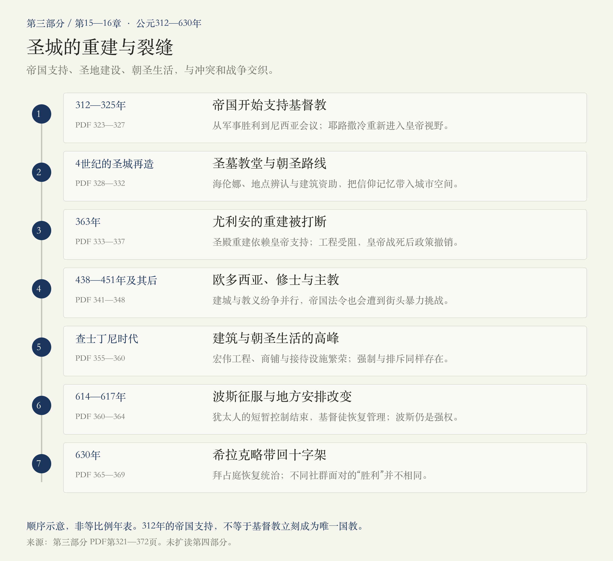
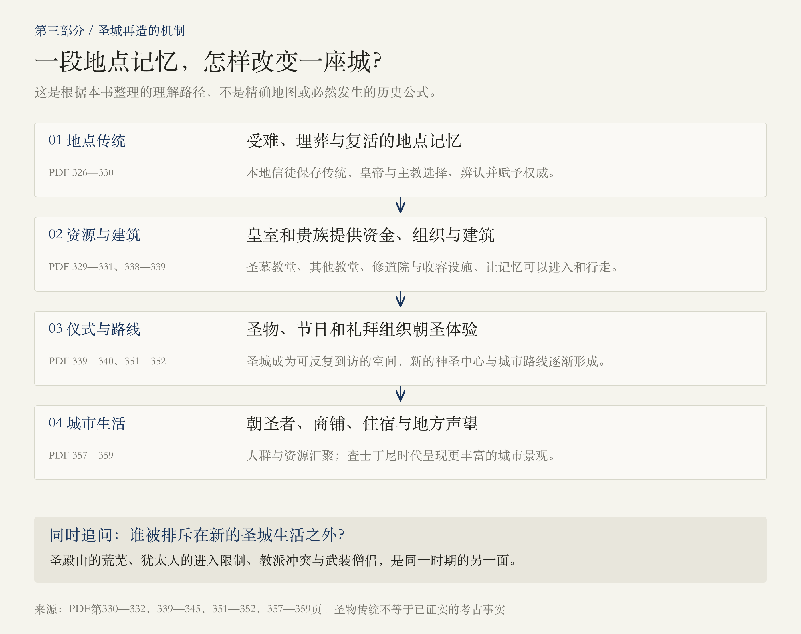
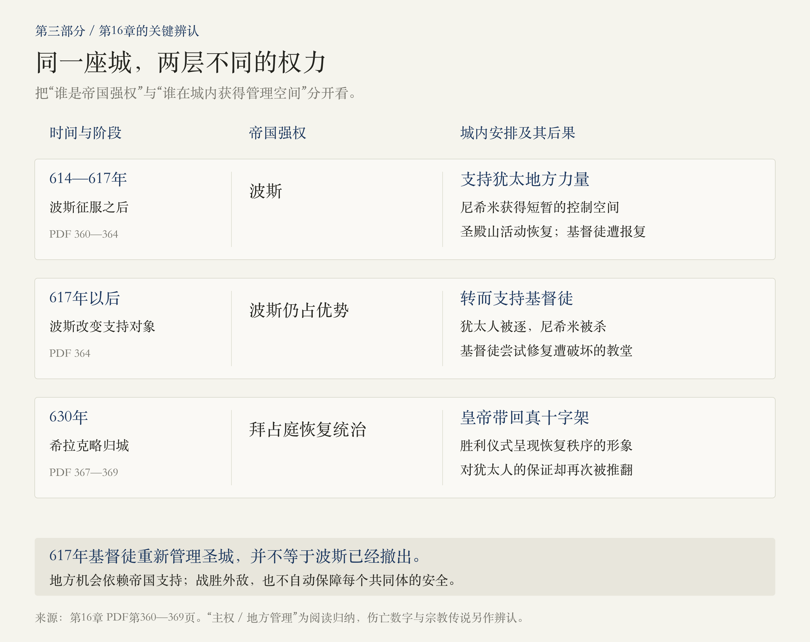

# 第三部分 · 基督教：圣城的重建与裂缝

> 阅读边界：本篇只依据第三部分题辞、第15—16章正文及章末注释，PDF第321—372页，共52页。第354页仅有页脚。时间范围沿用章题：312—630年；未扩读第四部分。所有页码均为PDF物理页码，原书中的“如今”等词属于作者写作时的语境。

<!-- block: part-03-core -->
## 01 · 被帝国冷落的城市，如何重新成为世界的圣城？

第二部分结束时，耶路撒冷是罗马的埃利亚：城市规模缩小，犹太人被限制进入，本地基督徒保留着耶稣受难与复活地点的记忆。第三部分的转折，是帝国开始为这些记忆提供资金、建筑和权威。

 **一句话抓住本部分：帝国支持把基督教的圣地记忆变成教堂、朝圣路线和城市繁荣；围绕正统、归属与统治权的冲突，又使这座圣城充满裂缝。** 

第15章讲圣城怎样被重新塑造，第16章讲这份辉煌如何遭遇帝国扩张的负担、内部冲突与波斯战争。两章合起来，不只是“基督教来到耶路撒冷”，而是信仰、国家资源、城市空间和日常生活怎样相互改变。[第15章，PDF第323—348页；第16章，第355—369页]

<!-- block: part-03-map -->
## 02 · 七个节点，连接重建、繁荣与战争

这条线按叙事顺序排列，年代间距不按比例。需要同时记住两件事： **基督教获得帝国支持是一个过程；这座城市在“基督教时代”也从未只有一种声音。** 

<!-- block: part-03-constantine -->
## 03 · 第15章上半：皇帝为什么开始重视耶路撒冷？

### 从军事胜利，到帝国统一的愿望

作者从312年君士坦丁的胜利写起：在皇帝的理解里，基督能够带来战争胜利；教会的等级组织，又似乎适合与帝国的行政秩序相配合。皇帝想把一个国家、一个统治者和一种信仰连接起来。[PDF第323—325页]

不过， **不要把312年直接记成“基督教立刻成为唯一国教”。** 本书写到313年的宽容与特权、君士坦丁在337年临终前受洗，也在注释中提及他保留太阳神等旧有符号；后来狄奥多西时期的国教化与强制推行，是进一步的阶段。[PDF第324—325、333、337、348—350页]

### 为什么教义问题会变成帝国问题？

皇帝很快发现，基督徒对基督与圣父的关系有严重争论。对信徒而言，这关系到救赎；对皇帝而言，这关系到他希望统一的帝国能否协调。因此，尼西亚会议不仅出现在神学史里，也成为本书解释帝国政治的重要节点。[PDF第325—326页]

在325年的会议期间，耶路撒冷主教马卡里乌斯让君士坦丁注意到这座城。皇帝由此支持拆除异教神庙、发掘相关地点并建造教堂，使原来受忽视的地方重新进入帝国视野。皇室家族的谋杀与忏悔，则是作者用来连接海伦娜赴圣城的一条人物线；其中具体动机仍带有推测，不能都当作已确认的心理事实。[PDF第326—329页]

<!-- block: part-03-space -->
## 04 · 圣墓大教堂：改变的不只是一处建筑

圣墓大教堂所承载的，是受难、埋葬与复活的地点传统。教堂群把这些记忆组织成可以进入、行走、礼拜的空间，朝圣者再把这种体验带向远方。皇室与贵族的资助、修道院和收容设施、圣物与节日，逐渐形成新的城市生活。[PDF第329—331、338—340页]

圣殿山与圣墓大教堂，不能看成同一个地方的两次更名。作者写的是 **神圣重心与解释权的重新分配** ：圣墓教堂被赋予中心地位，圣殿山的荒芜却被一些基督教作者用来解释犹太人的失败。新中心的荣耀与对旧共同体的排斥，在本书叙述中彼此联系。[PDF第330—332、340—341、352页]

同时，海伦娜“找到真十字架”的故事不能当作现代考古定论。作者明确说故事可能出自后人的杜撰，注释又指出：较早记述没有提到她发现十字架的角色，建筑与发现的确切顺序也不清楚。 **可以确认本书强调她对圣城建设的影响；圣物是否为真，属于另一层问题。** [PDF第329—330、349—350页]

一个适合带着走的理解是：圣城不是只有遗址，还包括人们如何命名、讲述、组织路线与举行仪式。本章注释中“锡安”名称的迁移，就是名字与空间并非始终一一对应的例子。[PDF第339、351页]

<!-- block: part-03-julian -->
## 05 · 尤利安：一场没有完成的圣殿重建

君士坦丁之后，基督教帝国也不是一条不可逆的直线。尤利安试图恢复旧神崇拜，并允许犹太人重返耶路撒冷、准备重建圣殿。他的行动既能改变犹太人的处境，也有反对基督教继承叙事、争取对波斯战争支持的政治含义。[PDF第333—336页]

工程准备、地震与起火、等待皇帝归来，随后是363年尤利安战死，政策被撤销。这里的关键不只是“工程遭到意外”，而是 **重建机会依赖特定统治者，缺少能在权力更替后继续维持的保障。** 这是根据本章过程作出的归纳。[PDF第336—337页]

不同作者把灾难或皇帝死亡解释为神意，体现的是各自的宗教立场。本篇不把这种解释当成地震、火灾或战争的历史原因。章末还提醒，一段有时被联系到此次重建的希伯来铭文，也可能属于更晚的公墓，不能用来补出一座已经重建成功的圣殿。[PDF第337、351页]

<!-- block: part-03-eudocia -->
## 06 · 第15章下半：繁荣为何没有带来安定？

### 朝圣既带来虔诚，也带来人群与利益

哲罗姆、葆拉等人的经历，让圣城从宏大建筑落到日常生活：贵族妇女出资建修道院，朝圣者不断聚集，宗教热情、贸易与个人关系混在一起。哲罗姆一面高度重视这些地点，一面又批评城中的诱惑与夸张的朝圣行为。[PDF第337—340页]

这些严厉描写来自带有立场的观察者，适合用来理解圣洁理想与城市现实之间的张力，不宜直接当作所有居民的生活全貌。作者写到哲罗姆对犹太人苦难的冷酷态度，也提醒我们：学识、虔诚与对他者的宽容，并不会自动相伴。[PDF第340—341页]

### 欧多西亚与巴尔索玛：皇室许可，为什么仍可能落空？

欧多西亚在438年来到圣城，放宽犹太人在重大节日进入圣殿山的限制。但巴尔索玛及武装僧侣对犹太人实施暴力，又以恐吓和宗教动员压迫官员，最终使袭击者获释。 **正式政策与街头实际掌握的力量之间，存在很大距离。** [PDF第341—345页]

此后欧多西亚因宫廷冲突长期居留圣城，推动城墙、教堂与收容设施建设。她既是建筑赞助者，也是教义和宫廷斗争中的政治参与者。作者明确将引出婚姻猜疑的“苹果故事”称为虚构，不能用它证明她与大臣有私情。[PDF第345—348页]

### 教义争论，也牵动主教职位与地方权威

关于基督人性与神性的争论，不只是名词之争：它连接皇室支持、主教地位与群众行动。451年的查尔西顿会议在本书中既是教义节点，也是耶路撒冷教会地位提升的政治节点。[PDF第346—348页]

读这一段无需先背完教派名单。先把两个问题分开： **人们相信怎样的教义？哪些机构与人物有权界定正统？** 两者相互作用，却不能简单归结为“都是争权”。本篇沿用原书的派别称呼，只作阅读导航，不把其简化标签当作各教会对自身信仰的完整表述。

<!-- block: part-03-justinian -->
## 07 · 第16章上半：查士丁尼把圣城推向怎样的高峰？

查士丁尼希望恢复罗马的疆域，也希望重新统一基督教世界。作者把战争、宗教政策和建筑放在同一个帝国计划中：对外收复土地，对内要求一致，再通过宏伟建筑表现皇权与信仰。[PDF第355—357页]

耶路撒冷的新圣母教堂工程，是这套计划在圣城的体现。商铺夹道的卡尔多路、贵族府邸、马赛克、接待朝圣者的收容设施，构成了本书描绘的城市盛景。它与第二部分闭塞的小型罗马殖民城市，形成明显的变化。[PDF第357—359页]

但这份繁荣的资源分配与准入有鲜明边界。作者同时讲述对犹太人、撒玛利亚人等群体的压迫，以及皇权对正统的强制要求。不能只记住教堂的尺度，而漏掉谁能参与这座城市的生活。[PDF第357页]

到了世纪末，作者笔下的帝国已显得难以维持过度扩张的疆域。皇位更替、强迫改宗与蓝绿赛车派别的街头冲突叠加，波斯又利用拜占庭的危机进军。 **繁荣与脆弱不是两个截然分开的时代，它们可能在同一套秩序中积累。** [PDF第359—360页]

<!-- block: part-03-war -->
## 08 · 614—630年：把帝国主权与地方管理分开看

| 阶段 | 本书叙述的变化 | 容易混淆的地方 |
|---|---|---|
| 614年波斯攻城 | 波斯军队及其犹太盟友攻陷圣城，教堂遭破坏，圣物和俘虏被带往波斯 | 不能把波斯征服写成一个完全独立的犹太国家取得主权 |
| 尼希米主持地方事务 | 在波斯支持下，犹太人短暂恢复对圣城和圣殿山的控制；本书也写到对基督徒的报复 | 地方机会依赖征服者的支持，不代表稳定的政治保障 |
| 617年政策转向 | 波斯撤换支持对象，犹太人被逐，基督徒重新管理城市并尝试修复教堂 | 地方管理转回基督徒手中，并不等于波斯已经退出 |
| 630年希拉克略归城 | 拜占庭恢复统治，皇帝将真十字架送回；先前对犹太人的保证又被推翻 | 战胜波斯与各共同体获得安全，是不同的问题 |

来源：PDF第360—368页；表格中的“主权／地方管理”是帮助辨认本书叙事的分析区分。

波斯统治者改变地方盟友，说明宗教身份不是理解帝国决策的唯一变量。军事需要、统治成本和对不同人群的利用，同样会改变一座城中谁暂时拥有权力。[PDF第363—364页]

希拉克略的反击也不只靠战场胜利。作者写到机动、联盟与波斯君臣之间的猜忌，使战争形势逆转。630年皇帝带回圣物，构成一场具有强烈救赎意味的胜利仪式；随后对犹太人的驱逐、杀害与强迫改宗，又让“胜利”具有截然不同的群体经验。[PDF第365—368页]

这里需要保留史料边界：屠杀数字与改宗或死亡的细节，主要来自本书引述的基督教资料；注释明确指出某些死伤数字有夸张，不能转为现代核实的统计。尼希米人物本身也被作者称为难以捉摸。[PDF第363、371页]

<!-- block: part-03-ending -->
## 09 · 看似恢复的秩序，为什么仍有隐忧？

希拉克略返回耶路撒冷时，恢复帝国与圣物的仪式仿佛宣告危机已经结束。但作者随即把视线转向阿拉伯：拜占庭与波斯长期把阿拉伯部落作为可以招募、拉拢的中间力量，而新的整合正在发生。[PDF第368—369页]

这段结尾让我们看见 **胜利者怎样可能低估秩序之外的新力量** 。它并不说明后来的结果早已注定；本轮止于第三部分，没有提前总结第四部分的征服经过。

此外，“第一个十字军战士”是作者描写希拉克略的章节小标题，指向战争与宗教象征的结合，不应把630年的事件直接等同于后来组织形式不同的十字军东征。金门突然关闭又打开的故事属于传说，金门本身的建筑年代也在注释中有争议。[PDF第365、368、371—372页]

<!-- block: part-03-questions -->
## 10 · 读完这部分，可以留下的三个问题

1.  **神圣记忆如何变成城市资源？** 从地点辨认、教堂建设到朝圣路线，哪些环节让一段信仰叙事持续改变经济与空间？
2.  **为什么帝国支持不能自动带来信仰统一？** 尼西亚、查尔西顿与武装僧侣的故事，分别揭示了教义、制度和实际暴力的什么问题？
3.  **为什么同一次“解放”，在不同人眼中会是不同事件？** 把尤利安、614年波斯入城与630年皇帝归城放在一起，观察保证如何随着统治者与盟友变化而改变。

回看[第二部分：一座城，三种延续](#/read/jerusalem-part-02)，两部分连接的问题是：当原来受压迫的信仰取得帝国支持，它如何塑造新的公共生活，又怎样对待仍然处于边缘的人？

<!-- block: part-03-sources -->
## 来源与本次阅读记录

- 使用用户提供的《耶路撒冷三千年》PDF。实际阅读题辞第321—322页；第15章正文及注释第323—354页；第16章正文及注释第355—372页，共52页。第348页同时含第15章正文结尾与注释开头；第354页仅页脚；第369页含第16章正文结尾与“注释”标题。
- 章界以PDF书签与实际文本核对。未读取第四部分正文，未将后来的征服过程当作本轮已读内容。
- 重要判断就近给出页码；人物心理、宫廷传闻、圣物与神迹、古代死伤数字、遗迹年代，保留本书提示的不确定性。对圣城再造机制和主权／地方管理的区分，为本篇阅读归纳。
- 三幅图均为原创理解示意，时间轴不按比例，空间关系图不是城市地图。源SVG与正文PNG分别保存，便于局部修改。
- 2026-10-31：第一版。后续可定向深读海伦娜与圣地辨认、欧多西亚的政治处境，或614—630年的权力转换。
