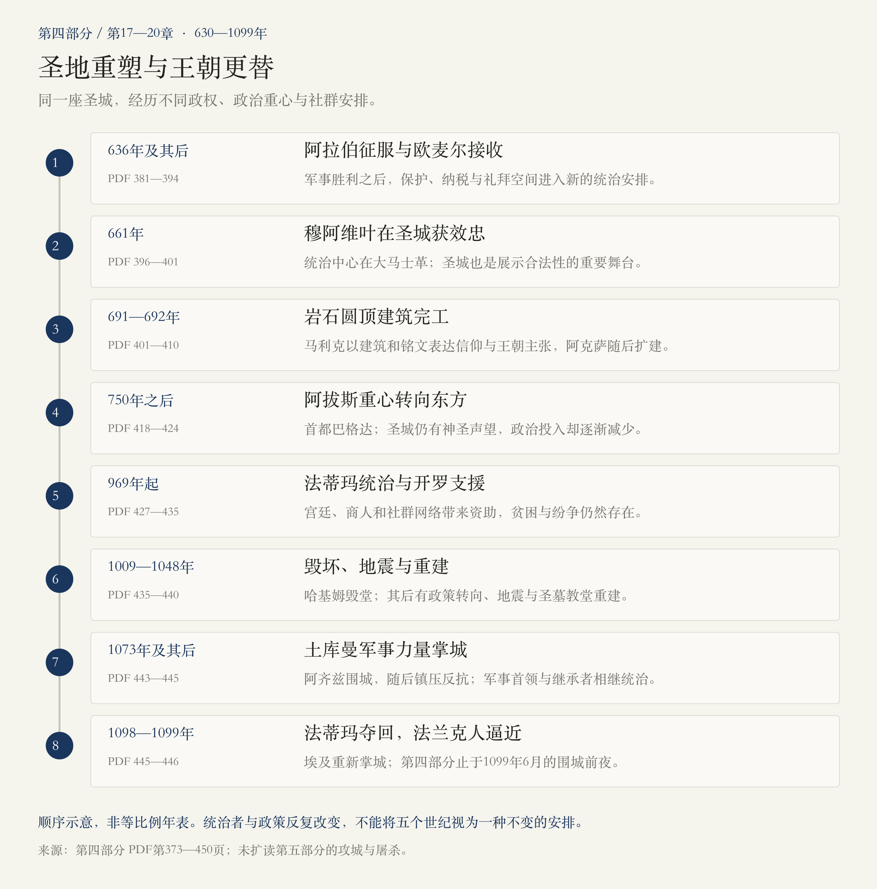
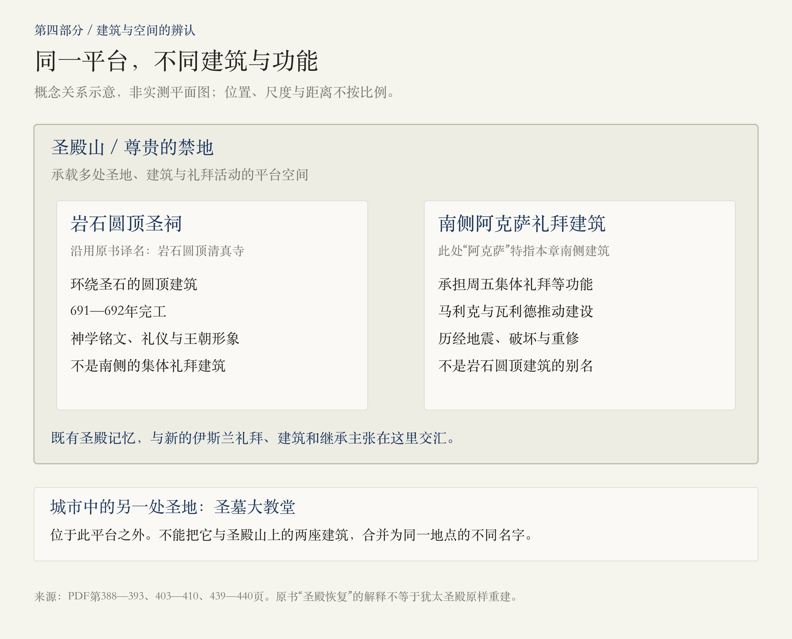
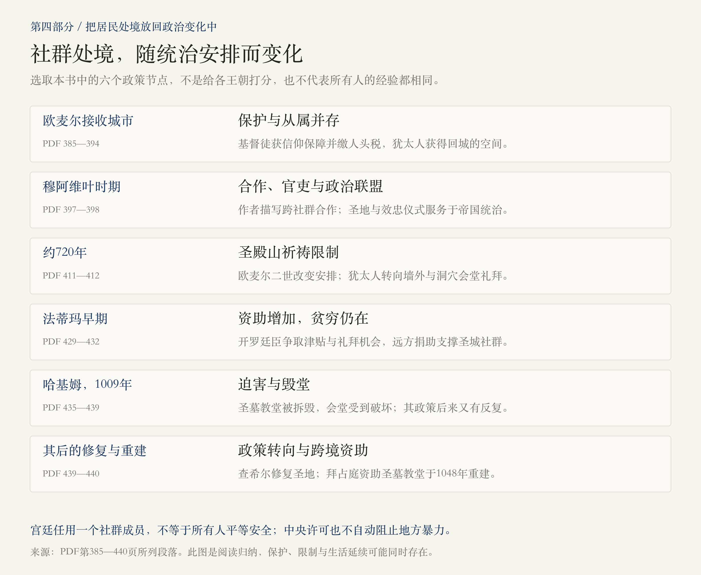

# 第四部分 · 伊斯兰教：圣地重塑与王朝更替

> 阅读边界：只依据第四部分题辞、第17—20章正文及章末注释，PDF第373—450页，共78页。时间范围沿用目录与章题：630—1099年。正文止于1099年6月法兰克军队抵达并围住圣城，未读取第五部分的攻城与屠杀经过。页码均为PDF物理页码；原书涉及当代的表述属于作者写作时的语境。

<!-- block: part-04-core -->
## 01 · 新的统治者，怎样进入一座已有千年记忆的圣城？

第三部分结束时，希拉克略刚带回真十字架，拜占庭似乎恢复了秩序。本部分从阿拉伯半岛的新信仰与新共同体写起，随后讲述阿拉伯军队征服巴勒斯坦，以及耶路撒冷如何获得新的建筑、礼拜方式和帝国身份。

 **本部分的主线：穆斯林统治者围绕旧圣地建立新的神圣秩序；随着王朝重心、政治盟友与政策改变，城中各社群的生活也不断变化。**

四章可以用四个问题串起来：欧麦尔如何接收城市？倭玛亚统治者为什么在圣殿山建造宏伟建筑？阿拔斯的首都东移，怎样改变耶路撒冷的地位？法蒂玛时代的宽容、迫害、修复和军事更替，又怎样把城市带到1099年的围城前夜？[PDF第375—391、396—413、418—424、427—446页]

<!-- block: part-04-map -->
## 02 · 八个节点，读懂近五个世纪的变化

时间轴按本书叙事顺序排列，不按年数比例。尤其不要把“穆斯林统治”想成一个统一政权连续执行同一套政策： **倭玛亚、阿拔斯、法蒂玛与后来的土库曼军事首领，各有不同的权力基础和统治需要。**

<!-- block: part-04-ch17 -->
## 03 · 第17章：征服之前，耶路撒冷已进入信仰的想象

### 夜行与登宵：圣地联系如何形成？

作者先叙述穆罕默德在麦加、麦地那建立信仰共同体的过程，再解释早期伊斯兰传统与犹太教、基督教人物和经典之间的联系。亚伯拉罕、摩西、大卫、所罗门和耶稣，被纳入新的先知谱系；末日审判的期待，也使耶路撒冷具有特别意义。[PDF第375—380页]

 **夜行与登宵在这里作为信仰传统来理解。** 本书指出，所引经文中的“最遥远的至圣之所”没有直接点出耶路撒冷，穆斯林传统将其与圣殿山联系起来。不能把这种神圣叙事改写成现代历史学已经证实的一次旅行，也不能据此认定后来所有地点和仪式从一开始便完全定型。[PDF第378、392—393页]

本章还写到礼拜方向转向麦加。理解这一点，有助于区分 **日常礼拜的方向** 与 **耶路撒冷的圣地地位** ：后者不会因为前者的改变而自动消失。[PDF第379—380页]

### 从军事胜利，到接收城市的条件

哈立德等将领在巴勒斯坦作战，636年的耶尔穆克战役成为本书的重要转折。作者把拜占庭在波斯战争后的衰弱、军事指挥与阿拉伯人的宗教动员放在一起解释，不宜把征服只归因于“狂热”，也不把古代记载的兵力与神意叙述当作现代核实的数据和原因。[PDF第381—385页]

欧麦尔接收城市的故事，重点在于投降与保护如何联系：基督徒获得继续信教的保证，同时需要缴纳体现从属地位的人头税。对犹太人而言，阿拉伯统治又带来返回圣城和活动空间扩大的机会。[PDF第385—390页]

 **保护不等于现代意义上的平等公民权。** 本书将基督徒与犹太人置于“齐米”，即有契约、受保护的从属社群框架中，也说明这种地位可能伴随宽容、限制乃至迫害。[PDF第394页]

<!-- block: part-04-omar -->
## 04 · 欧麦尔：重新使用圣地，也在界定新的归属

本章叙述欧麦尔清理圣殿山，并将礼拜地点安排在圣石以南、朝向麦加。这一安排既回应大卫、所罗门等古老圣地传统，也建立了新的礼拜秩序；不能简单理解成恢复从前的犹太圣殿。[PDF第388—389页]

但欧麦尔的故事本身需要分层阅读。有关他拒绝在圣墓大教堂礼拜、避免将其变成穆斯林礼拜场所的故事，来自较晚的穆斯林传统；作者也列出早期穆斯林与基督徒共享礼拜空间的材料。两者不能都当作没有缝隙的现场记录。[PDF第387—390页]

本章注释明确提醒，许多重要的伊斯兰史家生活在事件一两百年之后，且写作地点远离圣城。某些盟约文本中禁止犹太人进入的说法，也与作者所讲述的犹太家庭返回耶路撒冷相冲突。 **故事如何塑造理想的统治者，与我们能确认多少早期细节，是两个问题。** [PDF第390、392—394页]

<!-- block: part-04-ch18 -->
## 05 · 第18章：倭玛亚如何把圣地变成王朝的公共形象？

### 穆阿维叶：圣城也是政治合法性的舞台

661年，贵族们在耶路撒冷向穆阿维叶宣誓效忠。他的统治中心在大马士革，但耶路撒冷是显示其圣地保护者身份的重要场所。作者描写他吸纳基督徒官吏、与不同社群相处的政治手腕，也写到帝国扩张与王朝继承的矛盾。[PDF第396—401页]

阿里、穆阿维叶、耶齐德与侯赛因的故事，说明统治者的继承资格不是一个已经解决的问题。作者用内战和卡尔巴拉事件交代逊尼派、什叶派分化的重要背景；本篇以此辨认政治与宗教关系，不把复杂教派历史压缩成单一事件，更不将冲突视作各群体永恒不变的本性。[PDF第396—401、414页]

### 阿卜杜拉·马利克：建筑怎样表达帝国主张？

马利克面对内战与麦加不在掌握中的局势，在耶路撒冷投入宏大工程。691—692年完工的岩石圆顶建筑，使圣殿山成为突出的伊斯兰神圣景观。[PDF第401—405页]

建筑既借用熟悉的圆顶、拱廊与装饰技艺，又通过铭文表达自身的神学立场：承认耶稣在先知传统中的地位，同时反对将其视为神子及三位一体的教义。 **艺术语言可以相通，信仰立场和王朝主张仍然有明确区别。** [PDF第403—405、415页]

作者提出了与麦加竞争、展示王朝荣耀、回应基督教圣城等多种解释，也承认马利克从未明确说明全部动机。因此，不宜把“用耶路撒冷取代麦加”当作唯一且已证实的建造原因。[PDF第403—404页]

<!-- block: part-04-places -->
## 06 · 三个名字别混淆：圣殿山、岩石圆顶、阿克萨

沿用本书译名时，“岩石圆顶清真寺”容易使人以为它与阿克萨是同一栋建筑。本章其实作了重要区分：

| 名称 | 本篇用法 | 在本章中的主要作用 |
|---|---|---|
| 圣殿山／尊贵的禁地 | 承载多处圣地与建筑的平台空间 | 不同信仰记忆与统治安排交汇的地方 |
| 岩石圆顶清真寺，也称岩石圆顶圣祠 | 环绕圣石建造的圆顶建筑 | 圣地礼仪、神学表达与王朝形象 |
| 阿克萨清真寺 | 此处特指南侧的礼拜建筑 | 承担周五集体礼拜等功能，历经建设、破坏和修复 |

这里的词义限定只为读懂本章，图也不是实测平面图。不能用同一栋建筑解释整个平台，更不能把本书所说的伊斯兰视角下“圣殿的恢复”，误记为犹太圣殿制度已经原样重建。[PDF第393、403—409页]

倭玛亚还修建出入口、桥梁和宫殿，让礼拜、朝圣与王朝生活围绕圣殿山重新组织。与此同时，作者仍看到基督徒朝圣、社群往来与共享节日。 **宏伟的穆斯林建筑，并不意味着全城人口和生活在同一刻完成了单一化。** [PDF第408—411页]

<!-- block: part-04-ch19 -->
## 07 · 第19章：遥远的主人，怎样改变一座圣城？

阿拔斯取代倭玛亚后，权力基础转向东方，首都设在巴格达。耶路撒冷仍有宗教意义，却不再处于统治者持续投入的核心地带。本书描写维修、挪用既有建筑材料、修改建造者名字等行为，显示新王朝既继承旧圣地，也试图重写它的王朝归属。[PDF第418—421页]

### 查理曼获得钥匙，不等于获得主权

查理曼与哈伦·拉希德的往来，为城内基督徒争取财产保护、宗教设施与资助。钥匙和圣城保护者的名声具有很大象征意义，但统治者仍是哈里发。作者明确说，查理曼秘密到访耶路撒冷的传说并不真实。[PDF第419—421页]

这延续了上一部分值得记住的区分： **资助或保护某个社群、取得象征性荣誉，与实际统治整座城市，不是一回事。**

### 中央衰弱，地方权力与社群矛盾更加重要

本章随后从巴格达转向埃及统治者、军事强人与卡富尔。地方长官的勒索、与拜占庭关系带来的怀疑、街头暴力，都会改变居民的安全。犹太社群内部也有拉比派、卡拉派等差异，不能把它们当成利益和观点完全一致的整体。[PDF第422—424页]

对普通居民来说，圣城的荣耀不能替代稳定的治安、免于勒索的保障与持续的生活资源。谁在远方称帝，只有通过这些实际关系，才变成城中的日常处境。

<!-- block: part-04-ch20 -->
## 08 · 第20章：法蒂玛时代，宽容如何扩张，又如何逆转？

969年，法蒂玛势力夺取埃及并进一步控制耶路撒冷，此后以开罗为中心。这个伊斯玛仪什叶派王朝，与巴格达阿拔斯竞争。作者通过伊本·凯利斯、帕尔蒂尔等人的经历，写出财政才能、宫廷关系、改宗、医疗与商业网络怎样参与帝国运作。[PDF第427—430页]

### 社群的生活，连接着远方的资助者

开罗的犹太廷臣为耶路撒冷争取津贴与祈祷机会，海外捐助也支持经学院和贫困者。可是得到一些权利，并不等于摆脱贫穷；会堂与经学派别之间也仍有冲突。书中的募款信，使圣城从王朝与纪念碑的故事回到孤儿、寡妇和学者怎样维生的问题。[PDF第429—432页]

穆卡达西则同时热爱城市的美、饮食与神圣性，也抱怨浴池、社会风气和其他宗教群体。他眼中的耶路撒冷既是日常故乡，也是末日审判之地。这类文字适合帮助我们理解一位作者的经验与立场，不能把他的赞美或抱怨直接当成全体居民的共同感受。[PDF第432—435页]

### 哈基姆的迫害，与其后的修复

哈基姆先后施行限制、羞辱、强迫改宗和毁坏宗教设施的政策，1009年下令拆毁圣墓大教堂，犹太会堂也受到破坏。此后他的政治需要与政策又发生反复。本章把这种迫害与早期法蒂玛的宽容相连，显示社群的安全有多么依赖统治者及实际执行者。[PDF第435—439页]

但 **1009年的毁坏，不等于直到1099年圣墓大教堂始终是一片未修复的废墟。** 本书随后写到1033年地震、查希尔修复阿克萨与城墙，以及拜占庭资助、1048年完工的圣墓大教堂重建。修复后的建筑尺度和形制，与早先也不完全相同。[PDF第439—440页]

<!-- block: part-04-policy -->
## 09 · 用政策的变化，代替“永远宽容”或“永远迫害”

本部分反复出现几种同时存在的关系：统治者需要税收、技能与稳定；社群需要保护、礼拜空间与远方支援；地方官和街头力量又可能破坏这些安排。 **同一王朝内部也会转向，中央给出的许可也不保证每一位居民免遭暴力。** [PDF第385、394、411—412、424、429—440页]

因此，读到一个犹太人或基督徒成为大臣，不能推出所有同信仰者都享有平等与安全；读到一次屠杀或毁坏，也不能抹去其他时期的合作、修复和生活延续。图中的节点是本书叙事的例子，不是为各王朝打分的总榜。

<!-- block: part-04-ending -->
## 10 · 围城前夜：1099年的对手，不能只用一个“伊斯兰帝国”概括

法蒂玛的控制力减弱后，朝圣道路越来越不安全。塞尔柱与土库曼军事力量南下，阿齐兹在1073年围困耶路撒冷，随后又因城内反抗而进行残酷镇压，遇害者也包括穆斯林。之后城市进入奥尔图克及其儿子的控制之下。[PDF第442—445页]

1098年，埃及的法蒂玛宰相重新夺城。与此同时，他一度把欧洲基督教军队理解成可以协商分配势力范围的拜占庭相关力量，后来才发现对方的目标正是耶路撒冷。 **十字军抵达时，城中驻军属于重新掌城的法蒂玛政权，不能把他们直接记成已经失去城市的土库曼统治者。** [PDF第445—446页]

第四部分的正文止于1099年6月7日：法兰克军队看见圣城，并在城外扎营。攻城、城破与屠杀的具体经过，要留到第五部分阅读。本部分交代的是它发生前，政治分裂、外交误判、朝圣热情与军事动员怎样汇聚到同一座城。

<!-- block: part-04-questions -->
## 11 · 读完四章，适合继续追问的三个入口

1.  **为什么同一个圣地，能承载多种继承主张？** 比较岩石圆顶、圣墓教堂与此前圣殿的记忆，哪些是在共享人物与地点，哪些又明确划出了信仰边界？
2.  **圣城为什么可能神圣，却长期贫困？** 政治中心东移、朝圣道路、宫廷赞助与跨地域捐助，分别怎样影响居民能否生活下去？
3.  **什么决定一份保护承诺能维持多久？** 把欧麦尔的接收安排、法蒂玛的宽容、哈基姆的迫害和后来的重建放在一起，观察统治利益与地方执行力量。

回看[第三部分：圣城的重建与裂缝](#/read/jerusalem-part-03)，可以继续追踪一条跨越王朝的线：统治者借圣地建立合法性，居民则必须在宏大的神圣叙事中争取实际的生活空间。

<!-- block: part-04-sources -->
## 来源与本次阅读记录

- 本轮使用用户提供的《耶路撒冷三千年》PDF，实际阅读第373—450页，共78页：题辞373—374；第17章及注释375—395；第18章及注释396—417；第19章及注释418—426；第20章及注释427—450。第395页仅有页脚。
- 用PDF书签与实际正文核对章界；正文最后写到1099年6月围城前夜，未读取第五部分。注释中延伸到更晚时代的内容，属于本轮章末注释，不代表已经阅读后续正文。
- 内容以本书叙述为依据，重要判断就近标注页码。夜行、登宵与末日审判作为信仰传统；早期征服故事、盟约、建造动机和古代人数，保留作者提示的不确定性。对政策机制、象征荣誉与主权的区分，为本篇阅读归纳。
- 本篇不将原书对人物、族群或教派的尖锐评价当成对整个群体的定论，也不把其简化的教义与学术史评价当作外部考证的结果。
- 三幅图为原创理解示意，时间轴不按比例，建筑关系图不是精确地图。保留SVG源与PNG展示图，方便后续定向修改。
- 2026-11-01：第一版。
