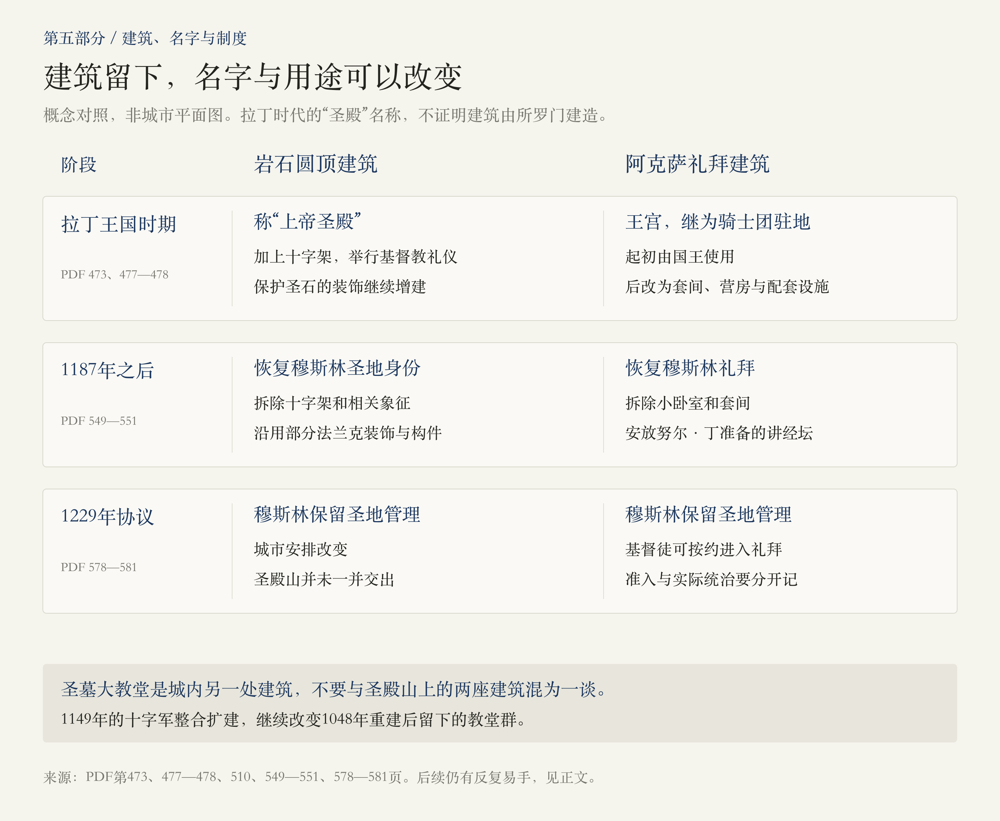
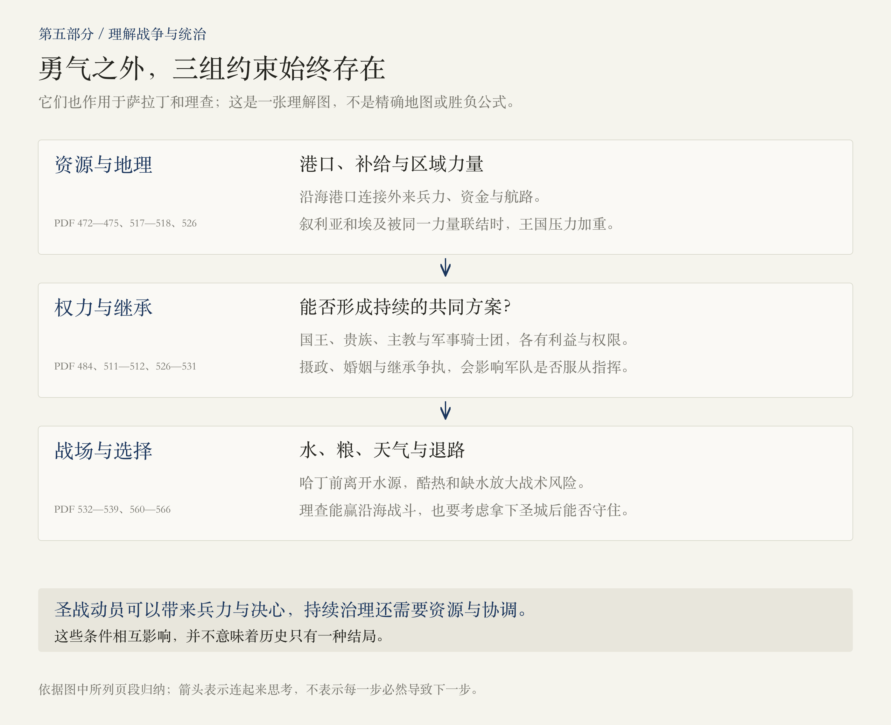
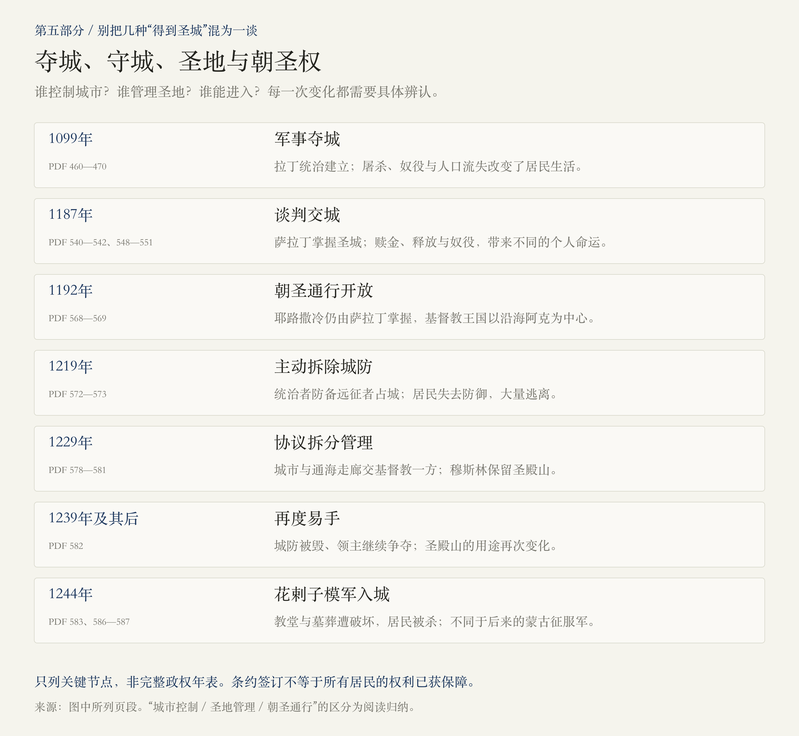

# 第五部分 · 十字军东征：圣战、王国与谈判

> 阅读边界：本篇只依据第五部分题辞、第21—28章正文及章末注释，PDF第451—588页，共138页。章题主线为1099—1250年，第28章末尾已前望1258年及其后蒙古人的威胁；这仍属于本部分正文，不代表扩读第六部分。所有页码均为PDF物理页码，原书对当代遗迹和局势的表述属于作者写作时的语境。

<!-- block: part-05-core -->
## 01 · 夺下一座圣城之后，怎样守住并治理它？

第四部分止于1099年6月，法兰克军队在城外扎营。第五部分从攻城与大屠杀开始，随后讲拉丁王国的建立、城市与王朝生活、萨拉丁的征服，以及战争僵局中出现的外交安排。

 **这一部分最值得记住的变化，是“占有圣城”逐渐被拆成多个不同问题：谁能攻入、谁能守住、谁管理圣地、谁可以前来朝圣，以及谁为这一切付出代价。**

宗教信念真实地动员着人们，但一座王国能否延续，还要看港口、兵力、资源、联盟和继承安排。八章把这些因素放进人物的选择中，而没有给出一个“某位英雄赢得一切”的简单答案。[PDF第453—469、471—479、505—532、535—585页]

<!-- block: part-05-map -->
## 02 · 八章路线：从攻城，到共享安排与再次毁坏

时间轴按章序整理，不按年数比例；章题的时间段不是每章严格的叙事边界。例如1192年的《雅法协定》，实际出现在第28章开头，承接上一章的僵局。[PDF第568页]

<!-- block: part-05-ch21 -->
## 03 · 第21章：1099年的胜利，为什么必须和屠杀一起读？

### 圣战动员与攻城条件，是两条相互作用的线

作者回溯乌尔班二世的号召，解释朝圣、赎罪和解救圣地如何动员远征者。十字军中既有虔诚的信徒，也有寻求领地与财富的人；信仰与利益不必互相排除，远征本身也伴随巨大的损耗。[PDF第455—458页]

但实际攻城仍受物资约束：缺水、酷热、缺木材，以及指挥者之间的争执都在起作用。热那亚船只提供的木材、围城器械、重新选择的突破点，与仪式和圣物带来的士气同样进入作者的解释。1099年7月15日，十字军攻入城内。[PDF第453—454、458—461页]

### 屠杀不能被“骑士精神”或宗教理想掩盖

本章叙述对穆斯林、犹太人及城内居民的杀戮、奴役和掠夺，也记录部分俘虏被赎回或幸存。尤其需要留意，某些法兰克编年史作者把暴力写成值得庆祝的神圣胜利。理解他们为何如此相信，并不等于接受这种正当化。[PDF第461—465页]

 **伤亡数字必须连同章末注释阅读。** 正文转述“十万”等庞大数字，注释却明确指出，后世数字可能夸张，某些血流遍地的描述受宗教修辞影响，也并非无人幸存。这里确认发生了大规模屠杀，但不把任何一个古代数字当作现代核实的精确统计。[PDF第453、462—465、469—470页]

戈弗雷随后接受“圣墓守护者”的头衔，王权与大主教对城市归属的争夺也随即开始。大量远征者离去后，守卫一座人口锐减的城市，成为比庆祝夺城更持久的问题。[PDF第465—469页]

<!-- block: part-05-ch22 -->
## 04 · 第22章：王国怎样从一场远征中长出来？

鲍德温一世称王后，依靠战争、地方兵力、对手之间的矛盾和海上盟友扩张。他争取意大利海上力量等支持，夺取沿海港口；在城内压低大主教的政治权力，并招徕东方基督徒定居。 **兵员、港口、人口与统治权威，共同构成建国的实际工作。** [PDF第471—476页]

鲍德温二世继续面对被俘、继承和外部进攻等危机。圣殿骑士团、医院骑士团则逐渐发展：前者把宗教誓愿与军事组织结合，后者从接待和照护朝圣者延伸为强大的军事力量。它们为王国提供资源，也成为国王必须协调的独立力量。[PDF第476—479页]

这里的建筑名字也在变化：阿克萨被用作王宫，随后成为圣殿骑士团的驻地；岩石圆顶建筑被加上十字架并赋予基督教名称。 **名称与用途的改变，并不能证明建筑真由所罗门建造。** 本书明确说，一些征服者误认了这些建筑的年代与来源。[PDF第473、477—479页]

<!-- block: part-05-ch23 -->
## 05 · 第23章：梅利桑德的城市，为什么不能只从战场理解？

梅利桑德通过王位继承与富尔克共同进入统治，但她并非仅是国王的配偶。王室婚姻、贵族派别、流言和暴力，反映了谁有资格实际掌权的争夺。对王后及其他女性的丑闻记载，需要辨认编年史家的立场，不将指控自动当成事实。[PDF第481—485页]

作者随之把镜头转向城市：集市、兑换货币、浴池、旅舍、修道院、医院、圣物仪式和建筑赞助，共同支撑了一个人口与朝圣者汇聚的都城。国王、贵族、教会和骑士团的收入，也与这些日常活动紧密相连。[PDF第489—496页]

奥萨玛·本·蒙奇德提供了观察跨社群相处的窗口。他与某些圣殿骑士成为朋友，受到欢迎，也遭遇新来法兰克人的干预；衣食与居住方式的适应，又和偏见、法律限制同时存在。医院照护穆斯林与犹太人的例子，也不能被简化为全城已经平等。[PDF第493、496—501页]

 **合作、礼让、歧视和暴力，可以发生在同一时期，甚至同一批人之间。** 奥萨玛是一位有经历、有偏好和叙事目的的作者，他的故事不是对任何文明的统一判决。犹大·哈列维是否在圣城遇害，本书也保留未知，不将传说写成确定结局。[PDF第498—502页]

<!-- block: part-05-space -->
## 06 · 同一栋建筑，为什么会反复获得新名字？

征服者经常保留既有建筑，再通过名称、符号、仪式与用途，改变它在城市中的意义。拉丁统治者采用旧圣地，萨拉丁恢复穆斯林礼拜时也沿用了一些法兰克装饰与建筑材料。 **制度和象征可以改变，工匠的手艺、石材与空间却可能继续被使用。** [PDF第472—478、549—551页]

圣墓大教堂也有建设的延续：在第四部分1048年重建的基础上，十字军又整合和扩建教堂群，并于1149年重新祝圣。因此，不能把今天所谈的这座教堂，理解成一次建设后便从未改变的完整原物。[PDF第510页]

<!-- block: part-05-ch24 -->
## 07 · 第24章：僵局背后，是叙利亚与埃及的争夺

1144年埃德萨陷落，赞吉的胜利使十字军国家受到强烈震动；其子努尔·丁进一步将政治整合与圣战动员相联结。第二次十字军东征随后发生，但对大马士革的进攻失败。大马士革此前还是耶路撒冷的盟友，后来却落入努尔·丁的掌握。[PDF第505—513页]

这个过程说明，联盟不是按宗教身份永远固定的。地方统治者可以跨信仰结盟应对共同威胁；来自欧洲的新远征，也必须与本地君主和贵族协调。否则，兵力增加未必能变成可持续的战略优势。[PDF第486、509—513页]

王国内部，梅利桑德与鲍德温三世的权力冲突甚至演变成对大卫塔的围困。继位的阿莫利则把目光投向法蒂玛埃及，希望借助其资源改变力量对比；努尔·丁也派谢尔库赫及萨拉丁进入埃及。埃及的归属于是成为包围或支撑耶路撒冷的关键。[PDF第511—518、520页]

迈蒙尼德在本章提供另一种视角：当君主们争夺资源与疆域，犹太朝圣者却在禁令、例外和失去圣殿的记忆之间寻找进入圣城的机会。他后来的学术与宫廷工作，又显示人们的生活网络超出任何一座城的边界。[PDF第518—520、522—523页]

<!-- block: part-05-ch25 -->
## 08 · 第25章：鲍德温四世的勇气，为什么仍不足以解决继承危机？

提尔的威廉既是史家，也是王室教师和政治参与者。他对鲍德温四世的描写带有深切同情：国王在疾病加重时仍承担指挥责任，并在1177年蒙吉萨取得胜利。 **个人的勇气有实际作用，却不能单独替代资源、稳定的联盟与可信的继承安排。** [PDF第524—528页]

随着摄政、王位与婚姻安排反复变化，西比拉、居伊、雷蒙德、雷纳德和军事骑士团之间难以形成稳定协调。萨拉丁在外部逐步联结埃及与叙利亚，雷纳德的劫掠与破坏停战又加剧危机。解释王国的失败，不能仅归结为国王患病或某一位君主性格软弱。[PDF第526—532页]

本章结尾的选择十分具体：居伊应否离开有水源的驻地、出兵救援提比里亚？主张不同的贵族各有处境与立场，最终军队在酷热中行军，被拖向缺水的哈丁。第25章止于决战前的围困与火势，第26章才展开战斗经过。[PDF第532—535页]

<!-- block: part-05-strategy -->
## 09 · 读战略，抓住三组约束

这是一张理解图，不是精确地图或胜负公式。可以用它反复检查本部分的转折：港口是否还在？埃及与叙利亚是否受同一力量支配？各贵族与骑士团能否服从共同方案？军队是否仍能获得水、粮与退路？[PDF第472—475、484、517—518、526—533、536页]

同样的约束也作用于萨拉丁和理查。两人都必须协调难以约束的贵族与军队，都受到财政、补给、疾病和其他领地事务的影响。不能只用“骑士对骑士”的浪漫故事理解他们的战争。[PDF第545、558、562—566页]

<!-- block: part-05-ch26 -->
## 10 · 第26章：1187年，战场胜利怎样转化成圣城易手？

哈丁战役中，法兰克步兵与骑兵的协同被瓦解，缺水和火势加重溃败，居伊被俘，真十字架被夺。萨拉丁随后取得多座城镇，但提尔仍然坚持。野战主力损失，极大削弱了耶路撒冷组织防守的能力。[PDF第535—541页]

贝里昂承担守城与谈判的责任。萨拉丁起初提到1099年的屠杀，贝里昂则威胁在无路可退时毁坏圣地，双方最终谈妥交城条件。1187年10月，圣城在议定安排下易手。[PDF第540—542、548—549页]

 **没有重演1099年的大屠杀，不等于所有居民都安全且自由地离开。** 本书明确写到赎金、贿赂、个别释放，以及无法付钱的人被卖为奴隶。哈丁之后对军事骑士团俘虏的处决，也必须与苏丹善待部分贵族的故事一起看。[PDF第538—539、548—549页]

萨拉丁恢复圣殿山的穆斯林礼拜，安放努尔·丁准备的讲经坛；他没有摧毁圣墓大教堂，而是调整管理与使用安排，也邀请一些基督徒和犹太人返回。建筑保存、宗教准入与社群地位是不同层面，不能由其中一点推出全面平等。[PDF第549—551页]

萨拉丁也不是拥有无限资源、行动完全自由的英雄。他的政治组合依靠亲属、总督与军事首领的支持。作者写出他的克制和人格魅力，也写出杀戮、宗教排斥及维系帝国的困难；这些面向需要同时保留。[PDF第542—546页]

<!-- block: part-05-ch27 -->
## 11 · 第27章：理查为何能赢战斗，却没有拿下耶路撒冷？

第三次十字军东征的中心，不只是耶路撒冷城下，还有阿克、沿海交通与雅法。理查在阿克加入战争，随后在阿尔苏夫和雅法表现出军事能力；作者同时写到阿克俘虏被杀及随之发生的报复，不能以“骑士气概”遮蔽暴力。[PDF第556—560、565—566页]

理查必须面对一个问题： **即使进入圣城，在萨拉丁仍拥有广大腹地与军力的情况下，能否守住它？** 天气、兵力、内部争执和后方事务，反复限制他的选择。两次逼近之后又撤退，不能单用怯战或勇猛来评判。[PDF第560—565页]

谈判始终与战斗并行。双方讨论土地、圣地、真十字架与朝圣，甚至提出婚姻和分治设想，但属下和各自支持者未必接受。末段的僵局不是双方忽然不再重视圣城，而是继续争夺的成本越来越高。[PDF第560—566页]

1192年9月的《雅法协定》在下一章开头接续叙述：耶路撒冷仍由萨拉丁掌握，基督徒可以前来朝圣，沿海的基督教王国以阿克为中心继续存在。 **获得朝圣通行，并不等于理查重新征服了耶路撒冷。** [PDF第568—569页]

<!-- block: part-05-ch28 -->
## 12 · 第28章：没有攻城，也能改变城市的归属吗？

### 家族帝国与1219年的拆墙

1193年萨拉丁死后，亲属们围绕叙利亚、埃及和圣城相互争夺。穆阿扎姆曾在耶路撒冷建设、接纳居民，但当十字军转向进攻埃及时，他又在1219年拆除城市防御，避免对方占城后以此控制叙利亚。居民因此大量逃离。对王朝而言合理的军事盘算，可能让当地人付出沉重代价。[PDF第570—573页]

### 1229年：城市与圣地被分开安排

腓特烈二世通过联姻与继承关系主张耶路撒冷王权，又与教皇冲突；卡米勒则需要应付阿尤布家族内部竞争。双方都难以承受全面战争，最终议定十年和平：城市、伯利恒及通海走廊交给基督教一方，穆斯林保留圣殿山，基督徒可依照约定进入礼拜。[PDF第574—578页]

 **这个安排把城市控制与圣地管理拆开处理，却没有涵盖所有居民的利益。** 本书明确指出犹太人被忽视；基督教主教、圣殿骑士团与穆斯林反对者也各有不满。统治者谈成协议，不代表各共同体都已认同，或缺乏防御的城市就此安全。[PDF第578—582页]

### 1239年之后的反复与1244年的毁坏

1239年，大卫塔被攻破，新修防御被毁；其后的家族战争和十字军行动，又使城市再次易手，圣殿山的用途也随之改变。1244年，书中称作花剌子模鞑靼人的军事力量闯入圣城，劫掠教堂、破坏王室墓葬并屠杀居民。这里不要把这些人直接当作后来蒙古征服军的同一支队伍。[PDF第582—583、586—587页]

随后，路易九世通过进攻埃及争取耶路撒冷的计划失败。1250年埃及发生马木鲁克夺权；本章末段又前望蒙古人的冲击，为下一部分铺垫。此时的耶路撒冷已深受拆墙、战争、反复易手与居民流失的损害。[PDF第584—585页]

<!-- block: part-05-control -->
## 13 · 把夺城、圣地与朝圣权分开记

这张图选择几个关键节点，不是完整的政权年表。它要帮助辨认的，是每次“得到耶路撒冷”究竟包含什么：有时是占领整座城，有时只是获得通行，有时则要保留另一方对圣地的管理。每种安排仍须面对执行、保护与继承的问题。

<!-- block: part-05-questions -->
## 14 · 读完八章，留下三个值得深挖的问题

1.  **为什么夺城与守城需要不同条件？** 把1099年的攻城、早期王国的港口扩张、哈丁之后的失守与理查的撤退连起来看，宗教动员、资源和战略各起什么作用？
2.  **跨信仰的合作为何能与排斥同时存在？** 可以沿奥萨玛、医院照护、地方联盟与萨拉丁的圣地安排继续读，区分个人友谊、政治需要和群体权利。
3.  **和平协议为何能成立，又为何容易动摇？** 比较1192与1229年的安排：谁让出什么，谁得以进入，谁没有参与谈判，谁负责保证执行？

回看[第四部分：圣地重塑与王朝更替](#/read/jerusalem-part-04)，可以延续同一个观察：神圣的城市吸引着统治者的宏大计划，而城市居民的生活，往往取决于更具体的安全、资源与准入安排。

<!-- block: part-05-sources -->
## 来源与本次阅读记录

- 本轮实际阅读用户提供PDF的第451—588页，共138页：题辞451—452；第21章453—470；第22章471—480；第23章481—504；第24章505—523；第25章524—534；第26章535—555；第27章556—567；第28章568—588，均含章末注释。第480页仅页脚。
- 章界以PDF书签和实际文本核对。正文中已出现超出章题时间的回溯与前望，注释亦延伸到后世；本轮未读取第六部分正文。
- 重要判断就近列出页码。对人物私生活、宫廷流言、宗教神迹、古代人数及史家评价，保留原书的不确定性，不把疾病、族群或教派身份当作历史结局的单一原因。
- 第21章正文中的巨大屠杀数字，必须结合469—470页的限定阅读；本篇确认暴行，避免把不同层次的估算拼成一组精确统计。对中世纪医术的叙述仅用于理解人物处境，不转写为医疗知识。
- 四幅图均为阅读归纳示意，不是原书插图、精确地图或完整政权年表；时间间距不按比例。保存SVG源与PNG，后续可按具体问题修改相应模块。
- 2026-11-01：第一版。
