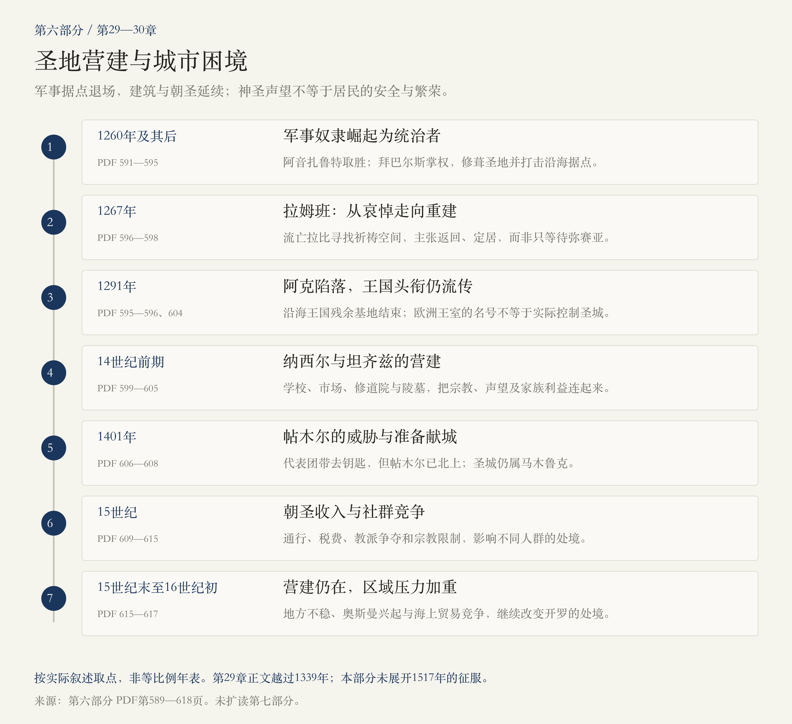
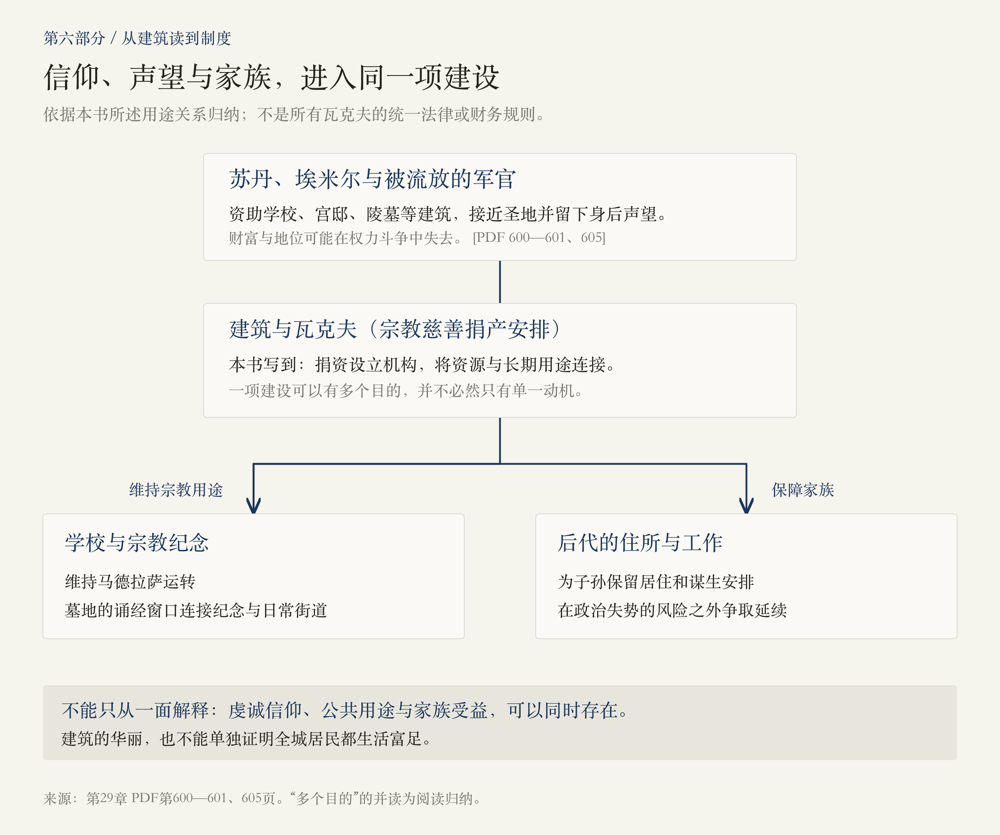
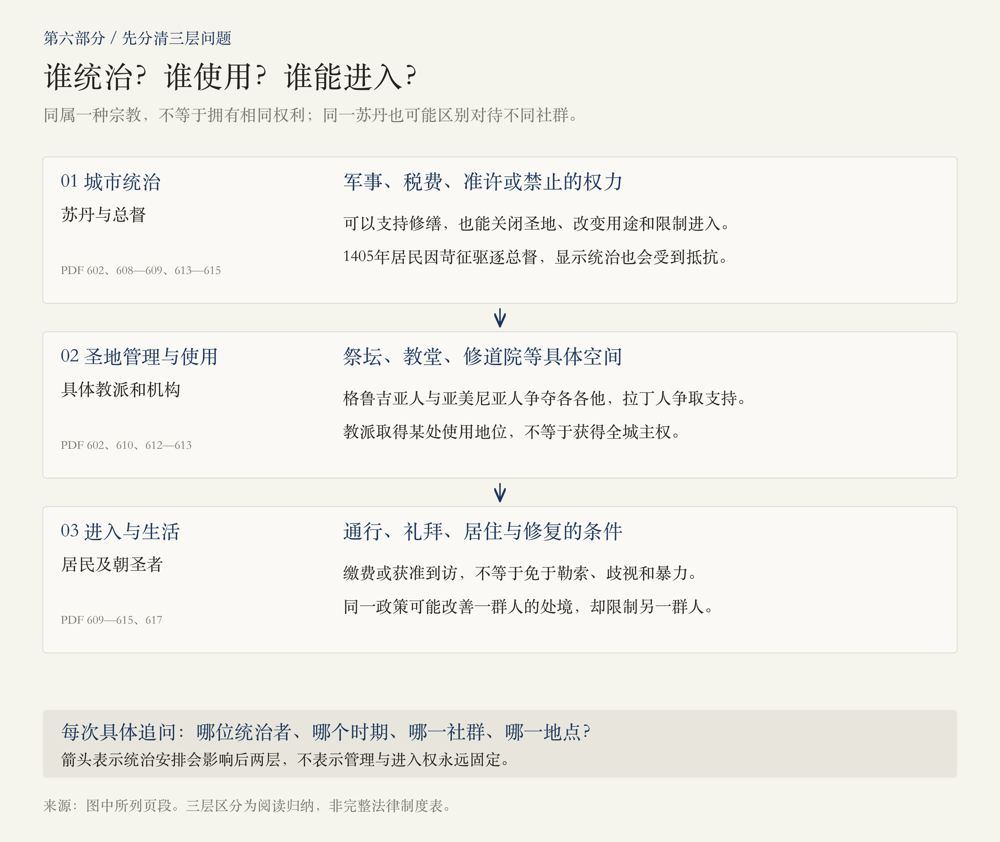

# 第六部分 · 马木鲁克：圣地营建与城市困境

> 阅读边界：本篇依据第六部分题辞、第29—30章正文及章末注释，PDF第589—618页，共30页；未扩读第七部分。所有页码为PDF物理页码。章题时间不等于严格的叙述边界，原书对“今天”的描述属于作者写作时的语境。

<!-- block: part-06-core -->
## 01 · 为什么圣地越来越受重视，城市却未必更安稳？

第五部分结束时，耶路撒冷已经历拆墙、反复易手与居民流失。第六部分把镜头移向马木鲁克：一批从奴隶军事体系中崛起的统治者，抵抗蒙古军队、消灭沿海十字军据点，又为圣城修建学校、修道院、市场与陵墓。[PDF第591—602页]

 **这一部分的核心反差，是神圣声望与居民处境并不总是一同改善。** 圣殿山及周边获得资助，朝圣仍吸引远方人群；城市却也面对政治边缘地位、苛征、劫掠，以及对不同宗教群体的限制。宏伟的建筑不能替我们回答：普通居民是否安全？谁能够进入圣地？谁承担费用？[PDF第596—602、608—616页]

本篇用三条线连接两章：军事统治怎样形成；宗教资助怎样改变城市；朝圣、钱财与社群争夺怎样交织。这是阅读归纳，不是原书另列的一套历史规律。

<!-- block: part-06-map -->
## 02 · 两章阅读地图：从军事胜利，到朝圣之城的困局

第29章章题为“1250—1339年”，但正文一直讲到1399年的危机；第30章章题为“1399—1517年”，正文主要写衰落过程及区域竞争，并未在本部分展开1517年的征服。阅读地图因此按实际内容取点，不把章题当成每件事都已叙完的保证。[PDF第591、602—603、606、616—617页]

<!-- block: part-06-ch29-power -->
## 03 · 第29章：奴隶士兵，怎样成为苏丹？

拜巴尔斯的经历显示，“马木鲁克”首先关联一套军事培养与依附体系：被贩卖的少年皈依伊斯兰教、接受训练，在精锐军队中成长，获得自由并争取更高地位；将领之间既有紧密联系，也存在激烈的权力争夺。不能把“奴隶出身”误解为他们掌权后仍没有自由或政治资源。[PDF第591—592页]

1260年阿音扎鲁特之战中，拜巴尔斯率先头部队抵抗蒙古军，马木鲁克取胜。他随后在古突兹遇害后的权力重组中成为苏丹。本书对他亲手从背后刺杀古突兹的细节标了“传说中”，因此不把这个场景当作已证实的目击记录。[PDF第592页]

夺权之后，拜巴尔斯持续攻击十字军据点；1291年，他的继承者攻陷阿克，沿海王国的残余基地终结。 **军事据点消失，与“耶路撒冷国王”头衔消失，是两件事。** 注释写到欧洲王室继续继承、购买或宣称这个名号，但名号并不等于对实际城市的控制。[PDF第594—596、604页]

开罗仍是权力中心。胜利使圣城受到新的宗教赞助，却没有自动恢复它的人口与城市繁荣。[PDF第592、596页]

<!-- block: part-06-ch29-rebuild -->
## 04 · 拜巴尔斯与纳西尔：怎样把统治写进圣城？

拜巴尔斯翻修岩石圆顶与阿克萨，资助苏菲派，并在耶利哥附近的先知摩西圣地建设穹顶。先知穆萨节把圣城与郊外圣地连成一条集体行走的路线；本书同时保留节庆可能源自萨拉丁时期的说法，不能简单断言由拜巴尔斯从零发明。[PDF第593页]

纳西尔·穆罕默德曾两次失位，第三次登位后才努力巩固统治。1317年亲自朝圣时，他向属下示范资助圣地的责任。在坦齐兹协助下，营建涉及大卫塔、宗教学校、柱廊、宣礼塔、市场及苏菲派修道院。 **这里的“重建”是整修、增建与改变用途，不是把古城推倒再造。** [PDF第599—601页]

建筑还承载了末日审判、身后声望和家族延续的期待：失宠军官被流放到城内，将财富投入靠近圣殿山的学校、宫邸与墓地。本书的注释进一步解释，瓦克夫既维持宗教机构，也为捐资者后代安排住所与工作。[PDF第600—601、605页]

<!-- block: part-06-waqf -->
## 05 · 一座学校，怎样同时连接信仰、财富和家族？

 **宗教虔诚、政治展示与家族利益可以共同推动同一项建设。** 这不要求我们断言赞助者只有一种动机，也不能因为有家族受益，就将所有宗教资助解释成虚假的信仰。[PDF第600—601、605页]

留意建筑的外观也能读到制度：深浅相间的石材、钟乳石状拱饰、埃米尔标识、面向行人的诵经窗口，使身份与纪念嵌入日常街道。图中呈现的是本书所述用途关系，不是所有瓦克夫的统一法律或财务规则。[PDF第605页]

<!-- block: part-06-ch29-faith -->
## 06 · 拉姆班、苏菲派与伊本·泰米叶：神圣意味着什么？

1267年到访的拉姆班，因欧洲宗教争论与迫害而流亡。他并不只为圣城哀伤，还主张在弥赛亚到来前返回、定居和重建，并寻找废屋作为祈祷空间。本书转述他见到约两千居民、仅两名犹太人的报告；这应记作一位到访者的见闻，不当作现代人口普查。[PDF第596—598页]

作者用“或许可以称为宗教犹太复国主义”概括他的选择。这是作者的回顾性比喻；拉姆班的宗教性定居主张，与后世现代民族政治运动仍需要区分。[PDF第597页]

同一座城内，苏丹资助的苏菲派仪式强调赞念、唱诵及隐修等接近真主的实践；伊本·泰米叶则批评过度圣化和某些圣地习俗，强调到访耶路撒冷不能与麦加朝圣等同。 **争论并不只发生在不同宗教之间，也发生在同一信仰内部。** 对后世思潮的影响，原书作了延伸，本篇不把它压成一条没有分歧的必然传承线。[PDF第593、600—601页]

本书还叙述1299年海屯与蒙古军相关的短暂进入、修缮和撤离。这里保留为本书的叙述，未另作史料核验；不据此画成一个稳定、完整恢复的基督教王国。[PDF第598页]

<!-- block: part-06-ch30-threat -->
## 07 · 第30章：帖木尔没有入城，威胁仍怎样改变城市？

帖木尔在叙利亚的进攻，使马木鲁克担心大马士革、巴勒斯坦乃至开罗的安危。伊本·赫勒敦以学者、政治参与者和苏丹教师的身份同他交涉，既表达对其才能的敬畏，也谴责大马士革遭劫掠。不能把学者获准会面，理解成他已经成功约束征服者。[PDF第606—608页]

耶路撒冷的学者决定送去岩石圆顶的钥匙、准备投降，但代表团到达时，帖木尔已率军北上。 **准备献城，不等于城市已经被他占领。** 本书明确说耶路撒冷仍归马木鲁克统治。[PDF第608页]

威胁暂退也没有结束内部困境：1405年，居民因苛捐杂税发动骚乱，赶走总督。圣地档案同时记录宗教法官、苏菲领袖、军官、藏书商人以及橄榄油和肥皂贸易。所谓“衰落”不是城内从此没有生活，而是这些生活在不稳定与压榨中继续。[PDF第608—609页]

<!-- block: part-06-ch30-pilgrimage -->
## 08 · 远征军退场以后，朝圣成为怎样一门生意？

欧洲没有因此遗忘耶路撒冷：礼拜堂、绘画、讲道、织锦和旅行，把圣城不断带回远方。当地的基督教朝圣者也成为重要收入来源，但需要反复缴纳通行费、罚金，并承受勒索和任意拘捕。 **城市依赖朝圣收入，不等于朝圣者受到稳定保护。** [PDF第609—611页]

圣墓大教堂既有宗教仪式，也有商铺、住宿与拥挤的生活。方济各会接待拉丁朝圣者，组织沿着耶稣受难记忆行走的路线；本书把它与后来苦路的形成联系起来。它并不证明当时认定的每个地点都已获得考古证实。[PDF第611—612页]

游记把敬虔与猎奇混写，也常带有敌意。关于圣物交易、放纵和对其他社群的指控，应区分“旅行者声称”与可独立确认的事实；本篇不将这些故事直接变成全体居民或朝圣者的画像。[PDF第609—612页]

<!-- block: part-06-rights -->
## 09 · 谁掌握城市，谁使用圣地，谁能走进去？

马木鲁克掌握统治与准许权，但基督教各派会围绕具体祭坛和圣地争夺使用地位。亚美尼亚人与格鲁吉亚人出价争取各各他，方济各会又依赖欧洲支持；本书所说的“基督教耶路撒冷”的优势地位，不等于这些教派取得了城市主权。[PDF第602、610—612页]

锡安山的争夺展示了另一个后果：基督徒限制犹太人进入，犹太人向开罗申诉，苏丹随后介入，将大卫墓及相关空间转为穆斯林使用。此处的“大卫墓”是后来形成的圣地认定，原书明确说它与真实的大卫无关，不宜直接当作已确认的王陵。[PDF第613页]

政策也不能概括为一张永远不变的“宗教待遇表”：贾科马克压制拉丁人，却保护亚美尼亚人；盖贝伊准许修缮教堂、重建拉姆班会堂，同时又限制犹太人靠近部分基督教场所。 **要逐次问清：哪位统治者、哪个时期、哪一社群、哪一地点？** [PDF第614—615、617页]

这些差别不抵消暴力与歧视的事实。头巾、浴池、职业与建筑修复的限制，和民众私刑、反基督徒杀戮，共同削弱了居民的安全。个别团体的挑衅，也不能替针对群体的迫害提供正当理由。[PDF第613—614页]

<!-- block: part-06-ending -->
## 10 · 盖贝伊的建筑，为什么没能扭转衰落？

盖贝伊曾被流放到耶路撒冷，与方济各会有过往来。本书用他喜爱修士蔬菜蛋饼的轶事，解释后来一部分优待；这样的故事能帮助记住私人关系的作用，却不足以独自解释整项政策。对他的判断，还必须放回不同社群获得或失去的具体权利。[PDF第615页]

阿什拉夫伊斯兰学校等工程继续装点圣殿山，但1480年的贝都因袭击暴露了总督的脆弱。奥巴代亚等旅行者悲叹荒凉，法官穆吉尔丁却珍视并书写城市的智慧与历史。同一时期的繁丽建筑、衰败观感与深厚眷恋，可以同时存在。[PDF第615—616、618页]

结尾的视野再度转向城外：奥斯曼的兴起、王位竞争、葡萄牙在印度洋的扩张，以及波斯的崛起，改变了马木鲁克的处境。开罗与奥斯曼一度务实合作，原书以危险的联盟作为转折，进入下一部分；本篇停在这里，不预读1517年的征服经过。[PDF第616—617页]

<!-- block: part-06-questions -->
## 11 · 接下来，值得沿哪条线追问？

1.  **宗教建设怎样兼顾公共用途与家族保障？** 可以从瓦克夫、马德拉萨、墓地与失宠军官的处境继续读，区分信仰、声望与财产安排。
2.  **为什么拥有朝圣者，不等于拥有繁荣而安全的城市？** 比较资助、贸易、通行收入与勒索，看收入由谁获得、安全由谁承担。
3.  **为什么受压制的群体之间仍会争夺和排斥？** 把各各他与锡安山并读，观察苏丹权力、社群内部竞争和进入权怎样影响彼此。

回看[第五部分：圣战、王国与谈判](#/read/jerusalem-part-05)，可以延续“城市控制、圣地管理、朝圣通行”的区分；第六部分又提醒我们加上一问：这些安排给实际生活在城里的人带来了什么？

<!-- block: part-06-sources -->
## 来源与本次阅读记录

- 本轮实际阅读PDF第589—618页，共30页：第六部分题辞589—590；第29章正文及注释591—605；第30章正文及注释606—618。未读取第七部分正文。
- 章节起点以PDF书签和正文核对。第29章的实际叙述超出章题1339年；第30章虽标至1517年，本部分结尾并未展开征服经过，不用章题代替正文。
- 人口数字标作到访者的报告；节日起源、刺杀细节与宫廷轶事保留原书限定。1299年海屯与蒙古军相关的入城叙述未另作史料核验，不用于断言稳定政权的建立。
- 第615页对盖贝伊登位年份的写法与紧接着叙述的较早活动不易对齐，本篇不据此标定登位年。其他有疑问的精确生卒、伤亡数字和宫廷细节，也不作为图解支点；需要时再作外部专题核验。
- 三幅图为阅读归纳，保存SVG源与PNG；不是原书插图、精确地图、完整政权年表或适用于所有时期的制度规则。
- 2026-11-01：第一版。
