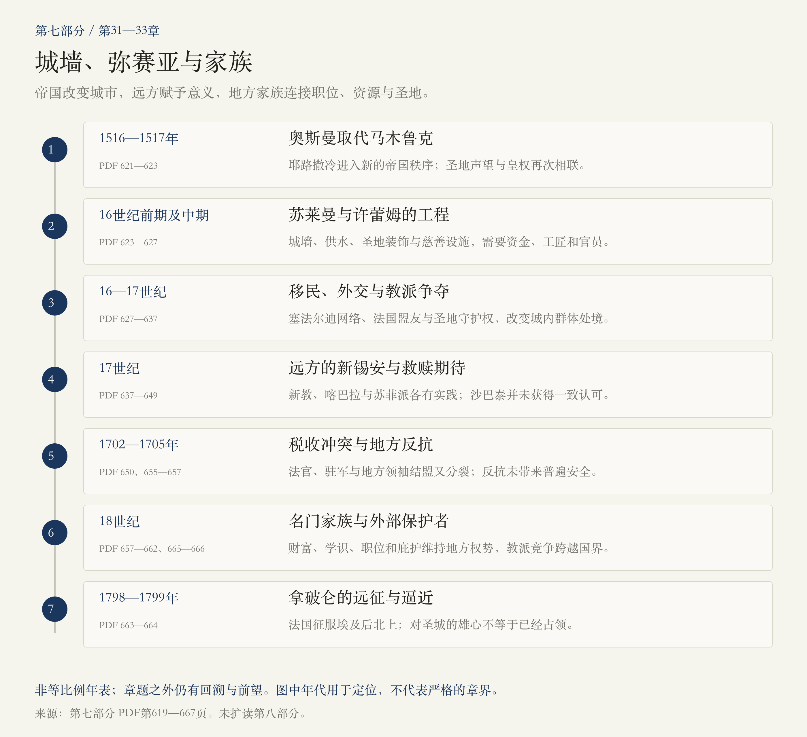
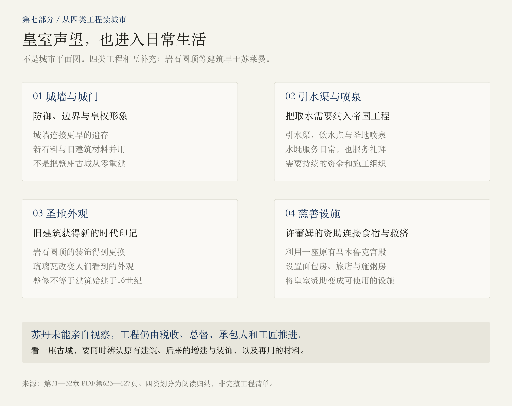
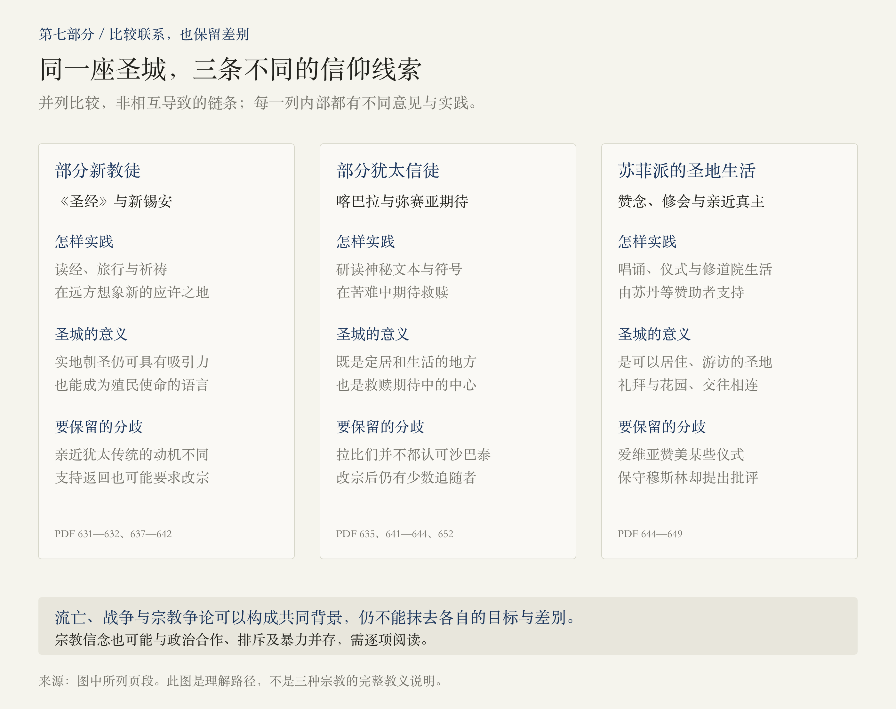
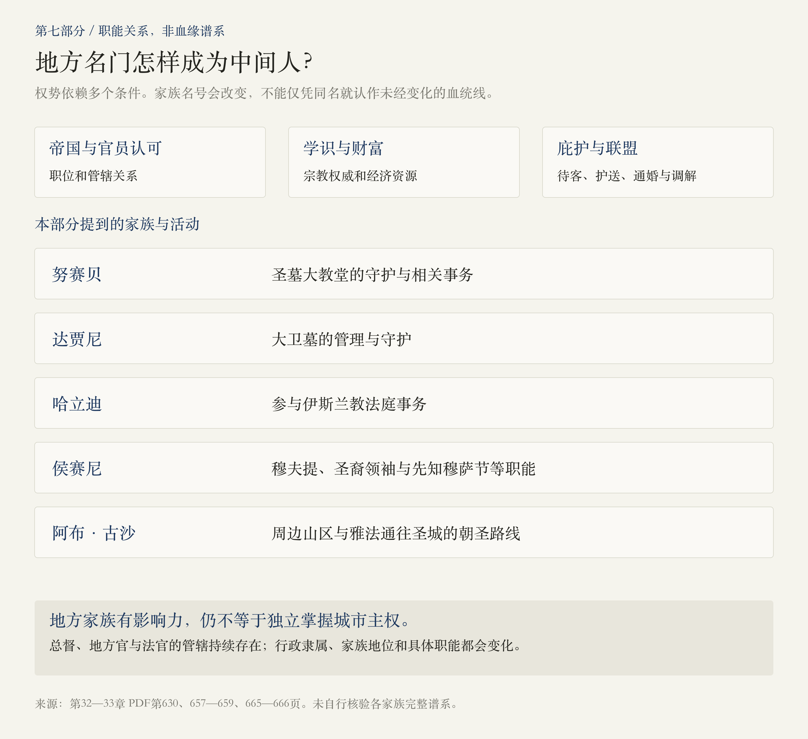

# 第七部分 · 奥斯曼：城墙、弥赛亚与家族

> 阅读边界：依据第七部分题辞、第31—33章正文及章末注释，PDF第619—667页，共49页；未扩读第八部分。所有页码为PDF物理页码。章题之外的回溯、前望以及注释中的后世事件，仍须与本部分主线区分；原书的“今天”属于作者写作时的语境。

<!-- block: part-07-core -->
## 01 · 一座城，为什么能同时活在帝国、远方与家族之中？

第六部分留下一个受重视却不安稳的圣城。第七部分从奥斯曼取代马木鲁克统治写起：苏莱曼以城墙、供水、圣地装饰和慈善工程留下可见的帝国印记；与此同时，难民、商人、外交使节和宗教期待，把耶路撒冷带进更广阔的世界。[PDF第621—641页]

 **读这一部分，可以同时跟住三种力量：帝国改造实际城市，远方信徒赋予它新的意义，地方家族则把职位、学识、财富与圣地管理连在一起。** 三者既合作也冲突，因此城墙更加完整、朝圣声望持续，并不保证居民免于勒索或暴力。[PDF第624—625、633—637、655—666页]

“奥斯曼时代”也不是始终一致的政策环境。苏丹、地方官、城市法官、宗教领袖和外部保护者，都可能改变具体社群的处境。本篇按三章推进，再用图把跨章节的关系连起来。

<!-- block: part-07-map -->
## 02 · 三章路线：从苏莱曼的营建，到拿破仑的逼近

时间线按实际叙述取点，不按年数比例。第31章虽标“1517—1550年”，正文已讲到1553年未能成行的视察；第32章又回溯1492年的驱逐与早期宗教改革。章题是阅读方向，不是封闭的时间盒子。[PDF第621、624、627、631—632页]

<!-- block: part-07-ch31 -->
## 03 · 第31章：苏莱曼怎样在未曾到访的城市留下印记？

1516—1517年间，奥斯曼战胜马木鲁克，耶路撒冷进入新的帝国秩序。苏莱曼继位后，以“第二个所罗门”等称号理解自己的地位，将美化圣所视为皇权声望的一部分。本书也记下先知托梦的传说，但工程仍需要资金、官员、工匠和施工组织才能完成。[PDF第621—624页]

苏莱曼的改变涉及城市防御、取水、圣地外观与日常设施：重修城墙和城门，改善城堡，建设引水渠和喷泉，并给岩石圆顶更换装饰。罗克塞拉娜，即许蕾姆，也通过慈善基金会，设置面包房、旅店和施粥设施。 **皇室的宗教声望，与居民实际使用的水、住宿和食物，在同一组工程中相遇。** [PDF第623—625页]

苏丹计划视察，却因战争未能成行。帝国通过税收、地方总督、承包人和建筑人员实施远距离改造；工人利用新石料，也沿用旧建筑的材料。本书还写到一些承包人留居、建筑师形成世袭职业网络。建城并不只是君主的一道意愿，也是资源和人的迁移。[PDF第624—625、627页]

<!-- block: part-07-city -->
## 04 · 今天看起来“古老”的城市，其实叠着不同年代

岩石圆顶早于苏莱曼，他改变的是部分外观与装饰；城墙也连接着更早的遗存，并使用回收石材。 **“由他修建或改善”，不能读成“所有建筑都由他从零创建”。** 沿着前面各部分的建筑史看，圣城是一层层修整、增建和再解释的结果。[PDF第623—626页]

章末注释主动拆解导游故事：狮门上的动物图像与拜巴尔斯的旧构件有关；苏莱曼因锡安山在城墙外而处死建筑师的故事，原书明确标为传说。神奇故事可以表现后人怎样记忆君主，不能直接充当工程档案。[PDF第625—626页]

<!-- block: part-07-diaspora -->
## 05 · 第32章：犹太难民怎样进入帝国工程与圣地生活？

本章回溯伊比利亚对犹太人的驱逐和强迫改宗，说明塞法尔迪移民怎样向东迁徙，带来拉迪诺语，以及新的商业与知识网络。苏丹接纳移民，也考虑经济和政治利益；接纳难民与社群获得全面平等，是需要分别判断的问题。[PDF第627—630页]

卡斯特罗参与管理用于耶路撒冷改造的埃及税收；约瑟夫·纳西则依靠商业、宫廷信任和外交工作，获得在提比里亚安置移民、重建城镇和发展丝织业的空间，也资助耶路撒冷学者。 **提比里亚的事业与耶路撒冷的城市统治，不是同一个地点、同一项权力。** 纳西的影响很大，却不能因此写成犹太人获得圣城主权。[PDF第627—629、632—633页]

移民群体也并不一致：塞法尔迪人与来自中东欧的阿什肯纳兹人，语言、资源和处境各有差异。会堂与学者网络曾有发展，后来又经历关闭、贫困与驱逐。不能用一个“始终宽容”或“始终迫害”的标签覆盖三个世纪。[PDF第634—637、656—659页]

<!-- block: part-07-diplomacy -->
## 06 · 苏丹的欧洲盟友，为什么能改变城内宗教生活？

苏莱曼与哈布斯堡作战时，需要法国这样的基督教盟友；法国又支持方济各会。贸易、外交与圣地看管安排由此相联。奥斯曼支持某一教派，可以出于现实联盟需要，不等于已经放弃对城市和圣地准许权的掌握。[PDF第629—631页]

同一时期，苏丹限制锡安山某些基督教空间，将大卫墓交给达贾尼家族守护；犹太人在西墙附近的祈祷也受地点和许可约束。 **要把城市主权、圣地管理与个人进入权分开看，且始终标明具体时期。** 西墙作为祈祷焦点的强化，也不是本书首次出现犹太人对这段墙的关注。[PDF第629—631页]

随着法国、奥地利和俄国分别支持教友，圣地内部的争夺越来越与欧洲竞争相连。本书把1699年和1774年的和约写成外部保护权加强的节点；这里保留为作者的叙述，不将后世全部外交冲突都归结为某一条约的单一结果。[PDF第649—650、661—662页]

<!-- block: part-07-new-world -->
## 07 · 为什么没有占有圣城的人，也会不断创造“耶路撒冷”？

宗教改革把《圣经》带到新的信仰实践中心。有些新教徒批判朝圣礼仪，却仍深深依恋耶路撒冷；乔治·桑迪斯就是一个例子。他既在圣墓和列王墓前祈祷，又以强烈敌意描写其他教派的仪式。虔诚并不意味着对其他信仰更加宽容。[PDF第631—632、637—639页]

桑迪斯后来去了弗吉尼亚。本书把他的旅行、英文《圣经》和清教徒“新锡安”“山巅之城”的观念连起来： **耶路撒冷可以是实际目的地，也可以成为远方殖民者解释自己使命的语言。** 这种自认被拣选的叙事，也与对美洲原住民的掠夺和暴力并存，不能只写成美好的精神远航。[PDF第639—641页]

克伦威尔及部分清教徒希望犹太人返回锡安，却又把他们改宗基督教视为基督再临的条件。玛拿西·本·以色列则用犹太人必须遍及世界的宗教解释，争取英格兰重新接纳犹太人。双方可以围绕同一行动寻找合作，但他们想象的终点不同。[PDF第641—642页]

<!-- block: part-07-salvation -->
## 08 · 喀巴拉、弥赛亚与苏菲派：不可混成一种“狂热”

在流亡、迫害和战争的背景下，卢里等人的喀巴拉研究为部分犹太人提供了理解苦难、接近上帝与期待救赎的方式；苏菲派则在赞念、仪式和圣地生活中寻求与真主亲近；新教的《圣经》实践又形成自己的圣城想象。 **背景可以相连，教义、实践与政治目标仍有差别。** 不能用一张图把三者画成彼此直接导致的关系。[PDF第635、640—642、644—649页]

沙巴泰·泽维宣称自己是弥赛亚，借助地中海和流散社群网络吸引追随者。但耶路撒冷的拉比并未一致认可他，追随者与怀疑者始终并存。运动发展、被奥斯曼当局拘捕并改宗后，多数信徒的期待破灭；注释又写到一部分人以新的解释维持信仰。因此，“预言失败”也不必然使所有追随者同时离开。[PDF第642—644、652页]

本书用现代心理疾病词汇解释沙巴泰的行为。本篇保留为作者的解释，不把隔着数百年的记述当作已经完成的临床诊断；对运动的理解，仍须观察处境、传播网络和群体分歧。[PDF第643页]

<!-- block: part-07-travellers -->
## 09 · 桑迪斯与爱维亚：同一座城，为什么像两个世界？

英国新教徒桑迪斯把许多仪式视为故弄玄虚；奥斯曼旅行家、苏菲派学者爱维亚·瑟勒比，却被岩石圆顶的建筑、光线、花园和宗教生活深深吸引。他也会嘲笑夸张的传说，并对圣火仪式作自己的解释。 **旅行者记录的不只是所见，也包括他带到现场的信仰、趣味和偏见。** [PDF第637—639、645—649页]

爱维亚笔下，圣殿山既有礼拜，也有散步、花木与交往；保守的穆斯林却批评同一类唱诵、舞蹈和男女相处。不能把一位作家的愉悦当作所有穆斯林的共同意见，也不能把他报告的学校、修道院数量当成无争议的普查结果。[PDF第647—649页]

读游记可以同时问：哪些是可辨认的空间与活动？哪些是作者自述、夸张或笑话？他在赞美谁、贬低谁？这比把所有精彩故事直接拼成城市全貌更有帮助。

<!-- block: part-07-revolt -->
## 10 · 第33章：1705年的反抗，为什么没有带来自由而安稳的城市？

第32章末尾已写到税收压力引发农民反抗，城市法官与总督决裂。第33章接着讲，法官、卫戍部队与地方领袖推动了短暂的地方掌权，但城内犹太人和基督徒仍遭服饰限制、苛征与羞辱。 **反对帝国官员的运动，不自动代表所有居民都获得更好待遇。** [PDF第650、655—656页]

当帝国军队逼近，地方联盟分裂，侯赛尼出逃，奥斯曼恢复控制，敲诈却没有结束。1720年，阿什肯纳兹群体面临入狱、驱逐、破产，会堂遭焚毁；其他犹太社群的延续也不意味着所有犹太人处境相同。[PDF第656—657页]

不要把随后出现的“侯赛尼”名字直接串成一条未经变化的血统线。本书强调古达亚家族采用旧侯赛尼家族名号，借助圣裔身份与职位重建影响力。这是作者依据所引研究作出的说明，不代表本篇自行核验了全部家谱。[PDF第657—658、665页]

<!-- block: part-07-families -->
## 11 · 地方家族靠什么成为城市不可绕过的中间人？

本书用侯赛尼家族首领的待客、庇护和骑兵护送说明地方权势：家宅既能招待官员和学者，也能容纳求助者。地方家族并非只靠头衔，他们还要积累财富、学识、人际网络，并取得帝国支持。[PDF第657—658页]

注释列出不同职能：努赛贝与圣墓守护有关，达贾尼管理大卫墓，哈立迪参与伊斯兰教法庭，侯赛尼与穆夫提、圣裔领袖及先知穆萨节有关，阿布·古沙则影响雅法通往圣城的路线。图中是本部分涉及的职能联系， **不是各家族所有时期的固定编制，更不是血缘谱系。** [PDF第630、665—666页]

家族可以争斗，也会通婚与和解。耶路撒冷仍受更高层的总督、地方官和法官管辖，其行政隶属也有变动。地方名门的影响力，不宜直接理解为独立国家的主权。[PDF第658—659、666页]

<!-- block: part-07-church -->
## 12 · 一座教堂的争夺，怎样变成跨国的权力竞争？

圣墓大教堂中的教派争斗，不只是抽象的教义争论，也涉及祭坛、礼仪、空间、收入与保护者。教派争相取得最高守护地位，同时又在狭小环境中长期驻留，被锁在教堂里的生活使疾病、贫困与矛盾相互加重。原书引用的相互辱骂，应作为带立场的材料阅读。[PDF第634、649—650、659—660页]

1757年，东正教与方济各会的冲突发生暴力升级，苏丹随后转而支持希腊方面。这里可以看清一条相互作用的链： **外部资助与外交支持影响本地竞争，本地冲突又促使统治者重新分配地位。** 这不是说任何一次争斗都由欧洲遥控，更不能由一次胜负推出后世所有管理细节。[PDF第660—661页]

<!-- block: part-07-ending -->
## 13 · 地方强人和拿破仑，为何都不能与“已经得到圣城”画等号？

查希尔·奥马尔以加利利和阿克为基地，与埃及的阿里·贝结盟，在俄国介入的背景下控制巴勒斯坦大片地区，但耶路撒冷仍由苏丹的帕夏守住。进攻又受城墙阻挡。 **“巴勒斯坦王”是原书使用的称号，不代表其已经统治本地区每一座城。** [PDF第661—662页]

1798年拿破仑远征埃及，带着科学家、革命后的政治设想和法国的帝国利益。法军陆上取胜，海军却遭纳尔逊重创，继而北上。1799年，部队逼近耶路撒冷，拿破仑在报告中想象自己将站在圣殿遗址上。[PDF第663—664页]

本部分到这里结束： **逼近、设想和向巴黎宣告雄心，都不等于已经占领圣城。** 后续战事留到下一部分。与[第六部分：圣地营建与城市困境](#/read/jerusalem-part-06)并读，城外强权、城内中间人与居民生活之间的距离，仍是值得追问的主线。

<!-- block: part-07-questions -->
## 14 · 读完三章，可以继续追问什么？

1.  **苏莱曼的城墙怎样改变城市，却又保留更早的历史？** 可以沿材料再用、供水、慈善设施与工程组织继续读。
2.  **为什么耶路撒冷既是一个地点，又能成为远方的政治语言？** 比较实际朝圣、新锡安与不同救赎期待，分清共同词汇背后的不同目标。
3.  **地方家族为何在帝国之下仍有持久影响？** 追踪职位、学识、财富、圣地管理、庇护和通婚，区分名号、血统叙述与实际权力。

<!-- block: part-07-sources -->
## 来源与本次阅读记录

- 实际阅读PDF第619—667页，共49页：第七部分题辞619—620；第31章正文及注释621—626；第32章正文及注释627—654；第33章正文及注释655—667。第654页仅页脚。未读取第八部分正文。
- 章界依据PDF书签与实际文本核对。对章题以外的回溯、前望以及注释中的现代事件，不扩充为本轮另读的范围。
- 先知托梦、建筑师处刑、圣物解释、旅行者的数量报告和宫廷细节，与可辨认的营建、制度和行动区分处理；不把游记的敌意描写转写为群体定性。
- 本篇不以正文中有疑问的精确入城日期、名号起源、医学判断及章末注释的后世会堂毁坏年份作为图解支点；未作额外外部核验。条约保护权与家族名号变化，均按作者叙述呈现，需要专题扩展时再核查具体史料与条文。
- 四幅图均为阅读归纳示意，保存SVG源与PNG。不是原书插图、精确地图、统一宗教教义表或家族血缘图。
- 2026-11-01：第一版。
