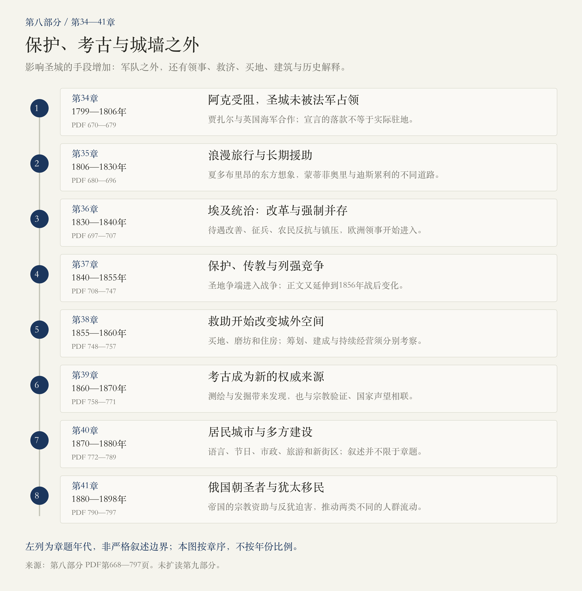
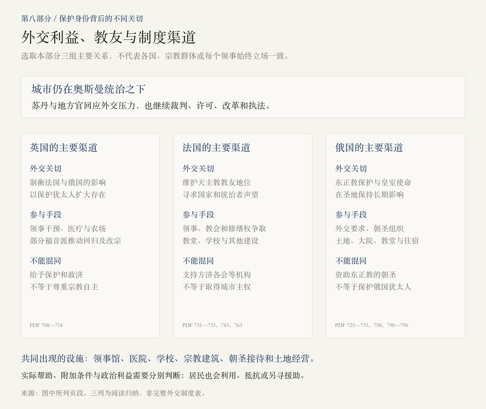
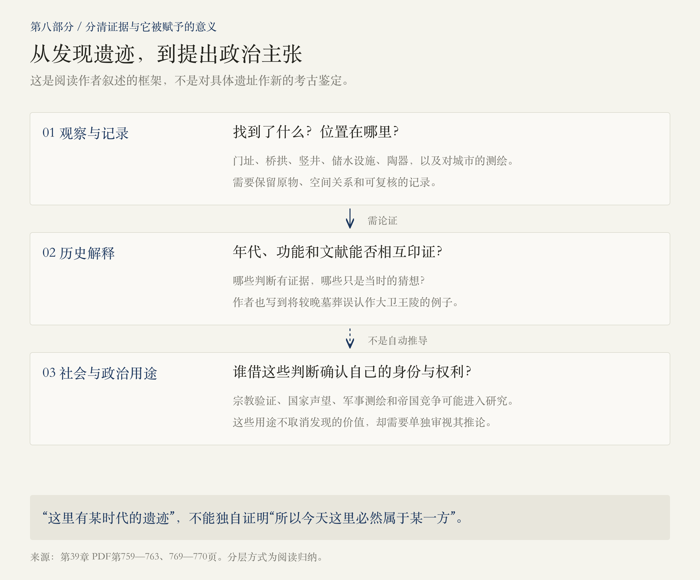
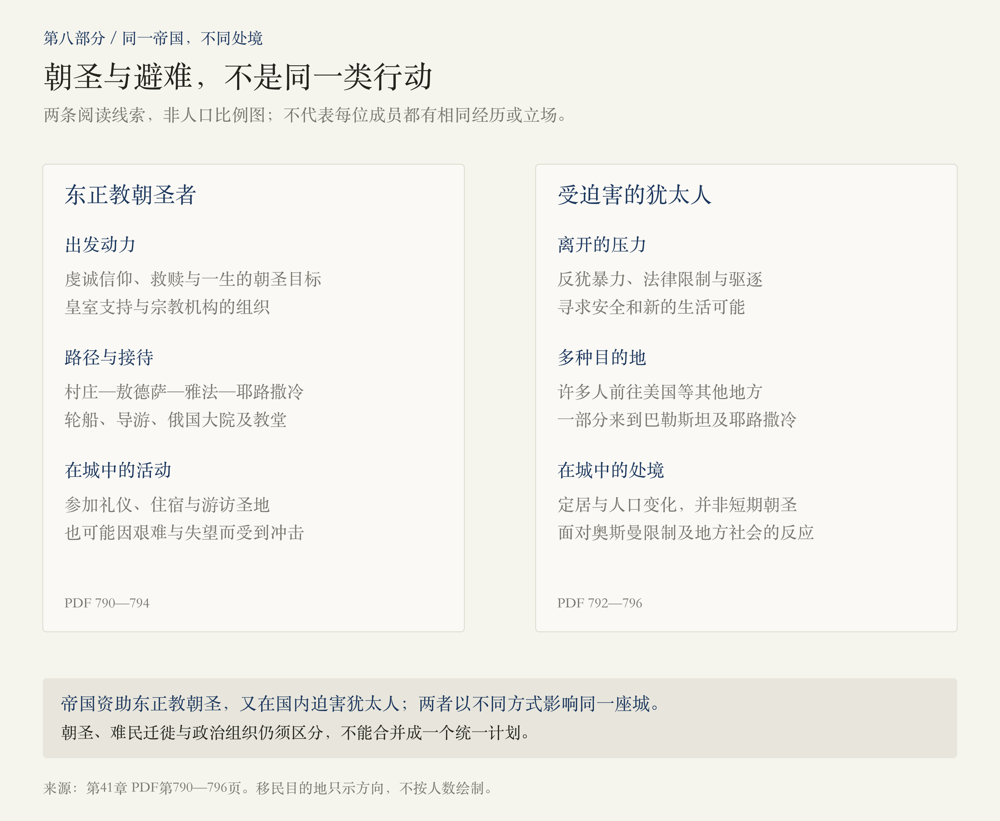

# 第八部分 · 帝国：保护、考古与城墙之外

> 阅读边界：依据第八部分题辞、第34—41章正文及章末注释，PDF第668—797页，共130页；未扩读第九部分。页码均为PDF物理页码。章题年代与实际回溯、前望分别处理；原书的“今天”属于作者写作时的语境。

<!-- block: part-08-core -->
## 01 · 没有直接统治圣城，也能改变它吗？

第七部分止于拿破仑逼近耶路撒冷。第八部分先写远征失败，再把视野转向整个19世纪：领事、传教士、慈善家、游客、考古学家和移民，不断进入这座仍在奥斯曼统治下的城市。[PDF第670—677、708—743、748—796页]

 **这一部分的关键变化，是影响圣城的手段增多了：除了军队，还有保护身份、外交施压、医疗与救济、购买土地、兴建学校和宗教大院，以及给遗迹命名、解释历史。** 这些活动有真实的助人和求知成分，也可能服务传教、国家声望与政治竞争；不能只用一种动机解释所有参与者。[PDF第708—717、748—764页]

与此同时，耶路撒冷没有被外来者的梦想完全覆盖。城内居民仍在交易、做音乐、过节、建立市政与家族网络；城外则出现新的住房、道路、旅游设施和街区。阅读时要同时看见远方的计划、实际建成的设施，以及在此生活的人。[PDF第753—755、768、772—789页]

<!-- block: part-08-map -->
## 02 · 八章路线：从远征受阻，到新城与新迁徙

本部分章题主线为1799—1898年，但正文并非严格按章题切断。例如第37章讲到1856年战后变化，第39章前望蒙蒂菲奥里1875年的末次访问，第40—41章也有超出章题的叙述与注释。图按章序取点，不按年数比例，不把前望误写成另读了第九部分。[PDF第733—743、766、780—789、796—797页]

<!-- block: part-08-ch34 -->
## 03 · 第34章：拿破仑为什么没有进入耶路撒冷？

拿破仑决定先攻阿克，再前往圣城。但阿克由贾扎尔帕夏守卫，并得到西德尼·史密斯率领的英国海军支援。多次进攻受挫，疾病、伤亡与奥斯曼援军进一步改变处境，法军最终撤向埃及。 **通往耶路撒冷的雄心，受制于港口、防御、海军与补给这些具体条件。** [PDF第670—675页]

书中引述一份落款“耶路撒冷总司令部”的《告犹太人书》，也转述法国公报对征服的夸耀；本章同时明确指出，拿破仑并未占领圣城。这里将宣言保留为本书引述的政治文本，不用其落款证明实际驻地，也未另行核验该文本的史料争议。[PDF第672—674页]

反对拿破仑的贾扎尔也实行残酷统治，法军在雅法的屠杀同样不能被“自由”或文明的口号遮蔽。史密斯随后经许可进入耶路撒冷，帮助保护面临报复的基督徒；这与英国取得城市主权仍是两回事。[PDF第670—677页]

<!-- block: part-08-ch35 -->
## 04 · 第35章：旅行者是在发现城市，还是寻找自己的故事？

夏多布里昂将残破的圣城写进天主教与十字军的浪漫记忆，也以强烈偏见描写穆斯林、犹太人与阿拉伯人。他的游记广泛流传，影响后来访问者对东方的期待。 **文字并不只是记录旅程，也会预先决定读者想在圣城看到什么。** [PDF第680—684页]

卡罗琳与赫斯特的旅行，把皇室、名望和宗教想象带到城市。1808年圣墓大教堂火灾后的重建，又牵动教派地位、外部支持和地方保护。作者转述的宫廷流言、对女性外貌与私生活的评断，以及教派对纵火的指控，不能自动视为无争议事实。[PDF第683—689页]

蒙蒂菲奥里夫妇的访问则逐渐转成长期救助；迪斯累利把圣城写进小说与政治抱负。两者都受旅程影响，却走向不同的行动。本书尤其写到，迪斯累利的文学愿望与他后来作为英国政治家的实际选择并不完全重合。[PDF第689—694页]

<!-- block: part-08-ch36 -->
## 05 · 第36章：改革待遇，为什么会与征兵和镇压并行？

穆罕默德·阿里及易卜拉欣的埃及军队进入后，耶路撒冷成为其与奥斯曼竞争的一部分。易卜拉欣许诺改善基督徒和犹太人的地位，取消部分限制与朝圣费用，又要求征兵、强化控制。居民最初欢迎新秩序，不代表他们接受随后的一切要求。[PDF第697—701页]

1834年复活节的圣火仪式发生拥挤、逃窜与军事暴力，造成严重死亡；紧接着，征兵争议、地方名门与农民反抗扩展成围城、抢掠和镇压。本书引用柯曾等人的目击叙述，本篇保留事件层次，不把惨剧压成单一的“宗教狂热”解释。[PDF第701—705页]

 **少数社群权利的改善，与统治者的军事征发和强制，可以同时存在。** 易卜拉欣准许修复宗教建筑、吸引欧洲领事，既有改革目标，也需要外部支持。1840年，英国等力量促使埃及军队撤离，奥斯曼军队回到耶路撒冷；对外开放留下的影响却继续存在。[PDF第705—706、713—714页]

<!-- block: part-08-ch37-protection -->
## 06 · 第37章：保护犹太人，为什么不一定意味着尊重其信仰选择？

帕麦斯顿希望英国通过保护犹太人，获得与法国、俄国相抗衡的影响力；沙夫茨伯里等福音派人士则希望犹太人回归并改宗，以迎接基督再临。两种动机可以促成合作，但并不是同一个目标。[PDF第708—712页]

领事芬恩既干预针对犹太人的暴力，也积极传教，支持农场、医疗与劳动项目。拉比和居民会抵抗这种改宗压力；蒙蒂菲奥里另派医生、资助犹太医疗，正是为了使救助不必依赖改宗渠道。 **保护、救济与宗教自主需要分别判断，不能只看谁提供了帮助。** [PDF第715—718页]

大马士革的“血祭诽谤”则展示跨国干预的另一种作用：诬称犹太人以基督徒鲜血举行宗教仪式，是迫害性的谣言，不是证据。蒙蒂菲奥里联合支持者游说释放受害者，并争取苏丹颁令否认诽谤；本书写到这道禁令后来在耶路撒冷再次发生诬告时发挥作用。[PDF第712—713、718页]

<!-- block: part-08-protection -->
## 07 · 领事、教友与帝国：三组关系怎样叠在圣城上？

图选取本部分最突出的几条渠道，不表示每位国民、每个教派都接受同一种政策，更不表示法国、英国和俄国的计划已经等于城市主权。奥斯曼官员仍在裁判、许可、执法和回应外交压力。[PDF第714—717、725—733、742—743页]

沃德·克雷森又提醒我们，个人宗教经历不能简单当作国家政策。他抵达后失去美国领事任命，却仍自行发放保护文件，后来改信犹太教，并因家庭诉讼面对信仰自由的争议。要区分官方身份、个人使命与实际行动，不把他的行为代表为所有美国人的一致立场。[PDF第718—724页]

<!-- block: part-08-ch37-war -->
## 08 · 圣地争端怎样进入克里米亚战争？

圣墓大教堂礼仪次序、伯利恒银星和修缮权的争夺，引来法俄外交对抗。拿破仑三世需要天主教声望与国外成功，尼古拉一世则把东正教保护使命同帝国权力相联。苏丹试图调整双方待遇，却难以平息竞争。[PDF第725、728、731—733页]

 **圣地问题是升级过程的一环，战争还涉及奥斯曼的命运、俄国的要求、欧洲均势与外交误判。** 不宜画成“修士打架，所以欧洲开战”的单线因果。本篇以1853—1856年战争过程与战后变化定位，不采用原书个别有疑问的精确宣战日期。[PDF第732—733、741—743页]

战争结束后，苏丹推动平等权改革，西方获得更多活动空间，俄国也转向宗教建筑、土地与朝圣组织的持续存在。军事失败没有终止文化和宗教竞争。敕令的承诺、实际执行及居民的安全，仍须分开考察。[PDF第741—743、758—759页]

<!-- block: part-08-ch37-travellers -->
## 09 · 作家的失望，为什么不能代替居民的城市？

果戈理、梅尔维尔、福楼拜、萨克雷等人，带着救赎、创作、好奇或批判而来，却未必得到期待的体验。作者借这些材料揭示，实地的拥挤、贫困和教派争斗，怎样冲击人们预先想象的圣城。对果戈理的心理解释及死后传闻，不能直接当作现代医学结论。[PDF第729—730、735—741页]

大卫·多尔以被奴役者的身份随主人旅行，写出同样带批评和失望的观察；注释说明，主人回国后没有履行释放他的承诺，他逃亡后才出版游记。将他与有钱作家并读，可以看见相似的旅行场景背后，行动自由与社会处境非常不同。[PDF第738—741、747页]

这些游记常把本地人写成风景或刻板角色；但同一时期也有居民在城门外野餐、邻里往来和谋生。 **文学上精彩的“荒凉”，不等于城市没有活生生的社会。** 这条线在第40章才获得更充分展开。[PDF第739、746、768、772—775页]

<!-- block: part-08-ch38 -->
## 10 · 第38章：蒙蒂菲奥里的援助，怎样走出城墙？

蒙蒂菲奥里希望救助不只停在分发善款，还包括工作、住房、医疗与学校。他依靠英国社会地位、犹太慈善网络，也与耶路撒冷的官员和家族谈判购地。原书注释强调，罗斯柴尔德、犹大·图罗等资助者同样重要，不能把所有工程写成一位富豪单独完成。[PDF第748—753、756—757页]

城外的救济住房和磨坊带来新可能，也暴露计划与现实的距离：最初居民担心抢掠，常回城内过夜；磨坊的风力和维护问题妨碍经营；他提出的雅法铁路计划也没有落实。 **筹款、买地、建成、持续运作，是四个不同阶段。** [PDF第749、753—755页]

1860年开放的住房成为犹太人在老城外拓展居住的重要开端。它的意义不在于所有项目都成功，而在于改变了生活空间的可能性。本书随后写到更多犹太、阿拉伯与欧洲机构向城外发展。[PDF第755、781—782页]

<!-- block: part-08-city -->
## 11 · 从城门外的风险，到新城的形成

这不是精确地图，也不把所有扩张归给一国或一位慈善家。俄国大院、欧洲宗教和住宿设施、犹太新街区、阿拉伯家族住宅，都参与了城外变化；本地商业、行政与奥斯曼建设同样在场。[PDF第742—743、753—755、758—759、780—782页]

早期未落实的铁路设想，与1892年实际通车是不同事件。交通、游客和住房相互促进，依然需要面对资金、管理与安全条件；不能从一条新路或一座大楼，直接推断所有居民已经富足。[PDF第743、749、780—782页]

<!-- block: part-08-ch39 -->
## 12 · 第39章：“新宗教”为什么指向考古学？

威尔逊、沃伦、罗宾逊等人的勘查，使桥拱、门址、竖井与储水设施进入新的研究网络。测绘、工程技术、发掘与文献辨认，扩大了认识古城的方法；王室、协会、军人和传教士又为这些活动提供资金与方向。[PDF第758—762、769页]

作者以“世俗宗教”比喻考古：一些支持者希望借发现确认《圣经》，一些人追求国家声望，测绘又可用于军事。与此同时，学术判断会出错，如将较晚的墓葬认作大卫王陵。 **遗迹的发现、年代和功能的解释，以及据此提出政治权利，是不同层次。** [PDF第759—763、769—770页]

马克·吐温嘲笑游客的轻信，却也带着自己的刻板看法；作者随后追问，访问者为何能看见圣经地点，却常看不见本地人。这里的批评不是否定所有旅行或科学，而是提醒读者检查观察者选择了什么、漏掉了什么。[PDF第765—768页]

<!-- block: part-08-archaeology -->
## 13 · 从“找到了东西”，到“因此这里属于我”，中间隔着什么？

图把本书呈现的不同活动分层，便于阅读，不是对任何一处具体遗址作新的考古鉴定。原物、位置、年代、功能与文献对应，都需要论证；宗教认同、国家竞争或领土主张，也不能由一件文物自动推导出来。[PDF第759—763、769—770页]

<!-- block: part-08-ch40-life -->
## 14 · 第40章：回到居民的语言、节日与街道

本章把视角从帝国宾客移回城市：不同群体使用阿拉伯语、土耳其语、拉迪诺语、亚美尼亚语或意第绪语，服饰又显示职业、地位与社群。语言不只是差异，也是商业和邻里合作的工具，塞法尔迪人与阿拉伯居民尤其有密切往来。[PDF第772—774页]

普珥节、逾越节、斋月庆祝、野餐、音乐、咖啡馆、澡堂与婚礼，形成许多交错的生活空间。有人交换节日食物，有音乐家共同演奏，瓦莱罗银行家又与名门家族合作。 **关系亲近不等于社会平等，节日共享也没有消除宗教限制与暴力。** 本章同时保留等级、私刑和节庆冲突，不宜只读成和谐的怀旧画面。[PDF第773—777页]

优素福·哈立迪的教育、语言、城市认同与市政工作，显示本地人也在推动变化。帝国宪政及其撤回影响他的地位，侯赛尼与哈立迪家族的消长又连接市长职位与伊斯坦布尔政治。地方现代化并非只从欧洲宾客那里输入。[PDF第775—779页]

<!-- block: part-08-ch40-city -->
## 15 · 旅游、摄影和美国侨民区，怎样改变日常空间？

库克组织的交通、导游、营帐和服务，把访问圣地变成可安排的旅游业；摄影工作室则出售圣经式造型和城市影像。游客追求的“真实东方”，有时本就是专门布置的场景。1892年通车的铁路进一步扩大出行和商业。[PDF第779—781、788页]

城外扩张也由多方推动：犹太家庭建立新街区，阿拉伯家族修建豪宅，奥斯曼官员改善设施，欧洲机构兴建教堂和收容设施。土地与商业改革中，名门和地主获益，并不意味着农民也分享相同收益。[PDF第781—782、789页]

斯帕福德夫妇因家庭灾难而迁来，他们的“胜利者”团体期待基督再临，并逐渐建设医院、孤儿院、学校、商店和照相馆。与美国领事的冲突说明，同为美国人或基督徒，也可能相互敌视；其慈善与社交又帮助他们与多群体建立联系。媒体关于“为耶稣温着牛奶”的故事，应保持为媒体说法，不当作已核实的日常规程。[PDF第783—786页]

<!-- block: part-08-ch41 -->
## 16 · 第41章：同一个俄国，为什么送来了不同的人群？

俄国农民朝圣者把前往圣城视为一生大事，经过昂贵而艰辛的海程，在俄国大院住宿、参加礼仪；皇室、巴勒斯坦协会、轮船和宗教建筑为这种移动提供组织。谢尔盖与埃拉资助教堂，使宗教、王室声望和考古遗存再次结合。[PDF第790—795页]

但同一个帝国也压迫犹太人。1881年后针对犹太人的暴力、限制性政策，以及谢尔盖在莫斯科的驱逐，推动许多人寻找新的生活地。有些来到巴勒斯坦，更多人选择其他目的地；不能把所有离开俄国的犹太人都画成前往耶路撒冷的单一路线。[PDF第792—796页]

 **朝圣、避难迁徙与政治组织，不是同一类行动。** 它们可以改变同一座城，却有不同的目标、风险与制度关系。奥斯曼的移民限制、执行中的落差和阿拉伯地方领袖的反应，又表明城市已面对新的人口与政治问题。本部分结尾引向《犹太国》，下一部分再读其政治展开。[PDF第795—797页]

<!-- block: part-08-russia -->
## 17 · 两种人群流动，不能合成一种“俄国影响”

图不按人数比例，也不把整个宗教群体归于同一种立场。皇室和机构资助的朝圣，与受到反犹暴力和法律限制推动的迁徙，在同一帝国中并存。共同的出发区域或航线，不表示共同的政治计划。[PDF第790—796页]

<!-- block: part-08-questions -->
## 18 · 读完八章，可以沿哪条线继续？

1.  **“保护”怎样既带来帮助，也带来附加条件？** 比较芬恩、沙夫茨伯里与蒙蒂菲奥里，区分外交利益、信仰目标与被帮助者的选择。
2.  **为什么买地与建楼还不足以建立稳定的新生活？** 追踪住房安全、磨坊经营、医疗、交通和城外商业，辨认计划与长期运作之间的条件。
3.  **怎样读懂旅行者和考古学家没有告诉我们的城市？** 把文学形象、遗迹解释与居民的语言、节日、市政和贸易并读。

回看[第七部分：城墙、弥赛亚与家族](#/read/jerusalem-part-07)，可以继续追踪同一个问题：远方如何想象圣城，权力如何把想象变成行动，而居民怎样承受、利用或改变这些行动？

<!-- block: part-08-sources -->
## 来源与本次阅读记录

- 实际阅读PDF第668—797页，共130页：题辞668—669；第34章670—679；第35章680—696；第36章697—707；第37章708—747；第38章748—757；第39章758—771；第40章772—789；第41章790—797，均含章末注释。未读取第九部分正文。
- 章节起止以PDF书签与实际文本核对。按正文记录章题之外的回溯、前望；第41章引用的移民统计延伸至1914年，本篇不将其误写为截至1898年的单期数字。
- 拿破仑宣言、旅行和宫廷轶事、对疾病的回顾性解释、考古地点认定，以及精确人口和死伤数字，均须辨认证据层次。本篇以原书为阅读依据，未另作外部史料、医学或条约核验。
- 不采用有疑问的精确宣战日期、迪斯累利受洗年龄、赫茨尔著作出版年、戈登与中国事件的年代等作为本篇时间支点；需要时再单独核对。对诽谤、传言、针对群体的贬抑性引语，不转写为事实判断。
- 五幅图为阅读归纳，保存SVG源与PNG。不是原书插图、精确地图、完整制度表、人口比例图或新的考古鉴定。
- 2026-11-01：第一版。
