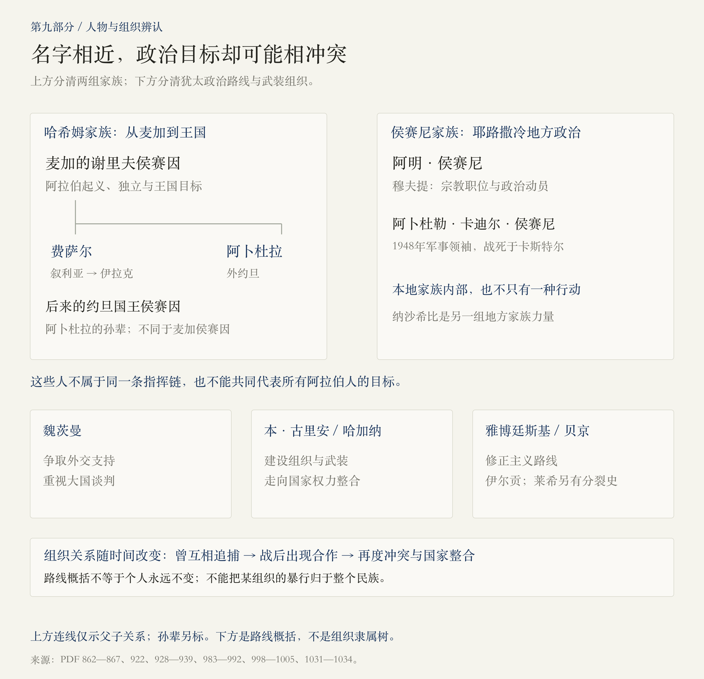
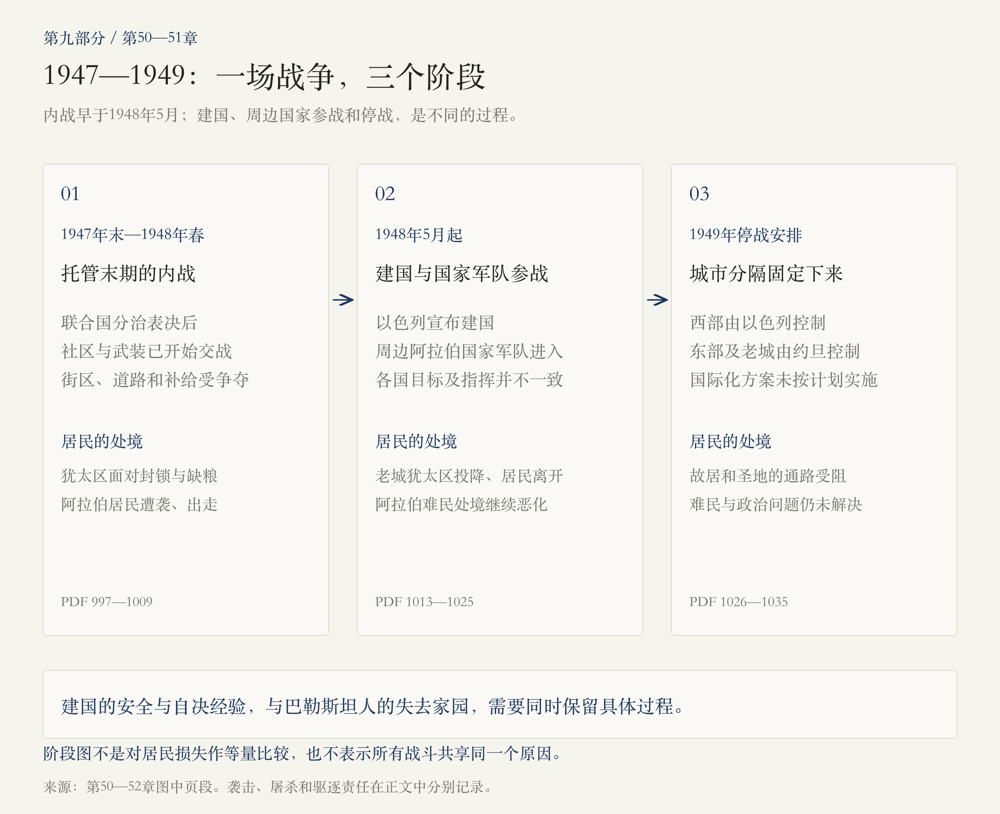
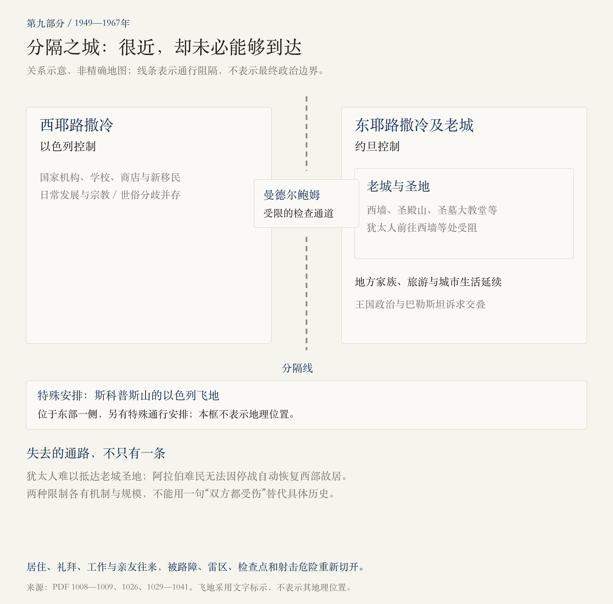
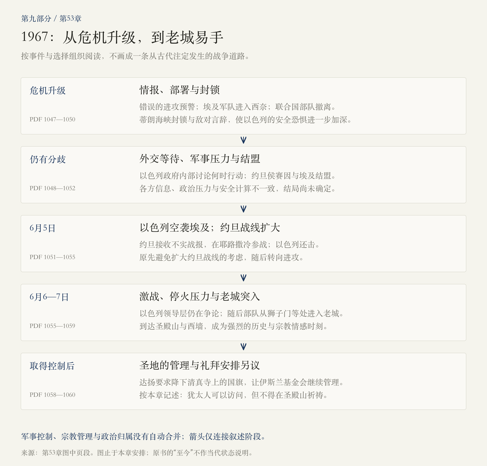

# 第九部分 · 犹太复国主义：家园、国家与分隔之城

> 阅读边界：已读第九部分题辞、第42—53章正文与章末注释，PDF第798—1061页，共264页。主线止于1967年，正文另有回溯与前望；未扩读后记。页码为PDF物理页码。三份历史文件的措辞及开罗会议年份另作外部核对，并就近列出链接；原书的“至今”属于作者写作语境。

<!-- block: part-09-core -->
## 01 · 同一座城，怎样成为不同民族的家园问题？

第八部分写到列强、慈善、考古和迁徙怎样改变圣城。第九部分进一步追问：当人们要求的不只是保护、朝圣或居住，而是能够保障集体安全、决定政治命运的家园与国家时，耶路撒冷会发生什么？本书从赫茨尔的外交奔走写到1967年以色列取得老城控制权，中间经历奥斯曼统治终结、英国托管、起义、纳粹大屠杀、两场战争与城市分隔。[PDF第800—819、846—861、983—1060页]

 **这部分最值得抓住的变化，是两种真实的家园诉求，逐渐进入同一片土地上的人口、制度、武装和主权竞争。**  犹太人面对欧洲反犹迫害与灭绝性灾难，寻求安全和自决；巴勒斯坦阿拉伯人面对移民、政治安排和战争带来的变化，要求自己的政治未来，并在1948年大规模失去家园。理解一种经历，不需要抹去另一种经历。[PDF第801—805、815—817、938—940、970—980、1008—1009页；本段为阅读归纳]

同时，任何一方都不是只有一种声音。宗教归返、世俗民族主义、社会主义定居、帝国外交、阿拉伯独立、地方家族政治与个人邻里关系，相互交叠，也不断冲突。阅读时应追问具体是谁、在何时、作出什么选择，承担什么责任。[PDF第820—826、886、903、928—939、983—985页]

<!-- block: part-09-map-early -->
## 02 · 前六章：政治运动怎样进入帝国的战后安排？

章题覆盖1898—1920年，叙述会回溯1896年《犹太国》和1897年巴塞尔大会，也会延伸到1921年的政策安排。图按章序整理，年代不是严格的截断线。[PDF第800—805、924—927页]

<!-- block: part-09-ch42 -->
## 03 · 第42章：从宗教归返，到有组织的政治运动

赫茨尔原本生活在欧洲的文化与政治世界里。反犹暴力、排斥以及德雷福斯事件，使他对同化能够保障犹太人安全的信心动摇。1896年出版《犹太国》、1897年组织巴塞尔大会，意味着把一个家园目标转化成宣传、会议、募资、组织和外交活动。[PDF第800—805页]

但这不是犹太人与耶路撒冷联系的起点，也不是所有犹太人同时接受的一套方案。本章回溯宗教传统、早期思想家与定居活动，也写到富裕犹太人、宗教人士及其他犹太群体对政治复国主义的保留或反对。 **古老的宗教联系、具体的迁居行动和现代政治组织，需要分别理解。**  [PDF第802—805、817页]

赫茨尔寻求德国皇帝威廉二世和奥斯曼苏丹支持，希望通过大国认可获得政治保障。但皇帝的短暂兴趣也夹杂把犹太人移出欧洲的反犹想象；苏丹则拒绝其核心要求。1898年的会面与盛大访问，没有兑现成赫茨尔期待的特许。[PDF第806—813页]

1899年，耶路撒冷的优素福·哈利迪致信，承认犹太人的历史联系，同时强调当地已经有居民、有社会和统治秩序。这里出现了贯穿全篇的难题：远方为迫害寻找出路的计划，一旦落地，就会触及另一群人的生活与政治权利。[PDF第815—816页]

本章又写到1903年的反犹暴力和东非等替代安置方案。各方对地点和目标的分歧，说明后来的道路并非从一开始就完全确定。《锡安长老会纪要》则是煽动反犹迫害的伪造阴谋文本，不能当作犹太人的真实计划。[PDF第816—819页]

<!-- block: part-09-ch43 -->
## 04 · 第43章：在政治地图之外，先看见一座生活着的城

青年本·古里安把理想带进移民与劳动实践，显示复国主义正在形成不同于赫茨尔外交路线的新力量。与此同时，瓦希夫·贾瓦哈里耶的日记，把我们带入音乐、咖啡馆、学校、庆典和跨社群往来。当地人并非只是大国计划的背景人物。[PDF第820—826页]

这些交往证明共同生活确实存在，却不能据此推断政治冲突已被解决。1908年奥斯曼宪政改革带来希望，报刊、社团与民族诉求也在发展；同一个人既可能拥有跨宗教朋友，也可能支持特定的政治目标。[PDF第823—826页]

本章的帕克寻宝事件，把上一部分的考古热推到危险边缘。以密码推算约柜位置的猜想、牟利动机和行贿，混在真实的地下探查工作里。1911年秘密进入圣殿山区域挖掘，引发亵渎与盗取圣物的恐惧，谣言迅速扩散；他们并没有找到约柜。[PDF第833—842页]

 **地下遗物可以成为地上政治的引线。**  这里应分开实际挖掘、未经证实的传闻、圣地管理失守和群众反应，不能把“有人相信圣物被盗”写成“圣物确实被盗”。[PDF第838—842页；本段为阅读归纳]

<!-- block: part-09-ch44 -->
## 05 · 第44章：世界大战怎样改变居民的生存条件？

奥斯曼加入世界大战后，耶路撒冷成为军事统治、征用和忠诚审查下的城市。杰马尔帕夏的高压措施涉及不同社群：阿拉伯活动者遭镇压，犹太人面临驱逐，基督教机构也受到征用。原先愿意效忠奥斯曼的本·古里安等人，后来仍被迫离开。[PDF第846—855页]

战时灾难由多个因素共同造成：征发、运输与贸易受阻、海上封锁、蝗灾、饥荒和疾病相互叠加。瓦希夫所记录的宴饮与贫民的生存困境形成强烈反差。把这一切只写成“某个暴君的性格”，会漏掉战争如何破坏粮食、工作和城市网络。[PDF第852—859页]

忠诚也不是固定标签。帝国先要求居民忠诚，又通过镇压、驱逐和征用破坏信任；居民则在安全、政治理想和现实生计之间改换选择。这是理解随后阿拉伯起义及犹太政治组织转向的重要背景。[PDF第854—859页；本段为阅读归纳]

<!-- block: part-09-promises -->
## 06 · 第45章：三组战时安排，究竟分别说了什么？

英国一边需要阿拉伯起义削弱奥斯曼，一边与法国安排战后势力范围，又支持在巴勒斯坦建立犹太民族家园。这些政策来自不同谈判对象和战争考虑，并未形成一个得到当地各方同意、能够直接实施的统一安排。[PDF第862—889页]

-  **侯赛因—麦克马洪通信** ：与麦加的谢里夫侯赛因讨论阿拉伯独立。地域排除措辞存在歧义，巴勒斯坦和耶路撒冷的具体位置成为争议；不能把它简化成一张毫无争议的国界图。[PDF第866—869页]
-  **赛克斯—皮科协定** ：英法在1916年安排势力范围，并设想耶路撒冷一带的国际化安排。这是列强之间的战时划分，不是当地已经实行的政府制度。[PDF第869页]
-  **贝尔福宣言** ：英国在1917年支持在巴勒斯坦建立犹太民族家园，同时载有保障其他群体权利的条件；文件没有把耶路撒冷明确交给某一方。[PDF第882—888页；措辞核对见下]

 **文件措辞核对** ：宣言信件日期是1917年11月2日。PDF第887页将关键措辞译为“民族国家”，本笔记采用原文 *national home* 对应的“民族家园”，避免把它直接等同于一份已确定国家边界的建国文件。其保障条件涉及巴勒斯坦既有非犹太社群的公民、宗教权利，以及其他国家犹太人的权利和政治地位。[日期核对：英国议会图书馆](https://commonslibrary.parliament.uk/research-briefings/cbp-7766/)；[宣言全文引录：英国议会记录](https://hansard.parliament.uk/commons/2017-10-30/debates/CB36ACC3-D2D7-441A-836B-736B8C869A13/BalfourDeclaration)。这项核对不代表新增阅读了PDF其他章节。

魏茨曼的游说重要，但作者也反对把宣言归因于他帮助制造丙酮这一件事。英国的战争战略、外交计算、宗教想象乃至对犹太影响力的虚妄成见共同进入决策；那些成见是决策者的偏见，不能拿来证明阴谋论。[PDF第882—886页]

<!-- block: part-09-ch45-revolt -->
## 07 · 阿拉伯起义：劳伦斯之外，还有谁？

麦加的侯赛因及其儿子费萨尔、阿卜杜拉，是哈希姆家族的重要人物。他们与英国合作，组织起义并争取战后王国。部落力量、资金、交通线、沿海据点与英军支持都很重要；劳伦斯是参与者之一，不能让个人传奇遮住阿拉伯人的行动和目标。[PDF第862—875页]

本章也保留了不同尺度的选择。萨卡基尼帮助犹太朋友莱文，后来因此被捕；跨社群援助并未因民族政治兴起而立刻消失，却越来越需要冒险。判断居民关系，既要看政治宣言，也要看这些具体行为。[PDF第873、912页]

另需区分战场：1917年秋英军突破巴勒斯坦南部战线，与当年12月耶路撒冷易手，是前后相接的事件。不能将第45章个别叙述中的10月底日期直接作为占领耶路撒冷的日期；第46章详细写了12月的撤离、投降与入城。[PDF第874—875、892—899页]

<!-- block: part-09-ch46 -->
## 08 · 第46章：英军入城，为什么还不是问题的终点？

1917年12月，奥斯曼军队撤离，市长及其同伴带着白旗寻找接受投降的英军，出现了多次交涉。艾伦比随后举行入城仪式，以克制、尊重圣地的形象呈现英国接管；这与奥斯曼时期的王室炫耀构成对照。[PDF第892—899页]

但战争仍在继续，居民还面对饥饿、疾病与供应困难。英方既需要维持秩序、修缮和管理城市，又要处理彼此冲突的期待；斯托尔斯等官员的个人文化趣味，也与帝国权力、偏见及现实行政工作相混合。[PDF第900—910页]

魏茨曼与费萨尔曾有接触，试图寻找合作；这种合作依赖费萨尔对阿拉伯独立的期待及各自政治条件，不能当作双方民众已经批准的一份永久解决方案。 **领袖之间可能达成的谅解，与当地居民的同意、落实机制和最终制度，仍有距离。**  [PDF第903、908—909页]

<!-- block: part-09-actors -->
## 09 · 人名太像了：先分清两组家族与几条政治路线

最容易混淆的是“侯赛因”和“侯赛尼”。麦加侯赛因、其子阿卜杜拉及后来约旦国王侯赛因，属于哈希姆王室线索；耶路撒冷的穆夫提阿明·侯赛尼、军事领袖阿卜杜勒·卡迪尔·侯赛尼，则属于本地侯赛尼家族政治。 **名字相近，不等于同一家族，更不等于追求同一个国家安排。**  [PDF第862—867、928—939、998—1005、1031—1034页]

犹太政治方面，魏茨曼重视外交，本·古里安重视组织建设与国家权力，雅博廷斯基及其后继者强调强硬路线；哈加纳、伊尔贡与莱希各有历史和指挥关系。它们有过合作，也发生过追捕和冲突，不能把任一组织的行动直接归于所有犹太人。[PDF第922、938—939、983—992页]

图只承担人物辨认；标示路线不意味着人物一生不变，也不意味着外交派没有安全诉求、地方名门都能代表普通居民。[PDF第903、953、998—999页]

<!-- block: part-09-ch47 -->
## 10 · 第47章：从战后会议，到街头暴力和地方任命

巴黎和会上的争论，使圣城命运继续取决于列强谈判。费萨尔在叙利亚的王国梦想遭法国击碎，巴勒斯坦阿拉伯人的本地政治组织与诉求更为突出；不能因此说此前没有地方认同，或把他们完全附属于一个王子的成败。[PDF第915—923页]

1920年纳比穆萨节庆期间发生反犹暴力，犹太居民遭袭和抢掠，英国当局的应对失灵。随后自卫组织进一步发展。理解其组织动力，需要看安全崩溃；这并不意味着后来任何自卫名义下的行动都自动正当。[PDF第919—922页]

塞缪尔出任高级专员后，英国尝试平衡家族、宗教职位和地方行政。纳沙希比与侯赛尼家族的竞争，因此不仅是私人恩怨，也与任命、资金、地位和政治代表权相联。[PDF第923—928页]

本章还叙述了英国安排费萨尔到伊拉克、阿卜杜拉到外约旦的过程。它既涉及战争承诺，也涉及英国的成本和控制方式；不能由此推断两个王国已经获得对耶路撒冷的共同统治。本篇对开罗会议采用1921年的历史定位，避免沿用第924页有疑问的年份。[PDF第924—927页；年份核对：[纽卡斯尔大学格特鲁德·贝尔档案，开罗会议合影](https://gertrudebell.ncl.ac.uk/p/gb-pers-f-005)]

<!-- block: part-09-map-late -->
## 11 · 后六章：托管危机怎样走向战争与分隔？

第50章虽然题为1945—1947年，实际已经写到1948年春的战争和居民离散。下一章的国家建立与周边国家参战，是冲突升级的新阶段；不能把1948年5月以前的战事删去。[PDF第995—1017页]

<!-- block: part-09-ch48 -->
## 12 · 第48章：托管制度怎样把地方分歧变成代表权竞争？

英国支持阿明·侯赛尼成为穆夫提，其宗教职位又与机构、资金和政治动员能力相连；纳沙希比市长及其支持网络则形成另一条路线。殖民当局希望借地方精英治理城市，却也强化了少数领袖掌握资源与代表权的能力。[PDF第931—933、938—939页]

1928年西墙的屏风、座椅与警察干预，随后成为更广泛政治冲突的焦点。犹太人的祈祷安全、穆斯林对圣地遭侵占的恐惧，以及双方的民族诉求，在同一地点集中。 **祈祷权、场所管理、财产归属与国家主张，是四个不同问题。**  一项礼仪变化引发的恐惧，不能直接当作另一方确实已有全面夺取圣地计划的证据。[PDF第934—937页]

1929年的暴力波及耶路撒冷、希伯伦等地，造成犹太平民遇害，也有大量阿拉伯人在英军镇压中死亡。书中同时写到阿拉伯人救助犹太邻居、公开反对暴行。具体救援不会取消屠杀责任，具体屠杀也不能证明整个社群都赞同行凶者。[PDF第937—938页]

白皮书、政策修正与政治施压往复，使温和路线难以持续取得信任。1933年后，纳粹迫害又推动犹太人逃亡和移民；对生存安全的迫切要求，与当地阿拉伯人的土地、就业和政治忧虑更加直接地相遇。[PDF第938—940页]

<!-- block: part-09-city-life -->
## 13 · 越来越紧张的城市，还在怎样生活？

希伯来大学、医院、青年会、旅馆、商店和住宅，使耶路撒冷继续现代化。库尔特·迈的商铺使用多种语言招牌；咖啡馆、音乐与沙龙连接不同社群的人。城市的日常交往，并没有在某一次政治冲突后整齐地停止。[PDF第941—949页]

但这些关系有阶层差异。能够流连旅馆和沙龙的精英，与面临贫困、失业或暴力的居民，拥有的选择不同。官员的社交圈和对东方的迷恋，也可能与种族偏见并存。不能把精英共同饮酒的场面，直接写成全城已经实现平等共处。[PDF第945—952页]

本·古里安与阿拉伯中间人曾讨论政治合作及联邦构想，表明其他道路被认真想过；它们没有变成可以执行的共同协议。我们可以研究失败的条件，却不能仅凭“有人谈过”，就声称只差某个人点头便能永久解决冲突。[PDF第953—954页]

<!-- block: part-09-ch49-revolt -->
## 14 · 第49章：1936年起义改变了哪些力量？

1936年罢工与起义，表达对英国政策和移民变化的不满，也逐渐形成武装冲突。1937年皮尔委员会提出分治，并为耶路撒冷保留英国控制的区域；方案还涉及严重的居民迁移问题。提出分治原则、把方案当谈判基础、接受具体边界和接受强制迁移，并非同一件事。[PDF第958—959页]

起义也出现内部暴力。阿明·侯赛尼阵营打击阿拉伯政治对手，纳沙希比阵营的部分力量则与英国合作、组织武装；伊尔贡袭击阿拉伯平民，英方以强制措施和集体惩罚镇压。责任需要具体落实到参与者，不能将平民受害写成任何一方理所当然付出的代价。[PDF第960—968页]

作者强调，镇压、流亡和内部清洗损伤了巴勒斯坦阿拉伯社会的组织能力；与此同时，英方与犹太武装的某些合作，帮助后者积累训练和经验。1936—1939年的变化因此影响到后来双方的准备程度，但不会机械地决定每场战斗的结局。[PDF第965—970页]

<!-- block: part-09-ch49-war -->
## 15 · 白皮书与大屠杀：政策转向发生在怎样的时刻？

1939年英国白皮书限制犹太移民和土地转让，并设想在一定时期后建立独立国家。对英国而言，这是调整与阿拉伯世界关系的政策；对正受到纳粹迫害、寻求逃亡的犹太人而言，却进一步收窄了避难通道。不能把两种处境压缩成一个抽象的“移民配额争议”。[PDF第970、979—980页]

阿明·侯赛尼在欧洲与纳粹合作，1941年会见希特勒，并支持迫害犹太人的政策。这些选择应明确记录，同时也要保留作者的限定：不能把所有阿拉伯民族主义者都等同于他的反犹立场，更不能由这次会面推导出纳粹灭绝计划由他发起。[PDF第971—974页]

英国与犹太军事组织在对抗轴心国时有过合作，双方又围绕移民、战后国家问题冲突。瓦希夫则曾掩护犹太医生。共同体层面的紧张、组织间的策略，以及个人保护他人的行动，可以在同一时期同时发生。[PDF第974、979—980页]

<!-- block: part-09-ch50 -->
## 16 · 第50章：战后反英行动，为什么不能用一个组织概括？

纳粹大屠杀后，幸存者的去向成为紧迫问题，英国仍限制进入巴勒斯坦。“出埃及记号”等事件，使难民处境与英国统治的正当性不断进入国际视野。美国、苏联和英国各有国内压力与战略考虑，也不能当作一组始终一致的外部力量。[PDF第983—989、995—996页]

哈加纳、本·古里安领导层、贝京领导的伊尔贡以及莱希，对英国和对犹太国家的策略不同。哈加纳曾协助英国追捕另两组织成员，战后又出现联合反英行动，随后再度分裂。 **判断行动责任，必须保留组织名称和行动时间。**  [PDF第983—992页]

1946年7月，伊尔贡炸毁大卫王饭店的一部分，造成英国人、犹太人与阿拉伯人死亡。是否发出、收到或重视警告存在争议，不能因此将平民死亡从事件中抹去。英方同样有绑架、杀害嫌疑人与滥用权力的事件；作者以鲁博维茨案件展示殖民治安中的暴力与责任问题。[PDF第990—994页]

英国最终决定把问题交给联合国，并结束托管。退出并没有自动创造一个各方认可的替代秩序，反而使“谁接管、接管哪里、如何保护居民”的问题更加紧迫。[PDF第995—997页]

<!-- block: part-09-arrangements -->
## 17 · 方案、停战线、实际控制：不要把三张图叠成一张

1947年联合国大会第181（II）号决议提出分治，同时为耶路撒冷及周边地区设想由联合国管理的特别国际制度，称为 *corpus separatum*。它不是把后来东西分隔的结果预先批准下来。文本方案与战后实际控制应分别记录。[PDF第995—997、1026—1027页；文件核对：[联合国第181（II）号决议，第三部分](https://www.un.org/unispal/document/auto-insert-185393/)]

1949年以色列—约旦停战协定处理的是军事停战和分界，其措辞明确保留未来政治与领土解决的问题。因此本笔记中的1949—1967年示意图表示当时的实际分隔，不把停战线标作已经解决所有主权争议的最终国界。[PDF第1026—1030页；文件核对：[1949年4月3日停战协定，第VI条](https://www.un.org/unispal/document/auto-insert-189953/)]

1967年以色列取得东耶路撒冷和老城控制权，改变了军事与行政现实；本部分末尾记录的政治宣示、宗教管理安排和不同群体的失落，仍须分别理解。这里止于本次已读范围，不用原书的结尾替代后来历史，也不把当时某一方的宣称直接当成各方一致承认的结论。[PDF第1057—1060页]

<!-- block: part-09-war-phases -->
## 18 · 1947—1949年：战争至少分成三个阶段

第一阶段，联合国表决后，托管地内部的战斗已经展开。混合街区、交通线和补给成为争夺重点，耶路撒冷犹太居民面临道路封锁与粮食困境；阿拉伯居民也遭遇袭击、恐惧、逃亡和驱逐。[PDF第997—1009页]

第二阶段，1948年5月以色列宣布建国，随后周边阿拉伯国家军队参战，战事进入新的规模。各国目标并不相同，约旦国王阿卜杜拉另有扩大王国控制范围的计划，不能把所有阿拉伯军队画成一个毫无分歧的指挥系统。[PDF第1013—1021页]

第三阶段，停火与1949年停战安排使分隔固定下来，但没有让居民自动恢复家园、通行和礼拜。 **战斗结束、国家获得承认、难民问题解决，是不同的进程。**  [PDF第1025—1035页；本段为阅读归纳]

<!-- block: part-09-1948-civilians -->
## 19 · 同一场战争：建国的喜悦，与失去家园的灾难

第50章连续记录针对平民的袭击，随后写到代尔亚辛和哈达萨医疗车队惨案。代尔亚辛的屠杀由伊尔贡和莱希实施；医疗车队则遭阿拉伯武装袭击。叙述事件先后，可以帮助理解恐惧与报复如何扩散，但不能让前一场暴行成为后一场杀害平民的理由。[PDF第1000—1007页]

书中描述的居民离散，有不同的具体原因：直接驱逐、战斗和炮击、屠杀带来的恐惧、社会组织崩解，以及以为很快就能回来的暂时避难。不能把所有人概括为“自愿离开”，也不能不看地点和过程，就用单一命令解释每一次出走。[PDF第1002—1009页]

瓦希夫离开时，曾以为只是两周，结果没能回家。早先带我们进入多语言音乐与咖啡馆的同一个人，如今成为失去故居的难民。将两处日记并读，灾难就不再只是总人数，而是一个完整生活世界的断裂。[PDF第824—826、1008—1009页]

对许多犹太人，建国意味着在反犹迫害与大屠杀后获得自我保护的国家；对大量巴勒斯坦阿拉伯人，1948年成为“纳克巴”——失去家园和社会秩序的大灾难。两种历史经验都必须保留；名称所表达的意义不同，不应迫使一种经验为另一种经验让出存在的位置。[PDF第1008—1009、1013—1017页；本段为阅读归纳]

<!-- block: part-09-ch51 -->
## 20 · 第51章：耶路撒冷没有沿着建国宣言整齐地归属一方

以色列建国后，城市仍是战场。约旦阿拉伯军团进入老城作战，1948年5月底犹太区投降，居民被迫离开，胡尔瓦犹太会堂等建筑遭毁。与此同时，西部犹太居民区的补给问题仍需通过战斗、道路和运输解决。控制一条交通线，与控制整个城市，不是一回事。[PDF第1018—1023页]

联合国调停者伯纳多特先后提出不同安排，包括耶路撒冷的未来归属与国际化问题。1948年9月，他被莱希成员暗杀，随后本·古里安加强对该组织的取缔和国家武装的整合。具体行凶组织与后来国家采取的措施，需要分开记录。[PDF第1024—1025页]

停战后，以色列控制西耶路撒冷，约旦控制东部及老城，斯科普斯山保留特殊的以色列飞地安排。联合国的国际化设想没有按原计划实施；国家宣示和国际讨论仍在继续。城市以实际的分隔，进入下一章。[PDF第1026—1027页]

<!-- block: part-09-divided -->
## 21 · 第52章：分隔的城市，居民怎样失去彼此的通路？

铁丝网、雷区、路障和射击危险进入日常，近在咫尺的街区可能不再能去。曼德尔鲍姆所谓的“门”，实际上成为受限制的检查通道；地图上一条线，落在生活中就是工作、亲友、故居和圣地的断开。[PDF第1029—1035页]

犹太人无法进入老城西墙等地点，阿拉伯难民也没有因停战而恢复西部故居。书中有关圣地通行保证未能落实的叙述，与难民的家园问题，应同时保留，又分别说明各自的具体机制，不能混成一笔抽象的共同悲伤。[PDF第1008—1009、1026、1034—1035页]

西部发展国家机构、文化与学术生活，并接纳经历不同的犹太移民；宗教与世俗路线仍有冲突。东部继续有旅游、家族社会和政治活动，但在约旦王国中处于不同的位置。两边都仍在生活，并非只有军事设施。[PDF第1035—1041页]

阿莫斯·奥兹与萨里·努赛贝的童年，分别让我们看到分隔线两侧的城市经验。把他们与瓦希夫的早年日记并读，可以追问：曾经通过语言、音乐和邻里连接的空间，后来怎样被政治边界重新教育？[PDF第824—826、1035页；末句为阅读问题]

<!-- block: part-09-ch52-kings -->
## 22 · 王位延续了，耶路撒冷的安排为什么仍不稳定？

1951年阿卜杜拉在阿克萨清真寺遇刺，少年侯赛因在场。关于幕后主使，本书包含传言与推断，本篇不把它们升级为已证实的完整指挥链。后来登位的侯赛因，面对的是巴勒斯坦人的政治诉求、约旦王国生存、与西方关系及阿拉伯民族主义压力。[PDF第1031—1034页]

纳赛尔成为地区政治的重要力量，巴勒斯坦组织也逐渐取得独立行动空间。约旦国王不能只按个人好恶决定耶路撒冷的命运；同样，巴勒斯坦人的政治未来也不能简单由约旦王位继承解决。这些张力把叙述带向1967年的危机。[PDF第1034、1043—1047页]

<!-- block: part-09-crisis -->
## 23 · 第53章：1967年，哪些决定把危机推向战争？

本章从1956年苏伊士危机等背景讲起。到1967年，苏联关于以色列将攻击叙利亚的错误情报、埃及在西奈的部署、联合国部队撤离和蒂朗海峡封锁，使危机迅速升级。以色列社会在大屠杀记忆及敌对言辞中感到强烈威胁，政府内部仍存在是否等待外交、何时动武的分歧。[PDF第1043—1050页]

侯赛因在地区舆论、国内压力和对孤立的担忧中，与埃及结盟。战事开始后，约旦收到埃及方面不实的胜利消息，影响了判断。这里既有结构性的敌对，也有具体的信息失真和选择，不能画成任何一方从一开始就准确知道结局的必然过程。[PDF第1049—1054页]

6月5日，以色列首先对埃及发动空袭；随后约旦与以色列在耶路撒冷交战。以方内部原先也有避免扩大约旦战线的考虑，后来才决定进攻老城。6月6日的激战、停火压力与指挥层争论，最后推动了6月7日的突入。[PDF第1051—1057页]

这条路径中，“谁先实施哪一次军事行动”“当时感受到什么威胁”“有没有其他选择”，是不同的问题。可以一起研究，但不应由其中一项直接跳到所有战争责任与后果都已解释完毕。[PDF第1047—1057页；本段为阅读归纳]

<!-- block: part-09-ch53-holy-sites -->
## 24 · 进入老城之后：军事胜利能否直接解决圣地问题？

1967年6月7日，以军从狮子门等处进入老城，部队到达圣殿山与西墙。作者通过士兵、拉宾、达扬等人的回忆，表现对许多犹太人而言强烈的历史、宗教和个人意义；即使不是虔诚信徒，也可能在现场被情感淹没。[PDF第1057—1059页]

但以色列领导层对如何对待圣殿山并不一致。达扬命令降下岩石圆顶清真寺上的以色列国旗；据本书转述，纳尔基斯拒绝了随军拉比破坏清真寺的主张。军事占领之后，仍有人作出限制本方行动、维护他人圣地的政治选择。[PDF第1058—1059页]

本部分最后记述，达扬提出让伊斯兰宗教基金会继续管理圣殿山，允许犹太人访问，但禁止在那里进行犹太祈祷。 **实际军事控制、宗教场所管理、进入与礼拜安排，没有被合并成同一项权力。**  这是理解本书结尾的关键；第1060页的“至今”是作者的时间语境，本笔记不据此描述今天的具体执行情况。[PDF第1060页]

以色列方面的“统一”宣示，与侯赛因失去东部和老城的痛苦、纳赛尔的战败相并置。作者在此收住正文：一种历史愿望得以实现，不能自动表示所有居民已经分享同一种胜利体验，也不能表示政治争议随军事结果一起结束。[PDF第1059—1060页]

<!-- block: part-09-synthesis -->
## 25 · 把十二章压缩成四个互相连接的问题

以下是依据本次阅读整理的理解框架，并非原书原句：

1.  **谁需要家园，为什么？**  犹太人的迫害记忆与安全诉求、当地阿拉伯人的居住与政治自决要求，都有具体历史；不能把一方写成只有梦想，另一方写成只有障碍。[PDF第801—805、815—817、970—980、1008—1009页]
2.  **谁能替谁作出承诺？**  大国、王室、宗教领袖和政治组织拥有不同的授权与资源。战时信件、领袖会谈和国际方案，都需要追问如何落实，以及未参与谈判的人会承受什么。[PDF第862—889、908—909、915—928、995—997页]
3.  **谁拥有怎样的实际能力？**  移民、土地、学校、资金、地方职位、警察和武装，逐渐把观念变成组织力量。起义、镇压与内部清洗又改变双方的准备条件。[PDF第931—940、958—974、983—992页]
4.  **胜利之后，谁仍失去什么？**  国家、家园、圣地通路和城市管理是不同层面；同一场战争可以同时产生国家建立、难民离散与新的宗教安排。[PDF第1008—1009、1013—1035、1057—1060页]

用这四个问题重读，可以避免把近代史写成古老仇恨的自动延长，也避免只按帝王和将领的胜负来理解城市。具体制度与个人选择，始终在改变可能的道路。[以上为阅读归纳]

<!-- block: part-09-followup -->
## 26 · 接下来，可以从哪一处继续追问？

-  **三组战时承诺** ：英国分别向谁说了什么，为什么不同的人都认为自己受到背叛？可从第45章与三份文件图继续拆解。
-  **组织与内部路线** ：魏茨曼、本·古里安、贝京以及穆夫提、纳沙希比、约旦王室，分别代表怎样的利益、资源和选择？可沿人物图定向补充。
-  **1948年的城市生活** ：把补给战、代尔亚辛、医疗车队、瓦希夫离家与老城犹太区撤离放在各自地点和时间中，看见具体人如何失去安全与家园。
-  **1967年的圣地安排** ：为什么军事胜利后还要保留不同的管理与礼拜规则？可从第53章末尾继续讨论权力的层次。

九部分正文的图文笔记至此已整理到第53章， **后记尚未阅读** 。若继续读全书结尾，应另开有明确来源范围的笔记，保留这篇止于1967年的阅读边界。

<!-- block: part-09-sources -->
## 27 · 来源、核对与本篇边界

本篇实际阅读264页：题辞798—799；第42章800—819；第43章820—845；第44章846—861；第45章862—891；第46章892—914；第47章915—930；第48章931—957；第49章958—982；第50章983—1012；第51章1013—1028；第52章1029—1042；第53章1043—1061。范围包含正文及章末注释，未扩读第1062页起的后记。

图中的年代、人物线索与关系均为本次阅读的整理；时间线不按年数比例，分隔之城是关系示意，不是精确地图。亲属关系、政治路线、军事合作分别标记，不用一条线表达所有关系。

外部核对用于三个容易混淆的历史文件层面：1917年宣言的日期和民族家园措辞、1947年联合国耶路撒冷方案、1949年停战协定保留最终解决的问题；另核对了开罗会议的年份。链接已放在对应正文处。它们与本书叙述分开标注，未扩展成当代局势更新或对所有书中细节的逐项考证。

书中的人物回忆、转述对话、未经证实的幕后归因、充满偏见的群体描写与有疑问的精确数字，不能仅因叙述生动就成为确定事实。本篇保留关键事件和责任主体，对不影响主线而存疑的精确日期、死亡总数与私生活传闻，不作额外断言。
