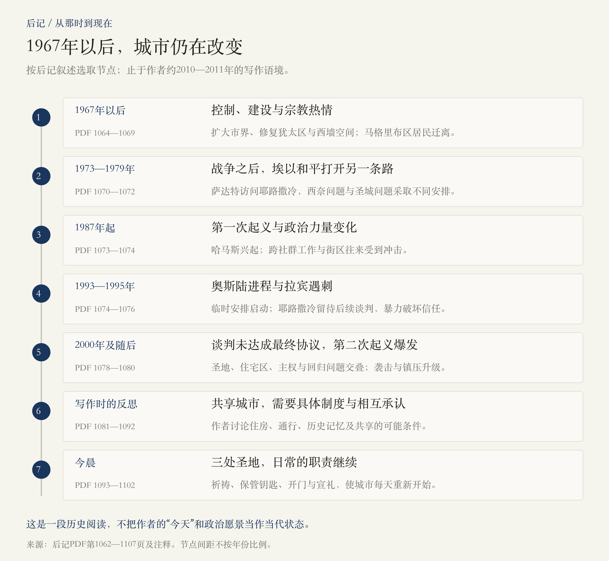

# 后记 · 谁拥有圣城，谁打开清晨

> 阅读边界：已读后记题辞、三个小节及全部注释，PDF第1062—1107页，共46页。小节交界页包含前后两节文字，只计一次。历史回顾从1967年延伸至作者约2010—2011年的写作语境；不作当代局势更新。未扩读附录、致谢、译后记，也未补读序幕。

<!-- block: epilogue-core -->
## 01 · 拥有一座城，为什么仍不等于能够共享它？

第九部分止于1967年老城易手，后记接着问：军事控制改变之后，居民是否得到安全，宗教能否并存，城市能否被分享？作者依次写战后的建设与冲突、和平谈判与政治愿景，最后收束到几个普通人的清晨。[PDF第1064—1102页]

  **后记最重要的转折，是把“谁拥有耶路撒冷”展开成几组具体问题：谁能够居住，谁负责管理，谁能够抵达圣地，谁的历史得到承认。**  一条边界或一句“统一”，无法替这些问题逐一作答。它们涉及住房、道路、土地、宗教机构、安全与个人尊严。[PDF第1067—1069、1082—1091页；本段为阅读归纳]

本篇沿用作者的历史截面。后记中的领导人职务、人口、调查、政策及“目前”“至今”，都属于写作当时。尤其“明天”是作者的判断和愿景，不是已经实现的制度，也不是对今天的预测更新。

<!-- block: epilogue-map -->
## 02 · 后记路线：战争之后，谈判之间，黎明之中

后记有三个小节：“耶路撒冷的早晨：从那时到现在”回顾1967年之后；“明天”讨论共享城市的条件；“今晨”写日常仪式。时间线仅帮助定位，最后一段并没有给出精确的采访日期。[PDF第1063—1102页]

<!-- block: epilogue-after-1967 -->
## 03 · 1967年以后：同一场胜利，产生哪些不同力量？

重新抵达西墙，使许多犹太人产生强烈的历史与宗教情感，包括原本世俗的人。作者同时辨认出不同解释：有人把胜利视为安全边界的机会，有人视为救赎进程；部分美国福音派又把它放进基督再临的末世叙事。它们能够共同支持以色列，却不共享同一套信仰目标。[PDF第1064—1067页]

这些是特定群体的观念及作者对它们的解释，不能概括成全体犹太人或全体基督徒的立场。后文西墙拉比明确认为，重建圣殿应属于上帝的事，人不应强行干预；虔诚信仰也可能成为约束激进行动的理由。[PDF第1071—1072、1093—1094页]

以色列政府合并城市、扩大市界，修复犹太区与会堂，建设新的街区和公共空间。西墙前的广场扩大，使犹太人的礼拜环境发生巨大变化；但原有马格里布区房屋被拆，居民迁离，也属于同一过程。  **新空间给谁带来自由，又让谁失去原来的生活位置，需要放在一起阅读。**  [PDF第1067—1069页]

本书对搬迁经过的交代较简略，本篇不从“迁至新居”的措辞推断居民自愿或得到充分安置，也不沿用其有疑问的狭窄通道精确尺寸。城市营建的意义，应由具体居民的经历补足。

<!-- block: epilogue-archaeology -->
## 04 · 考古：发现过去，也在改变现在的居住空间

战后发掘使迦南、犹地亚、希律、罗马、拜占庭、倭玛亚等时期的遗迹进入公共展示。城市的多层历史变得可见，发现也与国家认同、宗教热情和土地使用相互纠缠。[PDF第1067—1068页]

作者后来写到西墙隧道争议，以及瓦克夫在圣地地下施工时对遗存造成的损害。这里至少有三件事：遗址是否受到专业保护，施工信息是否可信，以及不同群体是否担心自己的圣地遭到破坏。传闻能够激发真实恐惧，却不能因此成为关于地下阴谋的证据。[PDF第1076—1078、1104页]

注释还保留了有用的反例：以色列历史学家帮助哈立迪家族维护房屋；以色列考古学家也曾通过诉讼反对相关扩挖。另有学者担心资助者要求考古证明预设的历史主张，而研究者仍坚持根据实际证据辨认遗存。[PDF第1104—1105页]

  **族群身份并不自动决定一个人如何对待证据、邻居或土地。**  可以分别评价研究方法、资金用途与营建后果，才能看见这些跨社群的合作和内部争论。[本段为阅读归纳]

<!-- block: epilogue-war-peace -->
## 05 · 从1973年战争到萨达特来访：政治选择仍能改变道路

作者回顾1967年后武装冲突的扩展，包括针对平民的袭击、国际恐怖行动，以及1973年埃叙对以色列的突袭。它们改变了安全感和地区力量关系。不同组织的行动需要分别归责；政治诉求受到关注，不能抵销杀害平民的责任。[PDF第1069—1070页]

1977年萨达特访问耶路撒冷，随后埃以谈判及西奈安排，为和平打开另一条路。贝京在领土问题上作出重大选择，同时坚持耶路撒冷不可分割，并推进城市周边建设。这提醒我们：  **一个领导人在某条边界上接受妥协，不代表他在所有问题上都接受同样的原则。**  [PDF第1070—1071页]

此后，萨达特遇刺、黎巴嫩战争与难民营屠杀，又让希望遭受打击。书中区分实施萨布拉、夏蒂拉屠杀的基督教民兵，以及沙龙所负的间接责任；本篇保留这一责任层次，不把复杂战争压成单一人物的性格故事。[PDF第1072页]

<!-- block: epilogue-intifada -->
## 06 · 第一次起义，为什么也改变了城市里的日常关系？

1987年起义从加沙蔓延，作者将其视为巴勒斯坦政治动员及国际形象的重要变化；哈马斯的兴起，又使政治组织、宗教动员和原有巴解领导层之间出现新的竞争。[PDF第1073页]

科勒克所期待的共同城市生活也受到冲击：居民减少跨社群工作和穿越街区。犹太社群内部的宗教与世俗冲突、基督徒群体的处境，则表明问题不限于犹太人与穆斯林之间的一条分界。[PDF第1073—1074页]

这段与作者童年所记得的互访形成对照。他的个人记忆能够说明一种交往曾经存在，但不是全体居民都自由平等生活的证明；同样，后来关系恶化也不表示每个人都停止帮助对方。[PDF第1069、1073—1074、1104页]

<!-- block: epilogue-negotiation -->
## 07 · 奥斯陆：签下了什么，又把什么留到了以后？

秘密接触、学者交流与政治领导层的参与，推动1993年奥斯陆进程。临时自治安排和双方关系取得变化，耶路撒冷却被留待最终地位谈判。这是一种先建立合作、再解决最困难问题的路径，其成败依赖后续执行与信任增长。[PDF第1074—1075页]

  **历史文件核对** ：1993年《临时自治安排原则宣言》第V条明确将耶路撒冷、难民、定居点、安全安排和边界等列入后续永久地位谈判。因而不能把奥斯陆的签署直接写成“圣城归属已经解决”。[原始文件：联合国收录的原则宣言](https://www.un.org/unispal/document/auto-insert-180015/)

书中另述贝林与阿巴斯讨论统一市政、分区与老城特殊地位等构想，但指出未成为双方正式签署的协议。这与1993年原则宣言是不同层次的材料。[PDF第1075—1076页]

拉宾1995年被犹太极端分子暗杀，哈马斯针对以色列平民的自杀式袭击接踵发生，选举与政策又发生转向。读这一段需要同时看见反对和谈者的暴力、政府选择与尚未落实的制度，才能理解信任如何受到破坏。[PDF第1076页]

<!-- block: epilogue-proposals -->
## 08 · 谈判构想、正式协议与作者愿景，要分开摆放

作者详细叙述2000年戴维营谈判及稍后讨论中的让步与拒绝，涉及住宅区、圣地、地下空间、主权和回归问题。这些叙述包含对阿拉法特动机与失败责任的强烈判断；应作为作者的解释来读，不能将谈判中不同时间的设想拼成一份已经生效的最终协议。[PDF第1078—1079页]

  **谈判状态核对** ：2000年7月25日三方声明确认，各方没有弥合分歧、达成永久地位协议。克林顿同日说明，按谈判规则，全部达成以前不视为达成，因此各方不受峰会讨论过的提议约束。这项核对只界定“有没有协议”，不为全部失败原因作裁决。[三方声明](https://clintonwhitehouse6.archives.gov/2000/07/2000-07-25-trilateral-statement-on-middle-east-peace-talks-at-camp-david.html)；[克林顿同日讲话](https://clintonwhitehouse4.archives.gov/library/hot_releases/July_25_2000_3.html)

到了“明天”，作者讨论两国共享首都、老城特殊制度、共同或国际巡逻等可能方式。这是他在写作时所支持的方向及设想，文本中的未来时态并不表示制度后来按此实行。[PDF第1088—1090页]

<!-- block: epilogue-second-uprising -->
## 09 · 第二次起义与隔离：安全的恢复，伴随哪些生活成本？

2000年沙龙访问圣殿山后，骚乱升级为第二次起义；作者随后描述法塔赫及哈马斯武装针对平民的袭击、以色列军事行动、阿拉法特去世，以及巴勒斯坦内部的分裂。书中叙述压缩了若干过程，本篇不把不同组织、选举和后续武装冲突归并成同一次事件。[PDF第1079—1080页]

隔离设施在书中具有两种同时存在的后果：作者强调其阻止袭击的安全作用，也写到它使西岸巴勒斯坦人前往耶路撒冷教堂和清真寺更加困难。不能用安全效果替代对通行成本的考察，也不能用设施的外观评价替代效果证据。本篇保留作者的评价，未另做统计或因果验证。[PDF第1080、1084页]

城市中还有住宅区之间的恐惧、宗教与世俗生活方式的冲突、基督教派间的争执。能够一起出现在城市里，与愿意进入彼此的日常、信任对方，是不同程度的共处。[PDF第1080—1085页]

<!-- block: epilogue-layers -->
## 10 · “共享耶路撒冷”，究竟需要共享哪些东西？

作者一方面承认犹太人与穆斯林的历史联系，另一方面批评强制搬迁、定居点扩张及阿拉伯区住房与服务需求被忽略的处境。他并未主张所有犹太建筑和修缮都具有同一种动机；评价应落到具体土地、居民待遇和项目后果。[PDF第1081—1084页]

他还指出，原则上的礼拜自由与实际到达圣地的能力可能相差很大。检查、许可、隔离与地理条件，使同一句权利宣示落在不同居民身上时产生不同结果。[PDF第1083—1084页]

共享方案因此至少需要回答四组问题：

1.  **居住与公共服务** ：谁能保有住房，谁能够建房，资源如何分配？
2.  **政治与市政** ：谁行使主权，谁提供管理和安全，如何执行及处理争端？
3.  **宗教与进入** ：谁管理场所，谁能进入、在何处礼拜，日常如何协调？
4.  **历史与信任** ：能否承认对方的遗产、现代创伤及对安全和尊严的要求？

以上四层为阅读归纳，依据PDF第1082—1091页。作者提出承认彼此历史的重要性，并不意味着情感上的谅解能够替代住房、公平服务、实际权利和执行机制。

<!-- block: epilogue-author -->
## 11 · 作者最后想反驳的，是怎样一种历史讲法？

作者拒绝把任何一个民族的历史写成一路通向预定胜利、灾难则全由他者造成的故事。他提醒，身份与选择始终复杂，许多道路在当时并非不可想象。关于谁否认谁的历史、谁有勇气公开承认对方，本书也有强烈而概括的评论；这些评论不等于对整个群体完成了证据审查。[PDF第1090—1092页]

城市的变化也有两种速度：战争、兵器和政治革命造成突变，家庭、诗歌、礼仪与世代相传的工作则缓慢积累。后记接下来写清晨，正是在给第二种速度留下位置。[PDF第1092—1093页]

  **承认别人的历史，不必取消自己的历史；承认自己的神圣记忆，也不能直接证明自己应独占他人的生活空间。**  这是本篇从作者收束中提炼的阅读理解，不是原书原句。[PDF第1082—1092页；阅读归纳]

<!-- block: epilogue-morning -->
## 12 · 今晨：三处圣地，由谁让日常继续？

 **西墙** ：拉比拉宾诺维茨走向祈祷群体，按惯常仪式开始一天，也负责祈愿纸条的清理。他对神圣的敬畏与拒绝人为破坏圣殿山并存。守护不只有扩张一种表达，也可以表现为给行动设定边界。[PDF第1093—1094页]

 **圣墓大教堂** ：穆斯林朱达家族保管钥匙，努赛贝家族负责开门。教堂内部的不同基督教派依约轮流举行礼仪，外部门锁的工作则由另一信仰的家族承担。这是具体的职责分配和长期惯例，不依赖所有人先消除分歧。[PDF第1095—1099页]

作者也没有把守门故事写成无冲突的和谐寓言：教派会争执，两个穆斯林家族也竞争荣誉与职责。家族把职位追溯到欧麦尔、萨拉丁的说法，其中包含他们自身的传统与身份叙述，不能都当作已经逐项证实的连续任职档案。[PDF第1096—1099页]

 **谢里夫圣地／圣殿山** ：安萨里或其团队打开岩石圆顶清真寺和阿克萨清真寺的门；卡扎兹家族的宣礼吏另行准备，以麦克风宣礼。作者写到兼职、收入和设备变化，神圣责任仍然是一份需要准时履行的工作。[PDF第1099—1102页]

三处圣地并行苏醒，不表示主权、宗教和社会争端已经解决。它表明在宏大政治之外，城市还依赖钥匙、时间表、清洁、训练、家族职责与每日重复的行动延续。[PDF第1093—1102页；本段为阅读归纳]

<!-- block: epilogue-closing -->
## 13 · 合上书后，可以留下什么理解？

这本书以黎明结束：不同信仰的人各自祈祷，同一束阳光照过城墙、清真寺和城门。作者将难以在政治地图上整齐切分的圣地，重新交还给具体空间与日常生活；金门仍紧闭，是结尾保留的宗教意象，不是关于未来事件的事实预告。[PDF第1102页]

从这次后记可以留下三条理解：  **把控制与共享分开，把历史联系与具体权利分开，把愿景与已经落实的安排分开。**  再去看人物与制度，就能同时问：他希望保护什么，实际改变了什么，代价落在谁身上？[依据本篇所列页段的阅读归纳]

如果继续追问，可以选“奥斯陆为什么延后耶路撒冷问题”“考古怎样进入住房与土地争端”，或“圣墓大教堂为何由穆斯林家族开门”。都可以在对应模块补充，保留现有笔记结构。

<!-- block: epilogue-sources -->
## 14 · 阅读范围与本次进度

本次完整阅读后记PDF第1062—1107页，共46页。小节起点分别为1063、1081、1093页，注释从1102页延续至1107页；题辞及交界页已全部读入。元数据按互不重叠页段记录，以免重复计算。

外部资料只核对1993年原则宣言对耶路撒冷问题的延后安排，以及2000年戴维营谈判未达成永久协议的状态；原始文件链接已放在对应段落。没有以今天的变化改写作者当时的政治判断。

书架进度现为“九部分正文与后记已整理”。序幕PDF第40—59页尚未单独精读，附录、致谢与译后记不在本次范围，因此不将整份PDF标记为逐页读完。前九部分的笔记继续保留各自的历史阅读边界。
