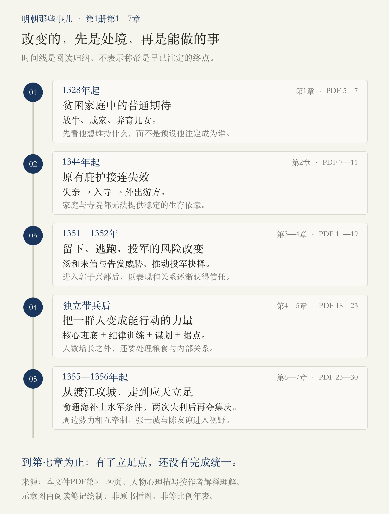
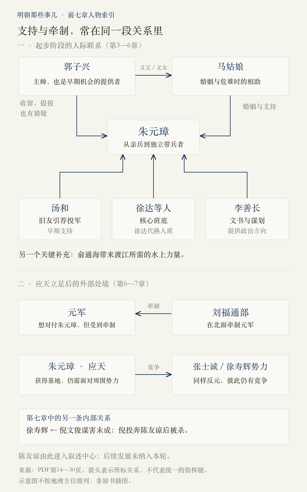

# 第1册·第1—7章：一个人怎样获得立足之地

> 阅读边界：依据本文件第1册第一章《童年》至第七章《可怕的对手》，PDF物理第5—30页。目录第2页、前言与引子第3—4页用于定位及理解写法；另查看第31页确认第八章起点，未纳入其内容。以下是原书阅读蒸馏，没有另作史料考证；人物心理与价值判断会说明归属。

<!-- block: central-thread -->
## 01 · 前七章，真正发生的变化是什么

**朱元璋先失去维持生活的依靠，随后才逐步获得独立行动所需的人、组织和地盘。** 从放牛、入寺到投军，问题首先是怎样活下去；从郭子兴的亲兵到拥有独立部队，问题变为怎样带人、处理关系；夺取应天后，问题再变为怎样在多方势力之间立足。[第1—6章，PDF第5—25页]

这条主线是我们的阅读归纳。它提醒我们：不要把后来称帝的结果倒推成每一步都早有计划。第三章的朱元璋还在犹豫是否投军，第六章的他也曾连续攻城失败。作者虽然不断预告人物的未来，故事当时的行动条件却在变化。[第3章，第13—15页；第6章，第24页]

<!-- block: chapter-01 -->
## 02 · 第一章《童年》：先还原一个普通人的生活期待

这一章用一份带有现代口吻的“人物档案”开场，再把朱重八放回贫困农家的生活：父亲靠劳动维持一家生计，他给地主放牛，没有正常接受教育的条件。他起初所期待的，是成年、成家，再让儿女继续生活下去。[PDF第5—7页]

**理解重点：在成为历史人物之前，他首先是一个生活选择非常有限的人。** 这让接下来的灾难有了重量：被打断的是具体的家庭生活，而不只是“英雄受难”的一个情节。

作者把朱元璋出生时的异光，与历代皇帝出世的祥瑞叙事放在一起讲。这里应读成作者转述并调侃的传统记载，不把神异现象当成已证实的事实。开头的口语档案、后人的结局预告，也属于叙述安排。[PDF第5—6页]

可继续追问：如果暂时不知道他后来当皇帝，这一章里哪些处境，才是我们最先会注意到的？

<!-- block: chapter-02 -->
## 03 · 第二章《灾难》：不是遇到一次挫折，而是庇护接连失效

1344年的水旱与疫病背景下，朱重八接连失去父亲、大哥、侄子和母亲；连安葬家人，也受制于土地与财物。他进入皇觉寺，首先为了获得食宿；寺院随后因饥荒遣僧外出，他又开始在淮西、河南一带游方讨食。[PDF第7—10页]

这段可以看成连续的生存压力：**家里不能维持生活，入寺不能保证稳定食宿，外出又要面对饥饿、拒绝与羞辱。** 原先的依靠一层层变薄，而不是苦难一来，人就自动获得了力量。

作者将三年游方写成转变：朱重八熟悉地方、接触人群，也逐渐形成应对困境的意志。这是原书解释人物成长的重要环节，但“内心在某夜彻底变强”等描写，带有作者的心理重建；不能据此推出受苦必然使人成长的普遍规律。[PDF第10—11页]

可继续追问：这段经历中，哪些是精神上的变化，哪些是后来可能用得上的具体见识？

<!-- block: chapter-03 -->
## 04 · 第三章《踏上征途》：留下来，也开始变得危险

作者把1351年的治河徭役、官吏盘剥与韩山童、刘福通起义连接起来。起义扩散后，朱重八并没有立即参军；他知道造反可能丢掉性命。另一面，官军抓普通百姓冒充起义者交差，又使寺院中的生活不再安全。[PDF第11—14页]

汤和来信招他投军，他先烧信、继续犹豫；当师兄告知有人准备告发他，局面才进一步收紧。书中写他在留下、逃跑、造反之间求卦，最终决定投军。[PDF第14—15页]

**关键不是忽然不怕死，而是每个选项的风险都变了。** 这也解释了作者为何反对把他写成毫不犹豫的“天生英雄”：作者欣赏的是明知危险仍作出选择的勇气。[PDF第13—15页]

“石人一只眼”的故事与占卜，应理解为本书叙述的动员、信仰和决策语境，不能拿来证明天命。作者对农民起义的整体肯定，也是他在本章表达的历史评价。[PDF第12、14—15页]

<!-- block: chapter-04 -->
## 05 · 第四章《就从这里起步》：被看见，还不等于能独立

1352年，朱重八进入濠州郭子兴的队伍。他从险些被当作奸细处死，到成为亲兵、获得带兵职位，靠的是书中反复描写的冷静、作战表现、谋划能力，以及把战利品交给主帅、把赏赐分给士兵的做法。汤和的介绍提供了入口，但他仍须在组织中建立声望。[PDF第15—17页]

马姑娘作为郭子兴义女，与朱元璋成婚，使他获得新的家庭联系。她在其被关押时送食的故事，又体现了这种关系在危急时刻的实际支撑。与此同时，郭子兴与孙德崖等人的矛盾、郭家内部对朱元璋的猜疑，说明**身处一个组织，也可能被组织内的争斗牵制**。[PDF第17—18页]

朱元璋决定带兵外出，随后从已有部众中挑出二十四人，迈向独立行动。这一步的意义，不在于人数突然壮大，而在于开始建立自己选择、自己带领的核心班底。[PDF第18—19页]

注意：郭子兴等人的对白、朱元璋当时的心情，以及姓名寓意的解释，均按原书叙述理解，不作为我们独立核实过的细节。

<!-- block: chapter-05 -->
## 06 · 第五章《储蓄资本》：怎样把人数变成组织能力

本章的“资本”，首先是部众、人才、纪律与可以立足的地方。朱元璋吸收张家堡的武装，夜袭并收编缪大亨的部队；扩充人数后，他强调训练与纪律。原书也没有把这些扩张都写成自愿合作：挟制寨主、武力进攻，同样是其中的手段。[PDF第19—20页]

冯国用、冯国胜等人加入，李善长从文书进入谋划核心，滁州成为可用的据点。李善长以刘邦作类比，帮助朱元璋把眼前的征战放进更大的政治目标之中。[PDF第21页]

**这一章最值得记住的，是资源之间要能彼此配合。** 更多士兵需要纪律与粮食；地盘要能够维持队伍；谋士与将领补足不同能力。把人数加起来，不等于已经形成一支可靠的力量。这是根据本章事件作出的归纳。

但组织壮大并没有消除关系约束。郭子兴来到滁州后，朱元璋仍以旧部和女婿的身份对待他；到了和州，郭、孙两方冲突使朱元璋被扣，最后靠徐达自愿交换人质才解围。郭子兴去世，才使这一层制约发生变化。[PDF第22—23页]

作者把让位解释为知恩、不以暴力逞强。我们可以同时看见它在关系上的作用，但不能因此断言朱元璋每一步都在实施一套隐藏的长远计划。

<!-- block: chapter-06 -->
## 07 · 第六章《霸业的开始》：有基地，才有更大的行动空间

和州难以承载更大的发展，朱元璋转向长江对岸的集庆。作者先写“龙蟠虎踞”的风水说法，又具体说明当地的粮食、商业、水运与地势条件。阅读时应把文化想象与实际资源分开：解释战略价值，不能只停在“王气”。[PDF第23—24页]

渡江需要船，俞通海的加入补上水上力量；1355年两次攻城失败后，朱元璋于1356年再攻集庆，夺城并改为应天。这个过程让我们看到，**目标重要，并不能替代完成目标所需的工具与组织能力**。[PDF第24页]

占据应天也没有立即取得优势：周围有元军、张士诚、徐寿辉等势力。作者指出，各方尚未集中对付他，而北面的刘福通部牵制元军，为他留下了活动空间。弱小处境中的机会，来自周边力量的相互牵制。[PDF第25页]

这仍是一段尚未完成的事业。到本章结束，朱元璋有了更好的立足点，距离统一局面还很远。

<!-- block: relationships -->
## 08 · 把人放回关系里，故事就不容易混乱

图分两个层次：上半部是朱元璋起步时的引荐、婚姻、上下级和团队联系；下半部是第六、七章出现的外部竞争。**同样参加反元，并不意味着彼此服从；同样在一支队伍里，也不意味着利益一致。**[第4—7章，PDF第15—30页]

几个人名可以这样区分：

| 人物 | 本轮先记住什么 |
| --- | --- |
| 汤和 | 旧友、投军引荐者，也是早期支持者。 |
| 郭子兴 | 提供起步机会的主帅、马姑娘的义父，同时也会猜疑、牵制朱元璋。 |
| 马姑娘 | 新家庭的支撑，在关押事件中帮助朱元璋。 |
| 徐达 | 二十四人班底中的成员，在人质危机中主动代换朱元璋。 |
| 李善长 | 从文书工作进入政治谋划，提出以刘邦为参照的方向。 |
| 刘福通 | 北面牵制元军的义军力量；与郭子兴、朱元璋的关系不能混为一条简单指挥链。 |
| 徐寿辉、倪文俊、陈友谅 | 另一支力量中的领袖、重臣与后来上升者，内部关系正发生激烈变化。 |

[第3—7章，PDF第14—30页]

<!-- block: chapter-07 -->
## 09 · 第七章《可怕的对手》：勇气、宽厚与权力手段，不能混成一种能力

**张士诚这一线，作者用“守得住危险，却未必继续扩张”来刻画。** 私盐生意给他带来人脉，也把他放在与官方冲突的处境中。高邮危局里，他和部众坚持抵抗，直到脱脱因元廷内部问题撤军。原书强调，他既碰上外部转机，也必须先撑到转机出现。[PDF第25—27页]

占据江浙富庶地区后，作者说张士诚趋于满足，并将其宽大待人与缺乏更大志向并写。这是作者的人物评价；“元军百万且为实数”等具体兵力断言，本轮没有另行考证，不把它作为我们分析的必要前提。[PDF第26—27页]

**陈友谅这一线，重点是他怎样处理地位与忠诚。** 书中先交代徐寿辉的起兵、天完政权和部将，再写倪文俊谋害徐寿辉不成，逃到自己信任、提拔过的陈友谅处。陈友谅探明其他将领仍支持徐寿辉，随即杀死倪文俊，将其首级送回汉阳。[PDF第27—30页]

作者用渔民出身、受歧视与向上攀登的欲望来解释陈友谅，尤其强调他把权位置于旧日恩义之上。这是本书对其心理的解释，不能泛化成某种出身必然导致某种性格。[PDF第29—30页]

读到这里，最有用的比较是：**善于动员、坚持战斗、善待别人、组织军队、争取权位，是不同的能力，也可能互相冲突。** 我们目前只能提出这个比较，不能用未读的后续战事给人物提前判定胜负。

本章止于汉阳收到倪文俊首级。后续清除部将、进攻朱元璋等事件属于第八章，本篇不展开。

<!-- block: synthesis-and-questions -->
## 10 · 读完七章，可以带走什么

以下是助手归纳，不是原书给出的固定公式：

1. **选择取决于处境。** 留在寺院本来相对安全，告发与滥杀改变了风险，投军才成为不同意义上的选择。[第3章，PDF第13—15页]
2. **个人表现需要转化为可合作的关系。** 介绍、信任、分配、婚姻和共同冒险，帮助朱元璋取得支持，也带来约束。[第4—5章，第15—23页]
3. **可持续的力量要有多种条件。** 人、训练、粮食、谋划、交通与基地，不能只靠一项替代其余各项。[第5—6章，第19—25页]
4. **机会并非全由自己创造。** 元廷内部的变化、各方相互牵制，也会影响一个人能够做到什么。[第6—7章，第25—27页]

这些线索有助于理解本段历史叙述，不是把古代战争与强制手段直接套用到今天生活中的方法。

适合继续追问的方向：

- 朱元璋同样经历贫困，为什么作者把他与陈友谅写成不同的人？哪些依据扎实，哪些只是心理解释？
- 郭子兴既帮助又压制朱元璋，应该怎样理解这段关系？
- 李善长、徐达与俞通海的加入，分别解决了什么不同问题？
- “能打的不想打，想打的不能打”，在应天的处境中具体指什么？

你的理解可以在后续追问中单独保存，不以这份归纳代替。

<!-- block: provenance -->
## 来源与更新记录

- 底本：用户新指定的《[明朝那些事儿]全七本精编.当年明月 .pdf》，共1918页。未使用此前1996页版本。
- 实际正文阅读：第1册第1—7章，PDF第5—30页；章界依次为5、7、11、15、19、23、25页，第八章始于31页。
- 额外查看：封面第1页，目录第2页，前言与引子第3—4页；第31页用于确认章界，阅读时看到了该页第八章开头，但其内容没有编入本篇。
- 原书正文页码在本段约为3—28，目录另有页码口径，不能直接替代PDF物理页码；本篇引用一律用后者。
- 两张图是根据本轮已读内容制作的辅助图，不是原书插图；时间轴不按年数比例，关系图不表示地理位置。
- 阅读进度仅到第七章。没有总结第八章及以后的正文，也未核验全文件与正版的一致性。
- 关联入口：[返回开卷导读](#/read/ming-dynasty-overview)。
- 2026-10-26：v1，完成前七章图文蒸馏。笔记ID与模块ID保持稳定，供后续追问和局部修改使用。
