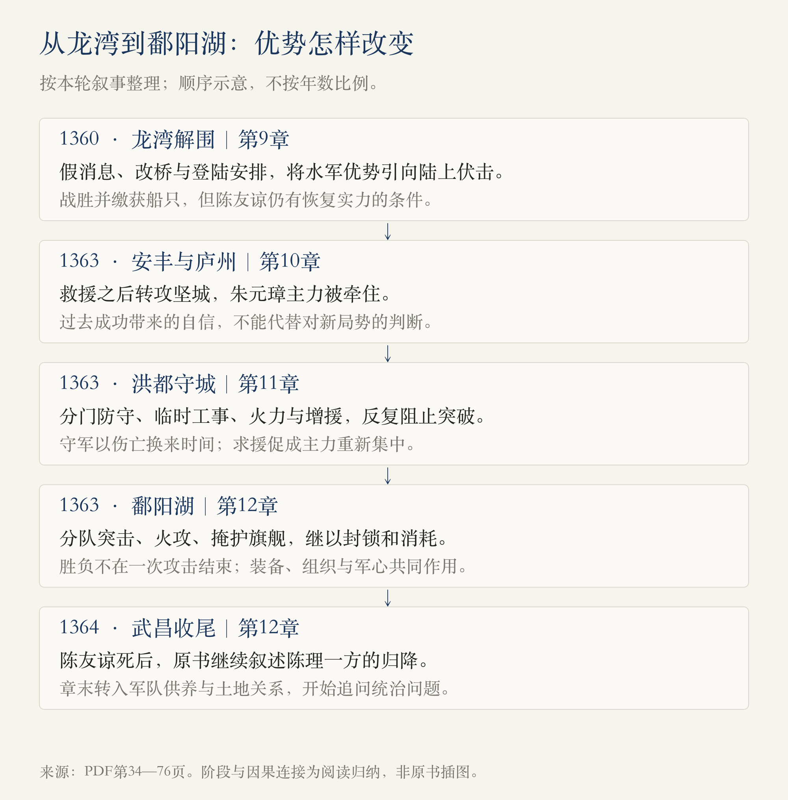
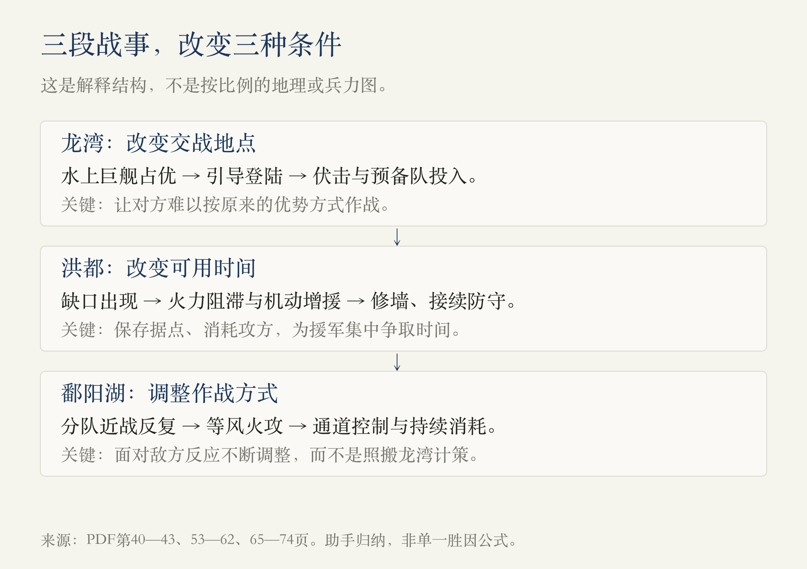

# 第1册·第8—12章：怎样把险局变成胜局

> 阅读边界：本文件第1册第八至十二章，PDF物理第31—76页；第76页只纳入第十二章末尾的土地制度讨论，第十三章标题及正文不纳入。依据原书蒸馏，未另作史料校勘。心理描写、传说、数字和助手归纳分开说明。

<!-- block: campaign-thread -->
## 01 · 不只是一场以少胜多的水战

上一轮读到朱元璋在应天立足，陈友谅开始进入叙述中心。本轮的问题变成：**在对手水军更强、自己也会误判的情况下，怎样保住行动空间，并把战争拖进对自己更有利的条件？**

这不是一条不断获胜的直线。1360年的龙湾战术不能原样复制到1363年的鄱阳湖；朱元璋救援安丰、转攻庐州，也使自己的部署陷入危险。洪都守军争取的时间，和水战中的反复调整，共同影响了最后的结果。[第9—12章，PDF第34—76页]

这张图是阅读归纳，时间不按比例；图中的“争取时间”不意味着每个后果都在当事人预先安排之中。

<!-- block: chapter-08 -->
## 02 · 第八章《可怕的陈友谅》：夺权能力与合作基础

陈友谅在杀死倪文俊后继续集中权力：赵普胜被除掉，部分将领离开，徐寿辉逐渐失去实权；1360年，徐寿辉被杀，陈友谅称帝，建立汉政权。作者一面承认他的组织和带兵能力，一面突出其不受信义约束的行事方式。[PDF第31—32页]

这里先记住一个区别：**控制了谁，与让谁愿意长期效力，是两件事。** 本章还没证明陈友谅必败，却已经为后面讨论军心埋下伏笔。杀君现场的对白、神态和内心活动，是本书的文学化叙述，不能全部当成直接记录。

叙事随后回到朱元璋与张士诚较早的冲突：谈判不成，徐达、常遇春等人投入作战，常遇春通过采石登岸等战斗证明自己的突击能力。但作者同时写出他的严重问题——杀降。**能打仗，不等于能判断每个行动的整体后果。**[PDF第33—34页]

本章先写1360年的夺权，再回叙1356—1357年前后的冲突，阅读时要留意这次时间折返。

<!-- block: chapter-09 -->
## 03 · 第九章《决战不可避免》：改变战斗发生的条件

作者把朱元璋的战略概括为两项：积累实力、暂缓称王；在张士诚与陈友谅之间优先应对后者。理由不是单看谁更弱，而是判断攻击一方时，另一方会不会介入，避免陷入两线作战。[PDF第34—35页]

常遇春杀俘并挑衅，成为本书解释冲突升级的一个环节。陈友谅沿江推进，采石、太平失守，应天受威胁。刘基反对放弃应天，支持诱敌深入、伏兵作战。朱元璋最终也没有选择立即夺回太平或主动到水上硬拼，而是把决战地点放在龙湾。[PDF第35—40页]

**龙湾计划的关键，是让强大的舰队不能按自己最舒服的方式作战。** 康茂才传递假消息，江东桥由木桥改为石桥，使陈友谅预期的通行和接应落空；龙湾方向的安排又诱导其登陆。埋伏、预备队、旗号与发动时机，共同构成作战计划，不能只归功于一句“用计”。[PDF第40—43页]

战斗中，登陆部队遭到攻击，退潮又妨碍部分船只撤退。朱元璋取得胜利并缴获船只，为后来的水战增加了条件；但这并没有消灭陈友谅的力量。[PDF第43—44页]

章末还有朱元璋微服入寺、拔剑质问住持与题诗的故事。它承担了作者对空谈与行动的态度表达；本轮将它作为原书轶事阅读，不以故事对白证明朱元璋真实的全部思想。[PDF第44—46页]

<!-- block: chapter-10 -->
## 04 · 第十章《等待最好的时机》：胜过一次，不等于以后都判断正确

龙湾战败后，陈友谅继续发展大型战船。作者把这种硬实力，与他杀害旧部后逐渐流失的信任并置：船更强，并不代表组织里的合作意愿也更强。[PDF第46—48页]

1363年，张士诚进攻安丰，韩林儿、刘福通求援。朱元璋主张救援，既考虑名义上的君臣、义军关系，也担心门户失守；刘基则指出应天可能被陈友谅乘虚攻击，且救出韩林儿后如何安置也是问题。朱元璋仍出兵，原书叙述的结果是刘福通战死、韩林儿获救。[PDF第48—50页]

更严重的转折在随后：朱元璋因张军骚扰，决定转攻坚固的庐州，徐达反对也未能阻止。作者将此写成愤怒与此前成功经验影响判断的时刻。这里不宜只记“坚持己见才能胜利”：**第九章赞扬坚持，第十章却展示了坚持错误判断的代价。应比较理由和条件，而非单纯赞美自信。**[PDF第49—51页]

陈友谅此时大规模动员，准备进攻。原书把他的等待写成圈套，也大量重建其心中盘算；“他从头到尾都安排好了什么”应保留为作者解释，不把心理描写等同于已核实的计划文件。

<!-- block: chapter-11 -->
## 05 · 第十一章《洪都的奇迹》：守城是在争取什么

陈友谅没有直接进攻应天，而先攻洪都。作者同时提出两类理由：洪都的基地、进退价值，以及陈友谅对背叛的愤怒。前者属于战略分析，后者属于心理解释，不能只用后者解释全部军事行动。[PDF第51—53页]

守将朱文正此前的放纵形象，与危机中的布防能力形成反差。邓愈、赵德胜、薛显等人分守各门，朱文正保留机动兵力，哪里出现危局就组织增援。**守住洪都，并不是城墙从未被突破，而是突破以后仍能组织恢复。**[PDF第53—56页]

几个细节比“意志坚强”更具体：

- 抚州门出现缺口，邓愈使用火铳阻滞，搭木栏临时防守，再争取修墙时间。
- 新城门方向，薛显乘对方准备攻城器械时出击，打乱其进攻节奏。
- 水关防守针对狭窄通道调整器械与办法；将领伤亡后仍有人接替指挥。

这些环节说明火力、工事、机动增援与指挥接续如何结合，而非单靠某个人的勇猛。[PDF第55—58页]

当抵抗接近极限，朱文正派张子明求援。张子明向朱元璋说明敌军久攻、消耗的情况，回程被捕，却在城下传递援军将至的信息，随后被杀。原书借此对照暴力威逼与人的坚持；张子明与陈友谅的具体神态、内心变化仍属作者的叙述方式。[PDF第59—60页]

朱元璋调回徐达，组织援军、封锁通道；陈友谅撤离洪都，转向鄱阳湖。**洪都的意义是保存据点、消耗攻方、为主力重新集中争取时间。** 这份归纳不能遮蔽守军真实的伤亡，也不能把朱元璋前面的失策写成早就计划好的诱敌。[PDF第61—64页]

<!-- block: battle-mechanics -->
## 06 · 两次战役，不能套同一种答案

图将三段战事归纳为不同条件的变化，不是说其中只存在一个胜因。龙湾利用登陆与伏击；洪都靠持续组织防守拖延；鄱阳湖则必须面对舰队本身，反复调整作战方式。[PDF第40—43、53—62、65—74页]

<!-- block: chapter-12 -->
## 07 · 第十二章《鄱阳湖！决死战！》：胜利是反复调整的结果

面对巨舰，朱元璋一方尝试发挥小船机动性：徐达等人分队接近，使用火枪、弩箭与登船战斗。初期取得战果，对方也组织反击，徐达座舰受损，战局重新陷入艰难。[PDF第65—66页]

张定边突击朱元璋旗舰，使主帅遭遇直接危险，常遇春射中张定边后才缓解危局。随后陈友谅连结战船，增强集群作战效果，却也增加了遭火攻时难以脱离的风险。丁普郎的冲锋则被作者写为义气驱动的支撑，与张定边针对目标、抓住空隙的突击作比较。[PDF第66—70页]

郭兴提出火攻，火船准备好后仍须等待风向；起风才使计划能够实施。这里既有主动准备，也有不能完全控制的条件，不能把风简单算成某位将领的能力。**“选择时机”必须包括有条件可用，也有力量撑到那个时刻。**[PDF第70—71页]

火攻后也没有马上结束战争。朱元璋一方将多艘船刷白，削弱敌人凭白色识别旗舰的办法；后续退守、封锁与逃亡继续发生。本书将双方不同的俘虏政策，与陈军信任瓦解联系起来。最后陈友谅突围时中箭身亡，张定边带陈理与遗体返回武昌；本章还写到1364年武昌的归降收尾。[PDF第72—75页]

因此，这一章至少有三层：舰船和战法的适应，主帅与指挥体系的存续，以及持续消耗中的军心变化。作者特别强调信义，但本书同时叙述了火攻、风向、封锁、兵力调度和偶发伤亡，不能用单一的道德解释替代全部过程。

<!-- block: land-and-evidence -->
## 08 · 战争结束后，为什么突然谈地主

第十二章末尾没有只停在陈友谅之死。作者提出：原本反抗地主的起义领袖，为什么后来又成为土地和租赋的控制者？其通俗解释是，军队需要持续吃饭，抢掠不能无限维持，占领土地以后便要恢复耕种、组织供给并收取租赋。[PDF第75—76页]

**我们的阅读归纳：夺取地盘之后，供养组织的方式会改变领袖与土地、农民的关系。** 这一问题把前面的战争与后续统治连接起来。

但作者关于农民、地主“别无选择”及历代起义的概括，是一种高度简化的制度解释，本轮没有用其他史料验证，不应直接当作全部历史的定律。

本轮还需保留这些证据边界：

| 原书怎样写 | 本篇怎样理解 |
| --- | --- |
| 反复使用六十万、二十万等兵力数字，并自行估算舰船载员 | 作为原书说法；作者承认人数有争论，不把精确比例当作已核实数据。 |
| 人物临战的恐惧、报复心、独白和长篇对话 | 属于作者心理重建与文学呈现。 |
| 丁普郎身死的不同记录 | 作者本人存疑，本篇保留分歧，不确认神异细节。 |
| “猪见糠”的胜败解释、张定边晚年寿数等 | 按民间解释或原书人物轶事处理，不作本篇论证基础。 |
| 本文件部分段落把元代纪年写成“至元”并混写汉、吴国号 | 引用时优先注明公元年和PDF页码，不据此自行编出更精确年表；本轮未做逐条校勘。 |

[数字，第54、61页；丁普郎，第70页；民间解释与晚年轶事，第74—75页；纪年与国号例，第47—51页]

<!-- block: questions-and-source -->
## 09 · 留给下一次追问

- 同样“坚持己见”，为什么龙湾的决断与庐州的执拗，得到不同评价？
- 洪都若只说成朱文正的个人奇迹，会漏掉哪些组织条件？
- 舰队、风向、通道和军心，各自在鄱阳湖之战的哪个阶段起作用？
- 作者关于军队供养与土地关系的解释，解决了什么，又简化了什么？

[回看前七章](#/read/ming-dynasty-chapters-01-07) · [返回开卷导读](#/read/ming-dynasty-overview)

来源记录：用户指定的1918页合并PDF。第八章31—34页；第九章34—46页；第十章46—51页；第十一章51—64页；第十二章65—76页，末页止于第十三章标题前。为核对末界，看到了同页第十三章开头，未纳入蒸馏。两图均为助手依据已读范围制作的解释图，非原书插图。2026-10-30：v1，阅读进度更新到第十二章。
