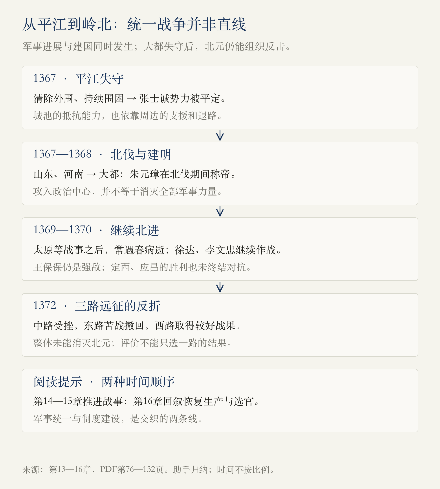
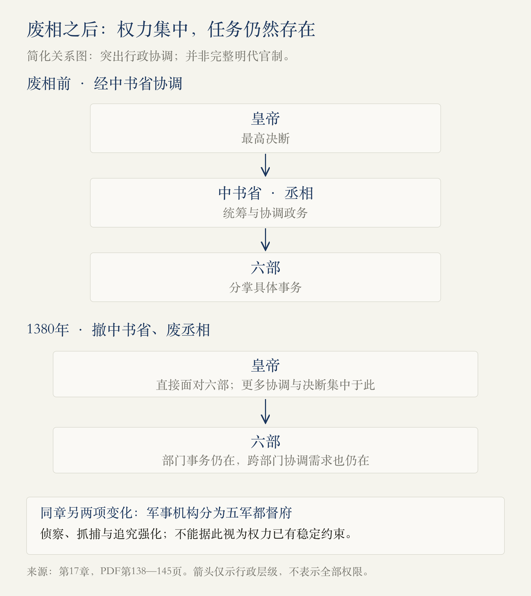

# 第1册·第13—17章：打下天下以后，怎样分配权力

> 阅读边界：用户指定的1918页PDF，第1册第十三至十七章，物理第76—153页。首页从第十三章标题起，末页止于第十八章标题前。依据原书蒸馏，未另作史料校勘；事件叙述、作者推测与助手归纳分别标明。

<!-- block: conquest-and-rule -->
## 01 · 从扩大地盘，到安排谁来管事

上一轮的主线是怎样战胜陈友谅。这五章把问题向前推了两步：**平定张士诚、攻入大都之后，战争为什么还没结束？建立王朝之后，皇帝为什么又要重组自己依靠的官僚体系？**

两条线相互交织。北伐需要将领、组织、粮饷和判断；建国需要恢复生产、招募官员、分配职权。前者不能只靠勇猛，后者也不能只靠皇帝勤劳。本轮最值得注意的转变，是朱元璋从依赖合作夺取天下，转向越来越担忧掌握权力的合作者。[第13—17章，PDF第76—153页]

图按事件时间组织。原书第十四章先推进到1372年前夕，第十五章写远征，第十六章再回叙建国措施，不能按章节顺序排出一条连续年表。

<!-- block: chapter-13 -->
## 02 · 第十三章《下一个目标，张士诚！》：攻城以前，先改变外围

陈友谅的主要威胁解除后，朱元璋转向张士诚。1364年称吴王，使两位“吴王”并存；作者也讨论了朱元璋称王与韩林儿名义权威的关系。称号在这里既表达实力，也涉及政治名分。[PDF第76—77页]

朱文正的遭遇构成本章的一条暗线。前面守洪都立下大功的人，此时因赏赐、失望以及与张士诚方面的联系而陷入危局；朱元璋亲自处理，马皇后劝阻杀戮。作者把这一事件解释为朱文正性格的结果，也把它与朱元璋加深不信任联系起来。**这些心理和性格解释，应与本书叙述的处置经过分开。** 不能因为已经知道结局，就说一个人的一生从早期性格起便已注定。[PDF第77—79页]

进攻平江时，真正有解释力的是部署次序。徐达、常遇春推进之后，面对直取中心还是先清外围的选择，朱元璋主张先夺取杭州等支援地区，再包围平江。城池不只是城墙，它还依靠周边的兵力、粮食和退路。[PDF第79—80页]

平江准备充分，攻方没有凭一次冲锋解决问题。多面合围、筑台、弓弩与火器压制、持续围困，共同构成攻城过程。到1367年平江失守，张士诚被俘，原书再叙述其拒降与死亡。作者对他的评价有两面：肯定最后的抵抗，同时批评其战略抱负与行动。**欣赏一个人临终的选择，不等于认同他此前所有政治判断。**[PDF第80—82页]

<!-- block: chapter-14 -->
## 03 · 第十四章《复仇》：夺取大都，不等于消灭全部对手

这一章篇幅很长，至少分为三层：宋元往事与文天祥的道德叙事；朱元璋的北伐；将领成长与判断力的讨论。作者以“复仇”把私人苦难、改朝换代与族群冲突连在一起，但这是一种强烈的叙事框架，不能替代对各方具体行动的分析。[PDF第82—95页]

**北伐的核心，是推进次序与敌方力量的分布。** 本书写1367年徐达、常遇春出师，先取山东、河南，再逼大都；1368年朱元璋称帝建明，与这场战争同时发生。元帝北走，大都被攻下，意味着元朝在全国的统治格局发生根本变化，却不意味着所有元军与政治力量当场消失。[PDF第94—97页]

接下来的王保保正是反例。他不是一个用来衬托胜者的无能对手。面对他的行动，徐达没有只追着眼前威胁移动，而是进逼太原，迫使其回援；在等待步军、观察敌营、利用夜袭机会等环节，战局依靠具体判断而变化。常遇春等人的战力也与这些组织和时机条件结合。[PDF第97—102页]

1369年常遇春北进后在归途中病逝。此后兰州、定西方向又出现“围点打援”的局面：王保保围城，援军遭挫；徐达转攻其要地，改变对方的选择。1370年的定西作战中，袭扰、营垒、面对局部突袭时稳定阵脚，以及随后进攻，都是书中呈现的环节。东线李文忠攻入应昌，但对方核心力量仍有逃脱与重组的空间。[PDF第102—106页]

章末的“名将学校”，是作者自创的说明模型，**不是明代真实存在的一套学校课程**。它把理论、实战、冷静、判断、挫折后的恢复与机会放在一起，试图解释为什么能冲锋的人很多，能独当一面的人很少。我们可以借此提问，却不能把它当作经过验证的六步成功公式。[PDF第106—110页]

作者对蒙古军队、人口损失和族群性格有不少概括。读这一部分时，应把军事组织与作战方式的具体描述，同对整个群体的道德标签分开；户口统计的变化也不能未经核查就直接换算成被杀人数。[PDF第84—93页]

<!-- block: chapter-15 -->
## 04 · 第十五章《远征沙漠》：最强的一路，也可能失败

1372年的远征以三路推进：徐达走中路，李文忠走东路，冯胜走西路。作者写出一个与“不断胜利”不同的结果：承担主要任务的中路受挫，东路苦战撤回，西路反而取得较好的战果。**三支军队的不同结果，比一句“明军强、元军弱”更能说明问题。**[PDF第111—115页]

中路的王保保利用退却诱导追击，再与贺宗哲配合反击。徐达的既往战绩没有使他免于误判；危局中的价值转为稳定军队、组织撤退与防御，蓝玉承担掩护。失败与失去指挥能力并不是同一件事。[PDF第111—113页]

李文忠东路轻装深入，遭遇蛮子哈剌章的部队，激战之后还要面对补给困难。进军时的机动优势，可能在深入后变成持续作战的负担。西路傅友德的突进则得到后续兵力配合，取得连续战果。[PDF第113—115页]

本轮归纳是：**战术能力必须放回敌人的反应、行军距离、补给和目标中评价。** 这次远征未能实现消灭北元的目的，不能因西路获胜便把整体写成完成统一；也不能因中路失败便抹掉徐达处理危机的能力。

<!-- block: chapter-16 -->
## 05 · 第十六章《建国》：生产、选官与派系同时出现

第十六章回到王朝怎样运转。战争造成田地荒芜，恢复生产需要招垦、减免和组织劳动力；作者又把江浙重税、商人处境等问题，与朱元璋的政治态度联系起来。这些内容提醒我们，军事胜利之后，统治仍须面对“谁生产、谁纳税、怎样维持支出”。但书中关于重税动机、沈万三和国号来源的说法，不宜一概视为定论。[PDF第116—118页]

选官部分介绍了科举与官僚群体：从地方资格、乡试，到会试、殿试，再到进入官场，读书人获得的是一条晋身路径，考试名次也会影响声望和机会。作者同时指出，同乡、同年、出身和翰林经历，会形成正式品级以外的身份差序。**一张官职表只能告诉我们职位，未必能告诉我们谁愿意支持谁。**[PDF第119—123页]

这里的制度介绍穿插了明代不同阶段的安排，应当作为原书的通俗导览，不能当作洪武建国时一次颁行、始终不变的制度手册。八股文讨论则呈现另一组张力：标准化有利于统一评判，却可能限制表达与思想；能在限制内写出高水平文章，也不等于这种限制没有代价。[PDF第120—123页]

派系冲突以李善长、刘基、杨宪与胡惟庸展开。李善长的行政和后勤功劳，与刘基的谋略作用不同；赏赐、任用与皇帝的信任，又把这种差别转化为政治处境。同乡关系与相互排斥，在作者笔下形成“淮西”和“浙东”两群。它们有助于理解联盟，却不应被当成成员、边界从不变化的正式政党。[PDF第123—132页]

监察官员也有两面：较低品秩可以配合较大的纠察作用，形成对官员的约束；同样的工具也可能被派系用来攻击对手。杨宪得势、失势，胡惟庸上升，刘基退隐又返回，说明“谁压倒谁”始终与皇帝的选择有关。[PDF第124—132页]

刘基病中服用胡惟庸方面医生的药物，后来胡案又出现毒杀指控。**服药经过、后来指控、作者怀疑朱元璋知情，是三个不同层级，不能合并成已经证实的谋杀命令。** 本篇只记录书中如何提出疑点，不替案件下结论。[PDF第131—132页]

<!-- block: power-reorganization -->
## 06 · 废掉一个职位，工作会去哪里

这张图只解释本轮制度问题，不是完整明代官制图。1380年撤中书省、废丞相，使六部直接面对皇帝；军事方面另将大都督府分为五军都督府，侦察和侦办体系则增强皇帝掌握信息与追究官员的能力。[第17章，PDF第138—145页]

**助手归纳：把权力集中起来，与把工作处理好，是相连却不同的目标。** 取消中间职位后，跨部门协调、筛选信息、形成决策这些任务仍然存在；如果主要由皇帝接下，就更依赖他的时间、精力和判断。原书用朱元璋大量批阅公文和茹太素长奏的故事，突出这种负担。[PDF第139—143页]

作者把皇帝与丞相比作拔河，还用后来的内阁说明协调需求会重新寻找载体。这是值得追问的解释，但有两点不能直接照收：其一，君臣之间的职权分工与传统约束，不能直接等同于现代分权制衡；其二，内阁的制度地位、实际影响与丞相并非只差名字。书中对后世内阁权力的概括较强，本轮没有阅读相应后续章节，也未外查验证。[PDF第140—144页]

<!-- block: chapter-17 -->
## 07 · 第十七章《胡惟庸案件》：从个人案件，走到制度重组

胡惟庸得势以后，干预任用、控制奏报并扩展联盟。本书让读者看到：他的权势一方面依靠皇帝任用，另一方面又可能妨碍皇帝直接掌握信息。作者据此提出“先纵容、后消灭，最终针对丞相制度”的解释。**这是由结果回推意图的作者判断，不等于我们已经掌握了朱元璋从一开始就制定的完整计划。**[PDF第133—136页]

胡惟庸之子死亡后擅杀车夫、占城使团未及时奏报、相关官员互相推责，以及涂节的告发，构成原书所叙案件升级的链条。1380年胡惟庸被处死，随后追查不断扩大。刑讯、供出更多“同党”、再次抓人，使案情越查越广；书中的指控不能因为进入供词便自动成为事实。[PDF第137—139页]

这也是为什么不能只把胡案读成皇帝战胜一个权臣。废相改变了行政关系，五军都督府的设置重组军事机构，检校及锦衣卫相关叙述又把注意力引向侦察与办案手段。抓捕越过日常办公程序、逼供形成更多名单，伤害的不只是某个失势者，也影响整个官场如何行动。[PDF第139—145页]

宋濂牵连获罪、马皇后劝阻杀戮等故事，呈现个人劝谏在本书中的作用。马皇后1382年去世后，作者把朱元璋进一步失去约束与此联系起来。她的救人行动是本章的伦理重心；但依赖某位亲近者能否劝住皇帝，终究不同于稳定的制度保障。关于人物临终情绪、长篇对白及皇帝心中所想，应按文学化叙述阅读。[PDF第145—148页]

本章末尾转向官吏的日常处境：俸禄、支出、钞票贬值、附加征收和休假。作者用“火耗”“淋尖踢斛”等例子，解释官员怎样把费用转嫁给百姓；又用海瑞、罗复仁、吴琳等清贫人物作对照。制度压力可以帮助解释行为，却不能直接构成侵夺百姓的正当理由。[PDF第148—153页]

这部分穿插了后代人物和后续时期的货币变化，不能全算在洪武同一年；纸币史、休假天数及各类收入是否合法等强概括，本轮仅作为原书论述记录。下一章将转向肃贪，但本篇止于其标题前，不提前整理后续内容。

<!-- block: evidence-and-questions -->
## 08 · 带着哪些区分继续读

| 容易合并的两件事 | 本轮保留的区别 |
| --- | --- |
| 攻下大都 / 消灭北元 | 政治中心失守以后，军事力量仍可能退却、重组和反攻。 |
| 名将有能力 / 名将不会失败 | 1372年徐达的失利与危机中的组织能力同时存在。 |
| 胡案指控 / 已被独立证实的事实 | 后来供词、刑讯与扩大追究，需要保留证据距离。 |
| 皇帝取消丞相 / 协调工作不再需要 | 职位可以撤销，行政任务仍须由具体的人和机构承担。 |
| 作者的“历史规律” / 可直接预测一切的定律 | 村长比喻、“名将学校”和拔河模型是解释工具，不是必然性证明。 |
| 不同时期的制度故事 / 洪武年间统一的制度切片 | 本书跨时段穿插叙事，读到内阁、海瑞、币值变化时应重新辨认时代。 |

[对应来源：PDF第96—115、119—123、131—153页]

本轮可以继续追问：

- 先清外围再攻平江，与先取山东、河南再逼大都，有什么共同点？又有哪些不同条件？
- 同样把别人当作威胁，战场上的判断与建国后的猜忌，怎样改变合作关系？
- 废相带来的决策集中，能否抵消信息过滤与协调负担增加的代价？
- 如果官员只能依靠额外征收维持衙门运转，怎样区分合理经费与侵夺？原书还缺哪些证据？

[回看第八至十二章](#/read/ming-dynasty-chapters-08-12) · [返回开卷导读](#/read/ming-dynasty-overview)

来源记录：第十三章76—82页；第十四章82—110页；第十五章111—115页；第十六章116—132页；第十七章133—153页。第76页排除第十二章末尾，第153页排除第十八章及其开头；为核对边界看到了同页下一章标题与少量开头。两图由助手依据本轮范围制作，非原书插图，不作为独立史料。2026-10-30：v1，阅读进度更新到第十七章。
