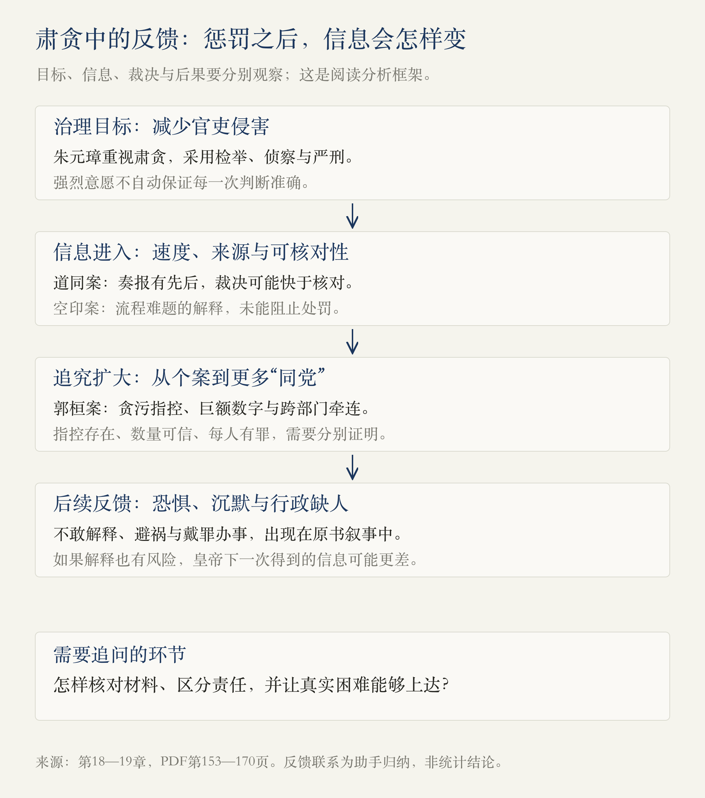
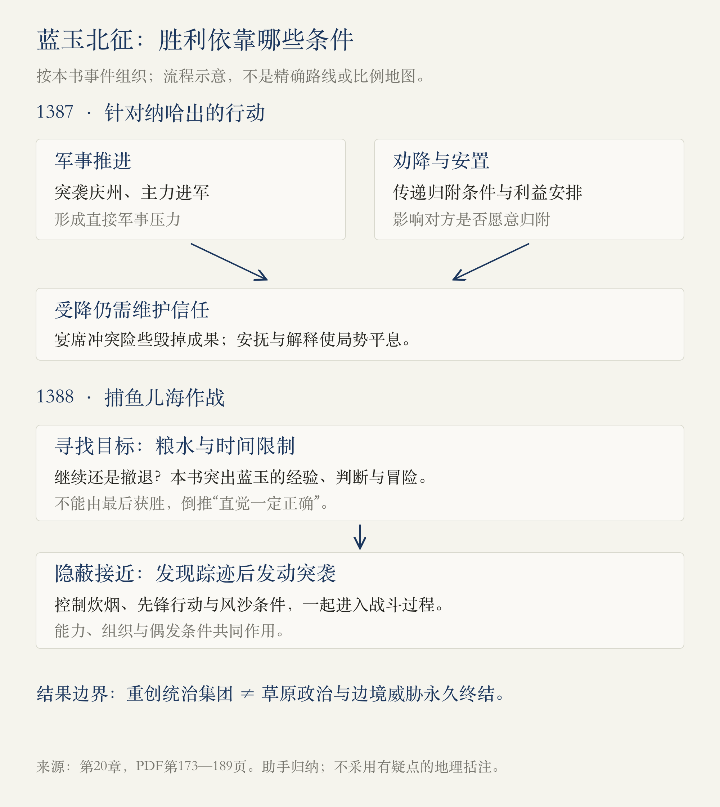
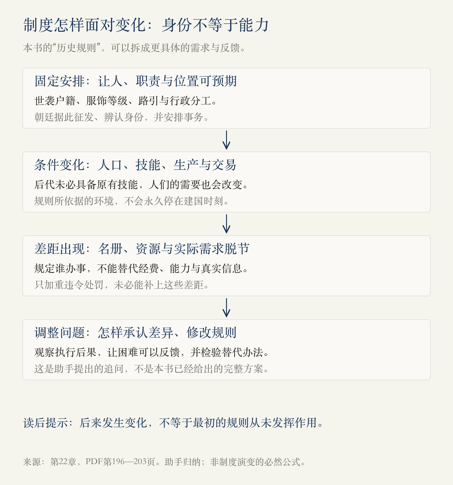

# 第1册·第18—22章：严厉的命令，为什么不能解决一切

> 阅读边界：用户指定的1918页PDF，第1册第十八至二十二章，物理第153—208页；首页从第十八章标题起，末页止于第二十三章标题前。依据原书蒸馏，未另作史料校勘；案卷指控、轶事、作者解释与助手归纳分别说明。

<!-- block: limits-of-control -->
## 01 · 处罚可以加重，问题为什么还在

上一轮读到胡惟庸案与废相，本轮继续追问：**皇帝既有强烈的整顿意愿，也有严厉的惩罚能力，为什么贪污没有就此消失，案件反而不断扩大？** 蓝玉的战功与覆灭，又把这个问题推进到功臣、继承人和皇权安全的关系上。最后，第二十二章把个人行动放回制度：一个人能否替未来的人，把所有问题一次解决？[第18—22章，PDF第153—208页]

本轮不能只读成“朱元璋杀人多”，也不能只读成“他的出发点是好的”。要分别看目标、信息、判断、执行与后果。维护百姓利益的目标，并不会自动使每次惩罚准确；战场上的成功，也不能证明统治中的一切选择合理。

图中的反馈关系是助手据原书归纳的分析路径，不是统计证明，也不表示三个案件的性质相同。

<!-- block: chapter-18 -->
## 02 · 第十八章《扫除一切腐败者》：愿望、威慑与执行的距离

作者把朱元璋憎恨贪官，与少年时受灾、贫困和官府失职的经历联系起来。他希望建立清廉的官场，采用严刑、侦察与民间检举等办法。书中罗列的极端刑罚和处罚门槛，表达的是威慑强度；具体制度的适用范围、执行次数与传闻来源，本轮没有逐项核实。[PDF第153—154、156—158页]

**道同与朱亮祖的故事，让“皇帝关心清官”和“清官得到保护”之间的距离显露出来。** 按本书叙述，道同与地方豪强冲突，朱亮祖收受好处、干预执法，继而先向皇帝告状；朱元璋据先到的奏报下达杀令，道同的申诉到达后，改令已经来不及。后来朱亮祖父子被处死，仍无法挽回道同的生命。[PDF第154—156页]

这里的重要环节不是单纯“坏人最终受罚”，而是：信息到达有先后，权势不同的人有不同的传递能力，裁决又可能快于核对。皇帝最终发现问题，并不等于此前的决策过程能够防止误杀。本书关于快马、现场对白和人物心态的细节，应与故事承担的解释作用分开。

章末写到官员被判罪后仍继续办事的现象，作者用它表现严厉惩处与行政缺人的矛盾。**朝廷不能只问怎样把坏官员移除，还必须回答由谁办事、经费从哪里来、怎样识别责任。**[PDF第157—158页]

本书一面强调贪污反复发生，一面又在后文说洪武时贪污较少，不能据此直接计算肃贪成效；“多人获罪”“实际贪污规模”“是否减少侵害百姓”，是需要不同证据回答的三个问题。

<!-- block: chapter-19 -->
## 03 · 第十九章《冤案》：操作变通、真实侵吞与扩大追究

**空印案先是一个文书流程问题。** 地方官员入京核对钱粮账册，数字不符需要重修，但印章留在原衙门，反复往返耗时很长。于是经办者携带预先盖印的空白文册，在核对后填写。朱元璋发现后震怒，案件扩大。作者明确保留发案时间的分歧：洪武九年与十五年两说，本书采用前者。[PDF第158—159页]

郑士利上书解释文册使用骑缝印、账目需要核对等情况，试图说明这种变通为何形成，结果受到处罚。作者继而推断，朱元璋真正不能容忍的是未经许可使用权力，未必只是没弄懂业务。这是一个关于权威的解释；**我们可以据此提出问题，却不能把作者重建的内心活动当成已经取得的决策记录。**[PDF第160—162页]

空白盖印文册存在被滥用的风险，也不代表所有经办者都已经贪污。应区分流程风险、实际违法和处分对象，不能从“可能作恶”直接跳到“全部同罪”。本书对主印、副职的处分与死亡人数也有保留，不宜照抄“全国官员一扫光”的修辞来充当统计。

**郭桓案则涉及实际贪污指控。** 本书叙述洪武十八年即1385年，御史告发户部与地方官员串通侵吞钱粮，随后追查涉及多个部门、地方经办人和富户。作者没有简单把案件全盘否定，而是质疑两点：指控数量巨大，接近其所说的全年财政收入；同党横跨许多并非直接经办钱粮的部门，范围可疑。[PDF第162—164页]

这也是本轮很重要的一次阅读方法示范：查看材料由谁写、有什么立场；比较数量与背景；分清原始记录和后来的解释。但作者自己的推理也有边界。“人数太多、规模不合常理”可以提出疑点，尚不足以还原每笔账目；“为什么偏查郭桓”也不是证明其必然有罪的充分理由。作者在这里承认，自己的分析只是推论。[PDF第164—165页]

本章随后以袁凯装疯避祸的故事呈现官员的恐惧，又回到李善长的结局。1390年，借兵修宅、为丁斌求情、审讯供词、家奴控告和官员弹劾共同进入追究过程。作者对告发者动机、朱元璋意图及李善长临终心理作了大量重建。**我们需要追踪指控如何累积，同时保留它们能证明什么、不能证明什么。**[PDF第165—170页]

<!-- block: chapter-20 -->
## 04 · 第二十章《最后的名将——蓝玉》：先找到敌人，才谈得上决战

这一章从1390年李善长之死，回叙较早的北方战争，不能顺着章节直接排年表。蓝玉在徐达、常遇春等名将之后逐渐获得机会；作者把他渴望证明自己的心情写得很强烈，那是人物塑造，不能据此确认他每一次行动的唯一动机。[PDF第170—173页]

1387年针对纳哈出的行动，不只有进攻。蓝玉冒雪突袭庆州，冯胜的主力随之推进；与此同时，劝降、安置与利益安排也在发挥作用。**军事压力与让对方愿意归附，是相互配合的两种办法。** 书中把相关政策概括为“平等对待所有民族”，这是作者的强判断，本篇只据本轮记下具体的招抚叙事，不据此概括全部明代民族政策。[PDF第173—176页]

受降宴席险些破坏成果：蓝玉要求纳哈出换衣，双方争执，常茂动刀，纳哈出受伤；冯胜等人安抚本人并向部众解释，才使局势平息。这个场面把战场外的能力放到了眼前：**打赢以后，怎样让对方相信自己的安全，仍是一项实际任务。** 把一切归为蓝玉“粗”或“性格注定”，会漏掉其他人及时补救的作用。[PDF第177—178页]

1388年的捕鱼儿海作战，难点首先在寻找目标。军队深入，粮食、水与行军时间形成限制；到百眼井附近仍未发现敌军，将领意见分歧，蓝玉决定继续前进。本书特别突出他的经验和直觉，却也叙述了隐蔽行军、控制炊烟、发现踪迹、派王弼为先锋，以及风沙下突袭等具体条件。[PDF第179—186页]

因此不能只从最后获胜倒推“坚持直觉就一定对”。这是一个有情报、经验，也有重大不确定性和偶发条件的决策。士兵承担补给不足与深入的风险，不能只作为主帅勇气的背景。

本书把捕鱼儿海大捷写成北元的“谢幕”，又叙述统治者逃走、被杀及后来汗位变动。**这里的“结束”，应辨认是在说一场大战、一个统治集团，还是整个草原政治与边境威胁。** 本轮没有足够依据把后两者一并宣布终结。书中括注的地理位置及后续家系、汗位说法，均未外查校勘，本篇不据其绘制精确地图。[PDF第186—189页]

<!-- block: chapter-21 -->
## 05 · 第二十一章《蓝玉的覆灭》：有过失，不等于谋反指控自然成立

蓝玉获胜之后，原书接着写出对元主妃子的侵害、强闯喜峰关、擅自任用亲信以及不满封赏等行为。军事成就不能抵销对人的伤害，也不能让指挥权无限扩张。但这些行为与“已经组织谋反”仍是不同的指控，需要分别举证。[PDF第189—191页]

1393年，锦衣卫告发蓝玉谋反，逮捕、审讯与供词迅速引出大量所谓同党，原书记载牵连约一万五千人。作者认为骄纵不法有依据，却怀疑谋反证据，并把案件扩大与朱元璋清除潜在威胁相联系。该人数及谋反案情在这里都属于原书所述，不能因为案卷有供词便视为全部坐实。[PDF第191—192页]

作者提供的另一条解释线索，是1392年朱标去世、继承安排转向朱允炆。新继承人的威望与驾驭功臣能力不同，朱元璋因而可能加紧清理强将，同时依靠分封诸子保卫帝国。**这是把继承变化与案件时间联系起来的政治解释，不是已找到一份注明全部动机的命令。**[PDF第192—194页]

这里也要警惕书中解释之间的拉扯：前面说蓝玉悲剧是性格的必然结果，后面又讨论皇位继承与扩大追究。性格或许帮助解释他为何与皇帝冲突，无法单独解释为什么那么多其他人同时被杀。

章末转向史料立场：作者讨论《明太祖实录》中的继承叙事与永乐时期修史的政治背景。由谁主持编纂、何时重修、叙述对谁有利，都是重要问题；但识别政治倾向后，仍须逐条比较材料，不能自动把一部史书全判为真或假。[PDF第194—195页]

<!-- block: chapter-22 -->
## 06 · 第二十二章《制度后的秘密》：把未来固定在建国时刻

本章把《大明律》与《大诰》并置：前者提供法律条文，后者用案件与处罚传播警戒，并通过持有书籍与量刑优惠等办法推动普及。可读案例与知法守法之间仍有距离，书籍是否入户，也不能直接证明群众理解法律、官员受到约束。作者以“判例法”“英美法系”作类比，本篇不把这种通俗比喻当成已经完成的法律体系分类。[PDF第196—197页]

随后列举的称谓、服饰、户籍职业、路引与行政分工，看起来分属不同领域，作者认为它们共享一个目标：让每个人的位置、职责与行动范围都可以预先确定。军户、匠户等世袭安排能使朝廷知道向谁征发，但当后代能力、人口或生产条件变化时，名册上的身份与实际需要便可能分离。[PDF第197—200页]

**助手归纳：一套规则不仅要能安排当下，还要能处理后来出现的差异。** 规定了职责，不等于配备了足够资源；设定了世袭身份，不等于后代自然具备技能；宣布祖制不变，也无法让人口、经济和人的选择停止变化。作者用“历史规则”概括这种超出个人控制的力量，并把普通人的生产、交易和学习放回历史进程之中。[PDF第200—203页]

这一解释有启发，但“历史规则”不能成为把所有后果都一笔解释掉的答案。内阁、商业、流民、宦官与宗室供养，各有不同的发展条件，书中预告的后世例子尚未在本轮展开，不能替代逐项论证。制度也不是因为后来变化，就证明最初毫无作用；本书同时承认明初一些安排帮助恢复生产。

本章最后还有两条支线。其一是锦衣卫的侦察、抓捕、诏狱与皇帝控制，以及朱元璋后来限制其司法活动的叙述。应区分机构本身、司法职能与不同时期的变化，不能只凭“撤销”一词便认定这一机构永久消失。[PDF第203—205页]

其二是明朝与高丽、李成桂及朝鲜的关系：北方战争改变地区力量对比，高丽内部的取向分歧与辽东争端相接，李成桂转向、建国与明朝确认关系成为叙事收尾。原书将数年过程压缩串联，涉及铁岭位置、使臣遇害归因及王位更替的细节；本轮只记录作者的叙事路径，不据此制作精确外交年表，也不把书中“至今”当作今天的政治描述。[PDF第205—208页]

<!-- block: evidence-and-questions -->
## 07 · 本轮留下的三组问题

| 需要区分的层次 | 这次怎样阅读 |
| --- | --- |
| 肃贪目标 / 指控可靠性 / 惩罚后果 | 意愿与力度不能代替核对证据，也不能直接证明成效。 |
| 违反流程 / 实际贪污 / 参与谋反 | 空印、郭桓、蓝玉案各有不同问题，不因同受重罚便混为一类。 |
| 军事能力 / 对人的责任 / 政治安全 | 战功、过失与谋反指控分别判断，不能互相包办证明。 |
| 作者模型 / 原始记录 | “直觉制胜”“性格决定命运”“历史规则”是解释框架，仍需具体机制支持。 |
| 制度文本 / 实施情况 / 长期变化 | 称谓、服饰、户籍及锦衣卫叙述跨越多个阶段，不能当作固定不变的切片。 |

[对应来源：PDF第153—170、179—208页]

本文件还存在需要保留的疑点：第172页的“洪武二十年（1381）”、第178页的“洪武二十三年（1387）”各自内部不一致；第180页的捕鱼儿海地理括注，以及北元统治者身份说法，本轮未校勘。因此图解只依本段前后反复出现的1387、1388年组织事件，不使用有疑点的纪年作精确定位；北元家系也不据此扩画。第193页关于朱标生母与身份的断言，不作为本篇继承分析的前提。

可以继续追问：

- 道同案里，哪些具体环节能减少“先到的奏报决定生死”的风险？
- 空印为什么成为日常变通？如果只取消变通，原来的办事难题由谁解决？
- 蓝玉案中，“性格”“过失”“继承安排”各能解释到哪一步？
- 第二十二章哪些规则解决了明初的需求，又需要什么调整途径才能适应后来的人？

[回看第十三至十七章](#/read/ming-dynasty-chapters-13-17) · [返回开卷导读](#/read/ming-dynasty-overview)

来源记录：第十八章153—158页；第十九章158—170页；第二十章170—189页；第二十一章189—195页；第二十二章196—208页。第153页排除第十七章末尾，第208页排除第二十三章及其正文；为核对边界看到了同页下一章标题与少量开头。三图为助手依据本轮范围制作的解释图，非原书插图或独立史料。2026-10-30：v1，阅读进度更新到第二十二章。
