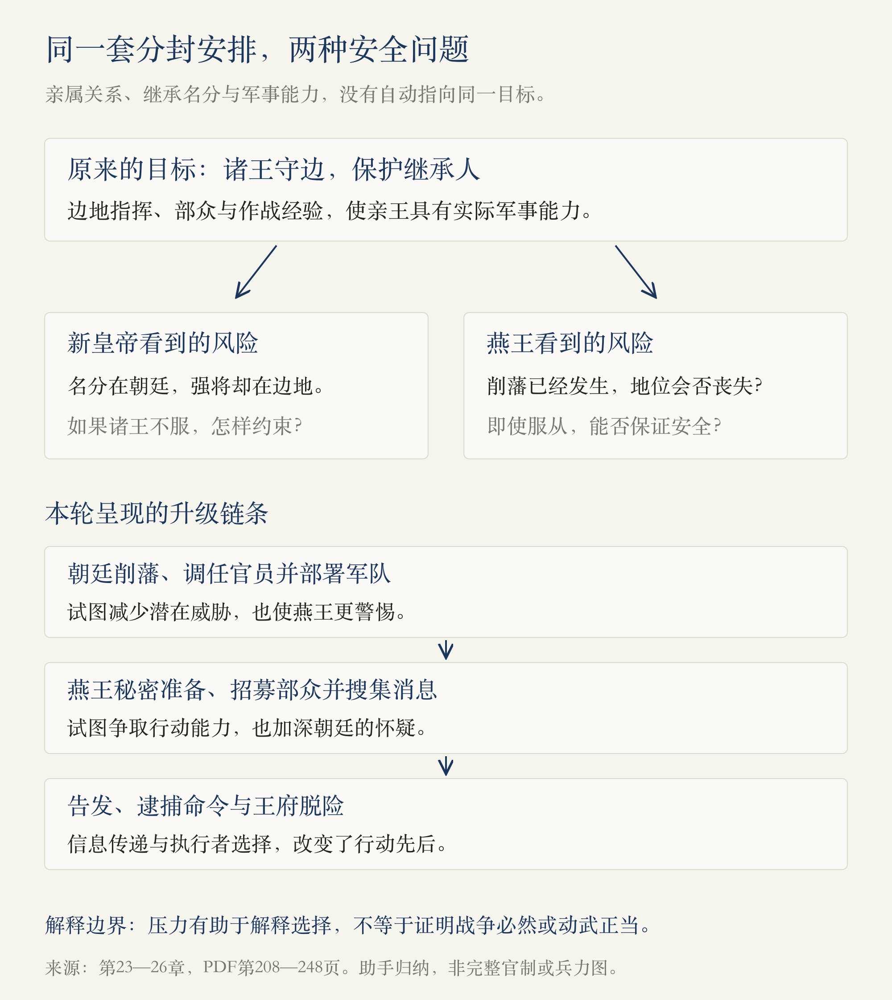
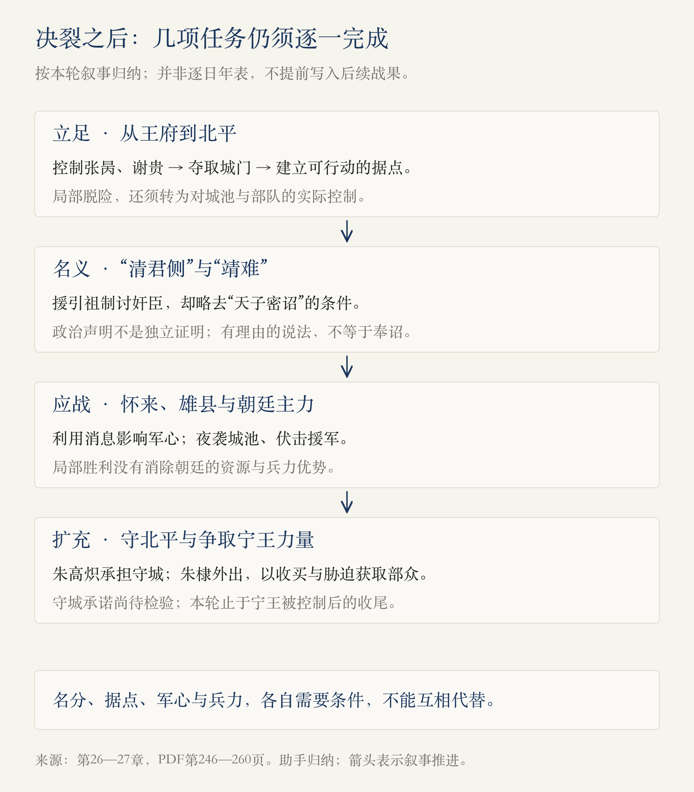

# 第1册·第23—27章：守护皇位的人，为什么成了争夺者

> 阅读边界：用户指定的1918页PDF，第1册第二十三至二十七章，物理第208—260页；首页从第二十三章标题起，末页止于第二十八章标题前。依据原书蒸馏，未另作史料校勘；人物心理、预言轶事、政治主张与助手归纳分别说明。

<!-- block: protection-and-threat -->
## 01 · 同一支力量，可以是屏障，也可以是威胁

上一轮读到朱元璋希望用制度保护后世，本轮开始检验这份安排。**把军事能力交给亲王，可以强化边防；皇位换人之后，这些能力又可能成为新皇帝最难处理的力量。** 问题并非简单的“亲人可不可信”，而是继承名分、军事资源、任命权与个人安全怎样相互影响。[第23—27章，PDF第208—260页]

朱元璋相信儿子们可以保护孙子，朱允炆担忧叔叔们有异心；朱棣既有地位与家属需要保护，也有能力、野心及身边人的推动。本书把这场冲突写成两位对弈者的较量，但将领、王府官属、宫中宦官和其他藩王，都不是可以自动听令的棋子。

图中相互加强的不信任，是依据本轮叙述提出的解释路径，不表示朝廷与燕王责任相同，也不表示战争必然发生。

<!-- block: chapter-23 -->
## 02 · 第二十三章《终点，起点》：能力培养与继承名分分开了

本章一边收束朱元璋的一生，一边回溯朱棣的成长。周德兴、傅友德、冯胜等人的结局，与汤和退居、年老病重的叙述相对照。作者把朱元璋对功臣的处理，归入替继承人清除威胁的逻辑。具体探望时的眼神、恐惧、孤独和心中独白，是文学化重建；“他为何独独留下谁”，也不能只由结果反推成完整的既定计划。[PDF第208—210页]

接下来时间倒回朱棣的童年。作者通过兄弟待遇的比较，解释他对皇位的不平与自我证明的需要；又以他接触李文忠等武将、婚姻关系、就藩北平及边地作战，串起军事经验的形成。**可以跟踪机会、资源和行动的积累，但不宜把未经直接记录的嫉妒、抱怨写成确定的心理档案。** 书中关于生母、教育程度及性格的强判断，本篇不另作确认。[PDF第210—215页]

1390年出征是本章最有解释力的事件：先侦察乃儿不花的位置，隐蔽进军，冒雪接近；到达后没有立刻攻击，而是派观童劝降，承诺安全并给予礼遇。作者把这归为朱棣压抑欲望、善于隐忍。我们还可以作一个较窄的归纳：**突然到达带来压力，可信的投降条件则帮助把压力转化为归附。**[PDF第216—220页]

不能因为后来存在残暴行为，就断言这次宽待必然没有任何真诚；同样也不能凭一次礼遇，就证明其所有行动出于仁慈。行动、效果与动机需要分开。

1392年朱标去世，朱允炆被选为继承人；朱棣后续继续出征，军事地位提高，却没有因此获得继承资格。**能守边、能带兵，与谁应当继位，是两套不同的安排。** 这份差距成为后续冲突的条件，但军事能力本身不是夺取皇位的正当性证明。[PDF第221—222页]

本章末尾写到1398年朱元璋去世，并以夕阳骑马的场景回望其一生。那是一段带有强烈赞叹与孤独感的文学收束，不能全部当成临终实录。读者可以同时承认其建立与恢复秩序的作用，也保留对滥杀、权力集中和继承安排的判断，无须让一个总评抹平具体的人与事。[PDF第222—225页]

<!-- block: chapter-24 -->
## 03 · 第二十四章《建文帝》：知道要做什么，距离做成还有多远

朱允炆继位，面对的不只是皇帝的法定权力，还有诸王已经掌握的护卫、边地指挥经验与人际联系。本书介绍九位边王及各自兵力，但编制数、实际可调兵力和部队归属不应直接划等号；宁王与朵颜三卫的关系，本轮仅按原书叙述理解，不据此画成完整军事隶属图。[PDF第226—227页]

作者借祖孙对话，列出约束诸王的阶梯：以德争取、以礼约束、削地、改封，最后才动兵。这组办法听起来完整，真正的难处却在执行：何时升级、针对谁、用哪些人、怎样判断对方反应。**一份列出步骤的计划，还没有回答每一步所需的能力和条件。**[PDF第228—230页]

方孝孺、齐泰、黄子澄成为建文的重要班底。本书分别叙述其学识、忠诚、事务知识及与朱允炆的关系，并特别批评黄子澄以汉景帝平定七国之乱类比当下：朝廷的总体资源优势，不能自动替代统帅、军队、部署和作战表现。[PDF第230—232页]

作者以“书呆子”“书生误国”总结三人，力度很强。我们的阅读应缩回具体判断：**这次类比漏了什么，这次任命适不适合任务，这项决定产生什么后果。** 不能把一次政治失败扩展成读书人普遍无能，也不能因为后来失败，便抹去其忠诚或已具备的知识。

<!-- block: chapter-25 -->
## 04 · 第二十五章《等待中的朱棣》：野心并不会自动变成行动

作者先比较朱元璋与朱棣行动前的处境：前者原有财产和地位很少，后者已经拥有王府、家属、部众及优裕生活。造反失败的代价不同，因而“想当皇帝”与“愿意现在起兵”并不是同一个决定。这是一个有用的解释框架，却仍是作者对朱棣权衡的推测。[PDF第232—233页]

道衍，即姚广孝，作为重要推动者进入叙述。作者写其求用、等待与跟随燕王，并以“白帽加王”的故事表达其劝进之意；随后用“治世、乱世、救世之臣”分类解释他的抱负。分类是作者的分析模型，相面预言是故事材料，均不能当成已验证的人物能力测量，更不能用外貌推断某人天生嗜杀。[PDF第233—238页]

削藩目标的次序出现分歧：齐泰倾向先对付燕王，黄子澄倾向先处理其他诸王、剪除其援助。作者没有只因结局失败便断定后一个方案毫无道理，这一点值得保留。**先从弱者着手，可以降低眼前执行难度，也会让尚未被处理的强者更清楚地看到威胁。**[PDF第238页]

本书接着写周王被捕贬徙、代王及岷王等受处置、湘王一家自焚、齐王等被废。不同案件的罪名、经过与年代仍须分别核对，不能把它们简单合成“人人确已谋反”。其中湘王全家死亡是政治压力下的惨剧，作者对“骨气”的赞叹也不应遮蔽家属承受的后果。[PDF第238—239页]

这些行动使燕王更有理由担忧自身安全，但不能由此把他的此前招揽谋士、野心及后续动武全部取消。**受到压力，可以帮助解释一个人的选择；“除此之外绝无可能”，则是更强、也更需要证据的判断。**

<!-- block: chapter-26 -->
## 05 · 第二十六章《准备行动》：信息渠道多，不等于命令一定执行

朱棣开始招募、训练、准备兵器，并借术士与预言制造声势；本书以地下工场、鸡鸣掩声等细节表现其秘密准备。朝廷同时任命北平地方与军事官员，并布置外围部队。双方行动形成对抗，不能只看一方的声明。[PDF第240—241页]

本章的信息斗争，可以按渠道分开：

| 原书所述渠道 | 对斗争的作用与边界 |
| --- | --- |
| 葛诚入京后转向朝廷 | 燕王派出的探听者成为朝廷的信息来源；装疯并不能使已被知情人看穿的准备消失。 |
| 徐辉祖通过家族关系获知情况 | 亲属联系可以带来消息，也造成信息泄漏；“徐妃本人有意为朝廷当间谍”并非本书能证明的结论。 |
| 宫中宦官向燕王提供消息 | 身处皇帝近旁的人，未必支持皇帝；作者关于待遇、不满与送礼的因果解释仍需辨认。 |
| 张信受命后向燕王报信 | 送达命令与执行命令是两件事，任命关系、个人选择与忠诚影响结果。 |

[PDF第241—246页]

三个儿子入京祭拜后获准返回，是作者批评建文决策的重点：齐泰、徐辉祖主张扣留，黄子澄希望以放还麻痹燕王，建文最终采纳后者。放还确实让朱棣家庭团聚、减轻其牵制，但不能因为后来的战果，就把扣留人质写成一定能够解决全部冲突的答案。[PDF第242—244页]

朱棣装疯争取时间，葛诚揭露情况，朝廷随后下令行动。张信却通报燕王，改变了预警时间。关于张信母亲相信燕王将得天下，以及术士传播如何影响她的解释，本书本身也使用推测语气；这能说明政治预言在故事中的动员作用，不能证明天命或相术有效。[PDF第244—246页]

王府危机的转折，在本书叙述中是命令对象的差异：张昺、谢贵持有的是逮捕燕王官属的诏令，朱棣利用这一空间，表示已准备交出人员，请二人入府辨认；二人随后被控制，与葛诚一同遭杀。摔瓜、对白及现场神情承担戏剧化效果，核心行动则是诱入、隔离护卫、夺去现场指挥者。[PDF第246—248页]

这里不能只说“朝廷没有计划”。原书实际上写到任命、监视、策反及多道指令；它暴露的问题是，**计划能否在人员选择、命令权限和现场判断之间连贯执行。**

<!-- block: chapter-27 -->
## 06 · 第二十七章《不得不反了！》：决裂之后，仍要解决三件事

杀掉朝廷官员，并不意味着朱棣已经能赢得战争。第一步是夺取北平：张玉率兵控制城门，原有指挥失效与士兵散乱给燕王创造机会，宋忠率部退往怀来。王府内的局部脱险，必须转为城池、部队和交通节点的实际控制。[PDF第248—249页]

第二步是给行动寻找名义。朱棣与道衍以“清君侧”“靖难”宣称讨除奸臣，而原书引用的勤王规定仍有“天子密诏”的条件；他们选择性使用条文，不能使自主举兵自动变成奉诏。**“清君侧”是行动者提出的政治说法，既不是旁观者应照收的事实，也不等于其真正目标已全部公开。**[PDF第250—251页]

第三步是应付朝廷的兵力与资源优势。怀来一段，宋忠以士兵家属被杀的说法鼓动军心，朱棣反而安排亲属出现，瓦解这一说法；原书随后写宋忠被俘、拒降而死。军心在这里与具体信息相连，不能只当作抽象勇气。[PDF第252页]

耿炳文受命出征，分布兵力、准备会合。朱棣针对雄县发动夜袭，并伏击来自莫州的援军，打破原来的相互支援。后续获取的情报使他尝试影响耿炳文合兵；但本段接着写耿炳文坚守、朱棣难以久待，继而由李景隆接任。不能只根据作者对朱棣的赞叹，便说他已经轻松解决朝廷全部主力。[PDF第253—257页]

作者把耿炳文的防守专长，与所受任务之间的差距作为解释；又把“不使朕有杀叔父名”的话视为建文的严重限制。前者应结合具体部署判断，后者属于本书所述命令及其评价；“非得杀掉主帅才算正确用兵”并不是本篇由此得出的普遍结论。

面对李景隆所率大军，朱棣需要更多可用兵力。他把守北平的责任交给朱高炽，前往宁王处，以求情示弱、带人入城、收买部众首领，再到郊外控制宁王，获取其部众支持。**按本书叙述，这是一场包含诱骗、收买与胁迫的力量重组，不能改写成所有人自愿追随。** 宁王与朵颜三卫的归属细节本轮未外查核实。[PDF第257—260页]

本篇读到宁王被挟持、加入靖难一方为止。第二十八章的北平防御虽与此事同时发生，尚未纳入本轮蒸馏，不提前写出其作战结果。

<!-- block: evidence-and-questions -->
## 07 · 怎样读到转折，而不把结局写回开头

| 原书的解释或写法 | 本篇保留的距离 |
| --- | --- |
| 朱棣幼年不平、对皇位期待、朱元璋临终孤独 | 能构成人物叙事，不等于直接取得当时每个人的思想记录。 |
| “不得不反”“性格决定”“书生误国” | 需要拆回压力、准备、具体决策与其他人的选择，避免一个标签包办全部因果。 |
| 相面、白帽、风雨落瓦与“天命” | 按轶事、象征与动员话语处理，不把预言当作未来已注定的证据。 |
| 亲王兵力、朝廷三十万与五十万等数字 | 按原书所述规模理解；编制、号称人数、实际集结兵力需要区分。 |
| 对宁王、李景隆等人的先行评断 | 不能用本轮尚未读到的战果来证明；后续逐段检验。 |

[PDF第210—225、226—239、244—260页]

另有几处文本细节应保留：本书第238—239页对代王的处置有重复叙述，不据此另计两次独立削藩；第245页称张信为燕王亲任，而第241页又把他列入朝廷任命叙述，不将其任用来源画成无疑义的事实。第217页对观童劝降角色的回顾，与前一轮所读乃剌吾劝降的叙述不同，不能直接据两处故事认定他独自完成此前所有招抚。本轮不作逐条校勘，以来源页码保留疑点。

可以继续追问：

- 朱元璋的守边安排，在权力交接后，为什么使双方都觉得缺乏安全？
- 先处理弱藩与先对付燕王，各自需要哪些条件才能奏效？
- 朝廷已经有消息、有任命、有命令，为什么仍没有控制住北平局势？
- 朱棣争取宁王的兵力，与1390年招降乃儿不花，哪些手段相似，哪些责任与后果不同？

[回看第十八至二十二章](#/read/ming-dynasty-chapters-18-22) · [返回开卷导读](#/read/ming-dynasty-overview)

来源记录：第二十三章208—225页；第二十四章226—232页；第二十五章232—239页；第二十六章240—248页；第二十七章248—260页。第208页排除第二十二章末尾，第260页排除第二十八章及其正文；为核对边界看到了同页下一章标题与少量开头。两图均由助手依据本轮范围制作，非原书插图或独立史料。2026-10-30：v1，阅读进度更新到第二十七章。
