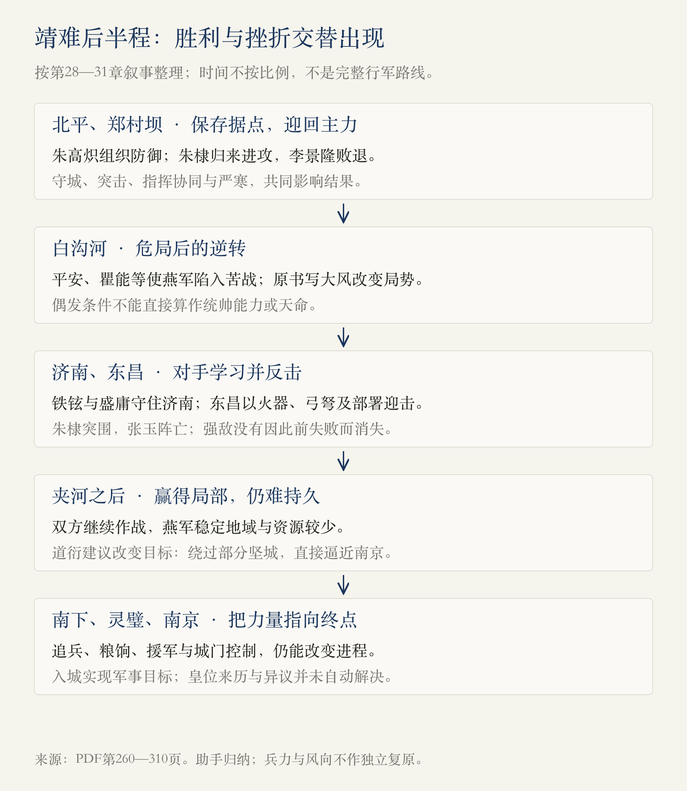
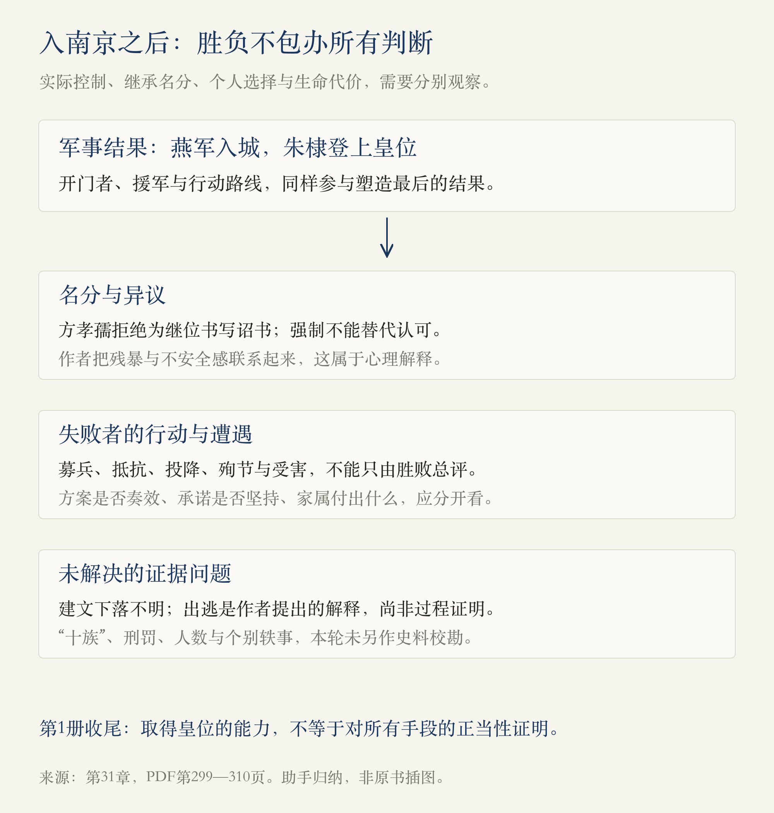

# 第1册·第28—31章：赢得战争以后，皇位的疑问仍在

> 阅读边界：用户指定的1918页PDF，第1册第二十八至三十一章，物理第260—310页；第260页从第二十八章标题起，至第310页第1册正文结束。第311页仅用于核对第二册边界。依据原书蒸馏，未另作史料校勘；战争叙述、轶事、作者判断与助手归纳分开说明。第1册至此读完，第二至七册未读。

<!-- block: victory-and-legitimacy -->
## 01 · 从“怎样不败”，到“怎样结束战争”

上一轮朱棣已控制北平，又争取到宁王方面的兵力。但这些条件并没有让战争迅速结束：北平要守住，强敌会学习，朝廷仍有更多资源，燕军即使屡次打胜，也可能回到原来的出发点。[第28—30章，PDF第260—298页]

**这四章最重要的军事转折，是从反复击败眼前的部队，改为绕过部分坚城、直接逼近南京。** 最重要的政治转折，则是朱棣终于进入皇城，军事胜利却没有自动消除皇位来历、建文下落与反对者的存在。入城是战争目标的达成，也是另一批问题的开端。[第30—31章，PDF第294—310页]

图表示本轮主要转折，时间不按比例，不是完整行军地图。几次战役的胜负不能压缩成一条“朱棣始终占优”的直线。

<!-- block: chapter-28 -->
## 02 · 第二十八章《你死我活的战争》：守住城池，才有后来的援军

朱棣外出争取宁王力量时，朱高炽承担北平防御。梁明整顿薄弱城门的守军，城内军民投入防守；朱高炽组织夜间出击，使攻方调动，又利用严寒浇水结冰增加登城困难。本书同时写到瞿能发现机会，却被李景隆制止。**北平得以坚持，是守方的组织、攻方的指挥与天气条件相互作用的结果。**[PDF第260—262页]

作者从守城表现评价朱高炽的能力，而非仅凭身体行动是否便利判断一个人。至于他具体患何种疾病，原书本身也是推测，本篇不作诊断。妇女参与防守的段落也不宜只当作轻松插曲：城市里承担危险的并不只有将领。

朱棣归来后，在郑村坝与李景隆作战。突击、对中军移动的观察和两翼进攻进入叙述；李景隆撤走却未使围城部队及时协调退却，进一步扩大损失。**一支部队能否打仗，也取决于指挥者能否把各部分行动接起来。** 本书借此引出马三保及后来“郑和”的名字；赐姓原因与时间在此仅作为原书说法记录。[PDF第262—264页]

白沟河一段则打破了“李景隆的部队完全无能”的印象。平安、瞿能与郭英等人的冲击、侧后攻击和火器，先后使燕军陷入危险；朱棣的惯用侧翼战法也遭到针对。作者把郭英埋设的火器称为“地雷”，这是现代名称的类比，不能据此想象其构造、威力与现代装备相同。[PDF第265—270页]

原书随后写大风折断南军帅旗，朱棣利用混乱从后方进攻并借风纵火，南军溃败；徐辉祖保留的部队掩护撤退，使失败没有消除全部后续抵抗力量。**这里既有临场行动，也有无法归入某位统帅能力的偶发条件。** 作者自己也强调胜利带有侥幸，不能把风变成朱棣必然获胜或“天命在身”的证据。[PDF第271—273页]

<!-- block: chapter-29 -->
## 03 · 第二十九章《朱棣的对手》：一场胜仗，不会让所有城市自动投降

济南的意义在于它是水陆要冲，也在于它没有随着李景隆败退而直接放弃。铁铉原本负责粮饷，收拢溃兵后进入济南，与盛庸合作组织防守。官职、此前声望与实际承担的任务，在危机中发生变化：一个并非职业统帅的人开始负责守城，一位长期跟随败军的将领获得独立发挥的机会。[PDF第273—276页]

这也修正了上一轮“书生误国”的总括。作者此处又高度肯定铁铉。**应检验具体的人如何理解情况、组织行动和与他人合作，不能让“书生”或“武将”一个身份标签代替判断。**

济南守军抵抗强攻，应对放水威胁，并以诈降诱使朱棣接近城门。关于铁板机关险些困住朱棣的细节，应按本书的战事故事阅读。随后铁铉以朱元璋神牌阻止炮击的叙述，则把战争与政治名义连接起来：朱棣以遵奉父皇遗训为出兵理由，攻打神牌便可能破坏自己的说法。**公开使用的名义也会限制行动，并非只在出兵时说一遍就算结束。**[PDF第277—279页]

这里仍不能从“挂神牌使其停炮”推论“若无神牌，济南必定立即陷落”。城防、火力、损耗与攻城能力还需要分别讨论；原书的戏剧化转折不应包办所有军事解释。

朱棣撤退，铁铉、盛庸反击收复德州；朝廷改用盛庸统兵。到东昌，盛庸针对燕军习惯的侧翼冲击布置防线，以火器、弓弩和诱入包围的办法作战。朱棣转攻中军后陷入圈套，朱能将其救出，张玉却在救援中阵亡。**既往失败没有使盛庸永久成为弱者，既往胜利也没有使朱棣免于被研究、被针对。**[PDF第279—285页]

铁铉的责任感与士兵的信任值得重视，但实际叙事同时写到了盛庸的战斗经验、武器配置和部署，不能把胜利只解释为意志强大。

<!-- block: chapter-30 -->
## 04 · 第三十章《离胜利只差一步》：战术获胜，仍可能没有接近终点

东昌失败后，朱棣必须恢复军队与士气。作者把张玉的葬礼解读为政治动员，也写道衍反复强调已无退路。哀悼具有凝聚效果，并不能独立证明哀伤全是表演；这些判断反映作者对朱棣的看法，不能替代死者、同袍及各人的真实感受。[PDF第285—288页]

夹河再战时，盛庸的阵型继续克制骑兵突击。谭渊误将试探当成总攻而投入作战，战死；朱棣乘南军调动后的空隙反击，盛庸又稳住阵势。这里至少能看到信息误判、协同失误和对手恢复能力，并非主帅一个人的决心足以控制整个战场。[PDF第288—290页]

本书接着以大风解释夹河与随后滹沱河战局的逆转，又反复用“防弹衣”比喻建文不愿伤害叔父的命令。**命令如何影响士兵判断，是作者的因果解释；朱棣每次脱险是否都因此发生，尚不能由一项命令直接推定。** 大风的具体时间、方向与影响，本轮也未另查战役记录。[PDF第291—294页]

真正使朱棣焦虑的是战略处境：自己掌握的稳定地域、人力与物资较少，攻下一些地方也不容易长期保有，北平还会受到威胁。烧毁对方粮草、打败追兵，都不足以让长期消耗变得有利。**“打赢了一仗”和“正在赢得整场战争”，必须分别判断。**[PDF第294—295页]

宫中消息称南京空虚，道衍提出改变路径与目标：不再以先攻克济南等坚城为必要步骤，而把军队指向南京。作者用“打开门不必先开锁”的比喻解释思路变化；它有启发，却不能把途中渡河、供给、守军与追兵都变成已不存在的障碍。[PDF第295—296页]

1402年南进正说明了这些障碍。朱棣绕过部分坚城后，平安追击；燕军在淝河设伏，又在小河作战中遇到徐辉祖援军而失利。将领要求退却，朱能支持继续作战。**这次改变战略提高了逼近南京的可能，却同时增加孤军深入、后路与军心的风险。**[PDF第296—299页]

<!-- block: chapter-31 -->
## 05 · 第三十一章《殉国、疑团、残暴、软弱》：入城与得到承认是两回事

灵璧一段，把战斗重新拉回补给和协同：徐辉祖被召回，平安、何福转移合兵，粮饷又被截断；原书以双方巧合使用三声炮为号，解释南军突围与燕军进攻撞在一起后的混乱。这个具体巧合本轮未作校勘，不将它压成“坚持就必定成功”的规律。[PDF第299页]

局势向南京推进后，求和、募兵与勤王仍在进行。朱棣拒绝了限制其所得的谈判条件，在浦子口又受到盛庸阻挡，朱高煦的援军使其得以继续渡江。临近目标，兵力、疲劳和增援仍能改变进程。关于朱棣以世子身体不佳的话鼓励朱高煦，以及儿子如何理解，原书已经埋下继承问题的伏笔，本轮不提前推演第二册。[PDF第300—302页]

南京城防的最后关口没有只由城墙决定。谷王与李景隆打开金川门，燕军入城。政治关系、控制城门的人以及是否继续效忠，成为关键环节。作者将李景隆此前战败与后来开门投降分开评价，这个区别有价值：**能力不足、判断失误与主动倒向对手，并不是同一件事。**[PDF第303页]

接着，叙述从胜者转向反对者。齐泰、黄子澄等在外募兵，后来获罪被杀；方孝孺拒绝替朱棣书写继位诏书；铁铉等遭到残酷报复。**一个人的方案可以失败，他对自己承诺的坚持仍须另行评价。** 这也说明不能把政治成败当作判断所有人格与行为的唯一尺度。[PDF第304—308页]

本书以殉节表达忠诚，但读到王省、黄观及其家属、无名樵夫等死亡故事时，要看到具体生命的损失，不能把死亡变成忠诚的唯一证明。被诛连或受强制处置的家属，也不应只作为主角气节的陪衬。这里的“殉国”是原书所在历史语境中的伦理语言。

方孝孺“灭十族”、登科名被删、若干人的具体刑罚与家属遭遇，本书写得十分确定；本轮没有核对各条材料的来源、年代与异说，保留为原书所述，不据此扩算人数或补写现场。暴力可以迫使人噤声，却不能使皇位来历的问题自动得到证明。

建文帝下落同样需要保留。作者一面称其不知所终，一面从未找到尸体推向出逃，预告后续追索。**未能确认遗体，不等于已经证明如何逃走；后续传说也不能倒过来填补本轮的空白。** 本篇只记录宫中起火、去向未明及作者的逃亡推论。[PDF第306页]

结尾把朱棣的残暴解释为不安全感，并写他纠正朱能的称呼、终于接受群臣朝拜。这里“心虚”“软弱”都是作者的心理解释。我们能够保留的核心问题是：取得实际控制权，如何与继承名分、修史和异议发生关系。第1册停在朱棣夺位成功，不能仅以胜利就认可此前的手段与后来的报复。[PDF第309—310页]

<!-- block: first-volume-review -->
## 06 · 第1册读完：把整条线接起来

| 已读范围 | 贯穿这一段的问题 | 回看笔记 |
| --- | --- | --- |
| 第1—7章 | 从灾难中求生的人，怎样获得伙伴、资源与据点？ | [从求生到立足](#/read/ming-dynasty-chapters-01-07) |
| 第8—12章 | 力量较弱的一方，怎样改变交战条件并不断调整？ | [把险局变成胜局](#/read/ming-dynasty-chapters-08-12) |
| 第13—17章 | 夺取天下以后，怎样分配职权并处理合作者？ | [建国与权力重组](#/read/ming-dynasty-chapters-13-17) |
| 第18—22章 | 严刑与精密规则，为什么不能替代信息、资源与调整？ | [命令的限度](#/read/ming-dynasty-chapters-18-22) |
| 第23—27章 | 守边的亲王，为什么在继承后成为威胁与争夺者？ | [分封与起兵](#/read/ming-dynasty-chapters-23-27) |
| 第28—31章 | 怎样结束战争？胜利能解决多少政治与伦理问题？ | 本篇 |

这是对已经完成的六轮正文阅读的回望，不是重新读取整册后的独立史学结论。贯穿全册的一条线，是**组织别人、获取信息、维持供给与约束权力之间的关系**：创业阶段能使人愿意合作的办法，到了统治阶段未必被保留下来；依靠亲属解决安全问题，又会在继承时形成新的风险。

另一条线是阅读方法的变化。作者常借胜败引出信义、隐忍、性格与历史规律，也多次使用“书生”“无赖”“天才”等强烈标签。我们读完之后更需要追问：具体哪一步改变了条件？谁付出了代价？哪些说法属于事件记录，哪些只是有感染力的解释？

<!-- block: evidence-and-next -->
## 07 · 留在第1册末尾的疑点与追问

- **纪年**：本文件第266、280页出现“建文二年（1340）”，第288页出现“建文三年（1341）”，与本段1398年后的叙事及1401、1402年的标注不一致。本篇不照抄这些括注作年表依据。
- **战争数字与器械**：五十万、六十万等兵力及伤亡、粮草数量，按原书所述理解，未独立核实；不以现代“地雷”“防弹衣”等类比还原真实装备与战场。
- **风与命令**：大风的作用、不伤朱棣的命令及实际执行程度，应分别校勘；本篇不将二者当作每场胜负的万能答案。
- **身份与结局**：第308页刑罚名单有“齐秦”等文字疑点；方孝孺诛连、黄观与部分殉节故事的具体细节，本轮保留来源，不另行定案。

[对应来源：PDF第264、266—273、280—294、304—309页]

可以继续追问：

- 东昌的盛庸，具体怎样打破朱棣的惯用战法？
- 绕过坚城直趋南京，解决了什么，又把哪些风险留在身后？
- 如果只说“朱棣更坚决，所以获胜”，会漏掉哪些人、资源和偶发条件？
- 本册作者对“书生”与“胜利者”的评价，在哪些地方发生了变化？

[回看第二十三至二十七章](#/read/ming-dynasty-chapters-23-27) · [返回开卷导读](#/read/ming-dynasty-overview)

来源记录：第二十八章260—273页；第二十九章273—285页；第三十章285—299页；第三十一章299—310页。第260页排除第二十七章收尾；第311页只核对第二册入口，未纳入第二册正文。两图由助手依据本轮范围制作，非原书插图或独立史料。2026-10-30：v1，第1册31章正文全部完成，第二至七册仍未读。
