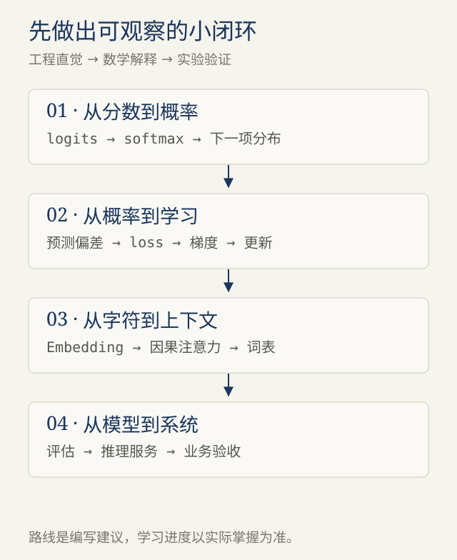

# 导读 · 把大模型变成能理解、能验证的系统

> 材料说明：基于2026-11-01用户问题与所贴AI回答重新编写；技术事实就近链接原始资料，时间与路线属于编写建议。

<!-- block: why-this-book -->
## 01 · 我们到底想弄懂什么

你的起点是两个很具体的问题：一个后端程序员要花多久，才能理解大模型，甚至亲手做一个？它和推荐系统里的模型究竟差在哪里？

这本手册围绕这两个问题写。目标是让你能沿着一次模型调用，解释输入怎样变成向量、向量怎样变成预测、预测怎样参与学习，最后把这个过程放回后端系统。你会得到一个能实际运行的小模型，也会知道它为什么不能冒充聊天助手。

它是一部持续修订的学习草稿。这里的讲解由助手整理，用户的提问决定方向；尚未收集你的学习反馈，不替你填写“已经理解”。书中实验使用教学数据，不使用你的业务数据。

<!-- block: revised-answer -->
## 02 · 先重新回答最初的问题

**有后端经验的人，通常可以把“看懂核心原理并训练一个教学语言模型”规划为约50—90小时的主动学习。** 若每周投入8—10小时，可以先安排约6—10周，再按反馈调整。这是本手册的预算建议，不是某项研究得出的平均学习时长。已有Python、概率和线性代数基础会更快；只看视频、不写代码和不做解释练习，往往会低估时间。

“弄一个模型”可以从几十到几万参数的字符模型开始。它生成的文字很有限，却足够展示训练、推理、过拟合和上下文的作用。训练实用聊天模型涉及更高的数据、算力和评估要求，不能沿用同一个时间承诺。

推荐系统是一类业务任务，生成式是一种建模方式，两者并不互斥。典型推荐排序器输出物品分数，典型自回归语言模型输出下一个token的分布；也有模型直接生成物品的标识符来完成推荐。后文将逐项拆开。[生成式推荐的原始论文 TIGER](https://arxiv.org/abs/2305.05065)

<!-- block: book-map -->
## 03 · 全书怎么走

| 模块 | 核心问题 | 你要留下的成果 |
| --- | --- | --- |
| 第1章 · 定义入门 | 做到什么才算懂？ | 自己的学习验收表 |
| 第2章 · 模型如何学习 | loss为什么能改变预测？ | 一次手算和一次训练闭环 |
| 第3章 · 推荐与生成 | 它们究竟共享了什么？ | 两种目标函数的对照 |
| 第4章 · Transformer | 上下文如何进入预测？ | 一张张量形状表 |
| 第5章 · 训练阶段 | 预训练、SFT、偏好训练各改什么？ | 数据和权重变化表 |
| 第6章 · 动手实验 | 能否在CPU上从零训练？ | 可运行脚本与实验日志 |
| 第7章 · 推理服务 | 为什么生成会慢、会占显存？ | 一次延迟与内存估算 |
| 第8章 · 应用判断 | 什么时候用检索，什么时候微调？ | 一份最小应用设计 |
| 第9章 · 学习计划 | 如何判断自己真的入门？ | 八周练习与自测 |

章节各自完整，你可以在聊天里说“把第4章的注意力讲慢一点”，或“带我逐行运行第6章”。后续修订沿用章节和模块链接。

<!-- block: evidence-contract -->
## 04 · 怎样使用这份资料

正文中的公式和代码是教学表达；类比只帮助建立直觉，不替代定义。引用链接指向论文作者或官方文档。资料核查日期为2026-11-01，重点是稳定原理，不提供所谓当前最强模型排行。

原回答是问题线索，不是权威来源。我们会保留有帮助的工程视角，改掉过度绝对的结论。无须先证明某个模型“答得更好”：有出处的判断去核对，能实验的判断就动手验证。

推荐从[第1章](#/write/backend-to-llm-orientation)开始。如果已经有神经网络经验，可以先运行[第6章](#/write/backend-to-llm-lab)，再回来解释每一步。
