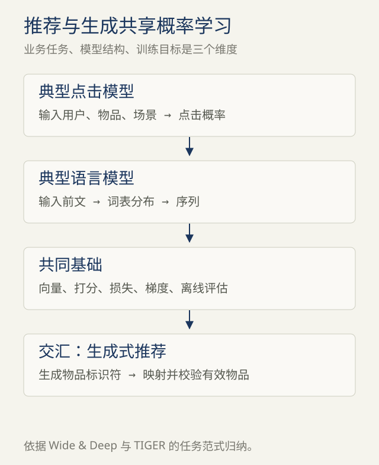

# 第3章 · 推荐与生成：差异之下的共同语言

> 材料说明：基于2026-11-01用户问题与所贴AI回答重新编写；技术事实就近链接原始资料，时间与路线属于编写建议。

<!-- block: separate-axes -->
## 01 · 不要把任务与建模方式放在同一条轴上

“推荐系统”说明业务想做什么：帮助用户找到合适内容。“生成式”说明模型怎样表示、学习或生成数据。Transformer是一类结构，CTR是一个预测目标。这些概念属于不同层次。

生成式模型的范围也比文本LLM更广。例如图像扩散模型可以通过逐步去噪生成图像，并不是逐个生成汉字。本书后面主要讨论自回归文本模型；“下一个token预测”不是所有生成式模型的统一定义。[DDPM原始论文](https://arxiv.org/abs/2006.11239)

因此，“推荐系统都是判别式，大模型都是生成式”只能作为粗略入门印象，不能当严格分类。以用户行为序列为输入的推荐模型，也可以使用注意力；模型使用Transformer，并不能单凭结构就判断它做文本生成还是排序。



<!-- block: objectives -->
## 02 · 两种常见目标，写出来就清楚了

点击预测模型可以估计 `p(click=1 | user, item, context)`。常见二元交叉熵为：

```text
L = -[ y*ln(p) + (1-y)*ln(1-p) ]
```

一个自回归语言模型学习序列概率，可以分解为：

```text
p(x1,...,xT) = product_t p(xt | x1,...,x(t-1))
L = -sum_t ln p(真实token_t | 前文)
```

它们都用数据决定什么分数应该提高，再用优化方法调整参数。区别在于样本如何构造、条件包含什么、预测空间是什么，以及在线结果怎样使用。点击预测是二分类；词表预测通常是V分类。推荐召回还可能使用对比损失或其他排序目标，不能把所有推荐训练简化为CTR二分类。

<!-- block: system-comparison -->
## 03 · 比较典型系统，而不是宣布绝对边界

| 维度 | 典型推荐排序链路 | 典型自回归文本生成 |
| --- | --- | --- |
| 输入 | 用户、物品、上下文或行为序列 | token序列，也可接收其他模态表示 |
| 一步输出 | 一个或一批候选的分数 | 词表上的logits或概率 |
| 最终结果 | 经过策略处理的推荐列表 | 多步拼成的文本或结构化序列 |
| 数据难点 | 曝光偏差、负样本、反馈延迟 | 语料质量、重复、泄漏、目标覆盖 |
| 主要验收 | 排序质量、线上行为与长期效果 | 任务正确性、稳定性、生成体验 |
| 性能特点 | 常需对大量候选低延迟评分 | 常含长输入处理和依赖历史的解码 |

这里描述的是常见形态。推荐嵌入表可以很大，排序模型也可能复杂；生成模型可以很小或输出很短。因此，模型大小、CPU/GPU和毫秒/秒不是定义两者的依据。要比较实际业务、硬件、批量、序列长度和质量目标。

Google的[推荐系统入门](https://developers.google.com/machine-learning/recommendation/overview/types)以候选生成、评分、重排描述一种常见链路；它并不要求每个产品都采用同样的层数。

<!-- block: shared-representation -->
## 04 · 为什么你已有的推荐经验仍有用

你可能已经理解稀疏ID、embedding、负采样、线上反馈和离线指标。这些经验能帮助理解“数据怎样转成模型可学习的对象”。Wide & Deep便展示了特征交互记忆与稠密表示泛化的结合。[Wide & Deep原始论文](https://arxiv.org/abs/1606.07792)

但ID的语义来源不同：推荐中的物品向量常与交互目标绑定；语言token向量与语言任务绑定。相似向量意味着在某个训练空间内相似，不是跨任务统一的“意义坐标”。

原回答给出的“协同过滤→FM→双塔→序列推荐→重排”也不宜当成严格历史阶梯。它混合了模型、训练目标和系统阶段，这些组件可以共存。

<!-- block: generative-retrieval -->
## 05 · 交汇点：生成的也可以是物品ID

TIGER把物品表示成离散的Semantic ID，并根据用户历史生成后续物品的标识符序列，再映射到候选物品。它说明生成机制可以服务于推荐目标，生成结果仍需要满足物品库的有效性约束。[TIGER原始论文](https://arxiv.org/abs/2305.05065)

另一个更容易工程落地的结合，是语言模型解析“预算500、通勤、轻便”等自然语言约束，再交给检索和排序系统执行。这里的用户意图解析、物品排序、事实核验是不同职责，不能因为前面接了LLM，就认为整套推荐算法被替换。

自测：如果某模型根据观看历史预测下一视频ID，它是在做推荐还是生成？可以两者都是。先说业务目标，再说它如何建模，答案就不冲突。
