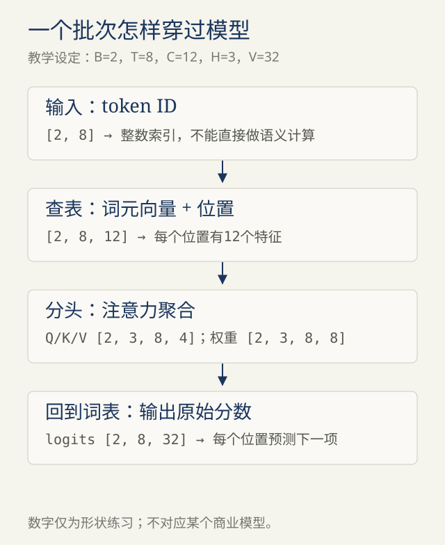
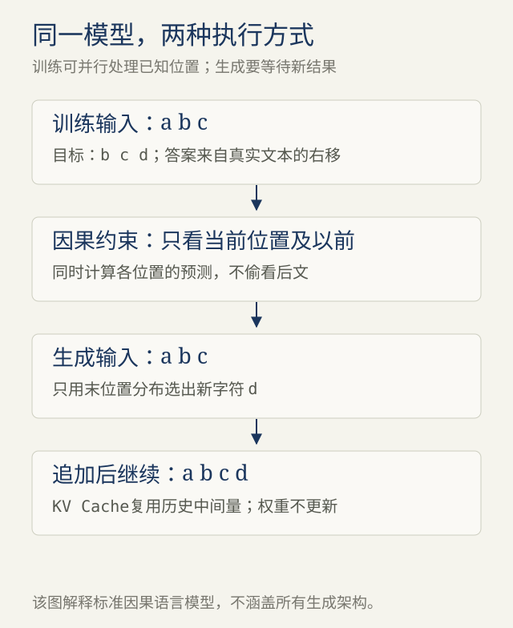

# 第4章 · 走过一层Transformer

> 材料说明：基于2026-11-01用户问题与所贴AI回答重新编写；技术事实就近链接原始资料，时间与路线属于编写建议。

<!-- block: shapes-first -->
## 01 · 先建立一张形状地图

为讲解，设批量B=2、序列长度T=8、隐藏宽度C=12、注意力头数H=3、词表V=32。每个头宽度为4。



`[B,T]`的整数ID经过embedding后成为`[B,T,C]`。教学模型再加一个可学习的位置向量，让“谁在第几个位置”进入表示。现代模型也可能使用旋转位置编码等方案；位置处理方式不能只记成“总要加一个位置表”。

最后得到`[B,T,V]`的logits。训练时每个位置预测其后一个真实token；生成时通常取最后位置的logits，选择下一token。

<!-- block: attention -->
## 02 · 注意力是有条件的信息聚合

对输入表示X做三次可学习投影得到Q、K、V。为避免和词表大小V混淆，下文将第三项称为“值向量”。对于某个位置，query与各位置的key比较得到相关程度，再把权重分配给值向量：

```text
scores  = Q @ K.transpose(-2,-1) / sqrt(head_width)
weights = softmax(scores + causal_mask)
output  = weights @ value_vectors
```

可以把query类比成这一步想提取的线索，key类比成候选位置提供的匹配线索，value类比成被聚合的信息。这个类比不是数据库精确查找：权重是连续数值，同一输入的表示也会随层变化，注意力权重本身不能保证是忠实的解释。

多头把表示拆成不同子空间并行聚合，再合并投影。它增加表达方式，不意味着“一个头专门负责语法、另一个负责事实”这样的分工一定会发生。[Transformer原始论文](https://arxiv.org/abs/1706.03762)

<!-- block: causal-mask -->
## 03 · 为什么必须遮住未来

设训练文本为`a b c d`。如果预测“c”的位置能直接看到“c”，模型就可以抄答案。因果mask让位置i只依赖位置0到i；对应被预测的目标是i+1。

```text
      可见输入位置
      a b c
a     ✓ × ×
b     ✓ ✓ ×
c     ✓ ✓ ✓
```

mask放在softmax之前，把不允许的位置设为负无穷，它们的概率就变成0。第6章会把后半段输入故意改掉，检查前半段logits是否保持不变。这比只看训练损失，更直接验证没有偷看未来。

<!-- block: rest-of-block -->
## 04 · 不是只有Attention

一个教学版预归一化block可以写成：

```text
x = x + Attention(LayerNorm(x))
x = x + FFN(LayerNorm(x))
```

注意力负责跨位置交换信息；FFN通常对每个位置分别进行非线性变换。残差让信息和梯度有较直接的路径；归一化帮助控制数值尺度。这是一个常见教学布局，并非2017论文和所有现代模型都使用同一层顺序或同一种归一化。

把很多block叠起来，表示会反复重组。不能把整个模型简单理解成“从数据库把答案检索出来”，也不能因为它有参数记忆就否认输入上下文的作用。

<!-- block: parallel-and-sequential -->
## 05 · 训练并行，为什么生成仍一步一步

训练时完整文本已知，通过因果mask可以同时算多个位置的损失。生成时，下一个真实token尚不存在，模型必须先选出一个，再继续。因此标准自回归解码包含跨步依赖。



“生成100个token需要100次普通解码选择”描述了基础方式，不是所有实现必须完整重算模型100遍。KV Cache复用历史中间结果；推测解码等方法还可以改变每次大模型前向验证的token数。优化执行方式不会自动消除条件概率链。

练习：将B改为4、T改为16、C改为24、H改为3、V改为50，写出Q、注意力分数和logits的形状。参考答案：`[4,3,16,8]`、`[4,3,16,16]`、`[4,16,50]`。
